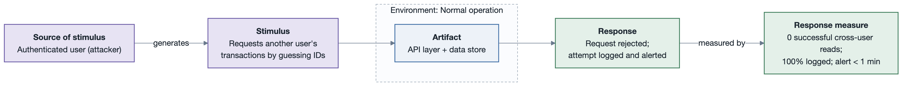
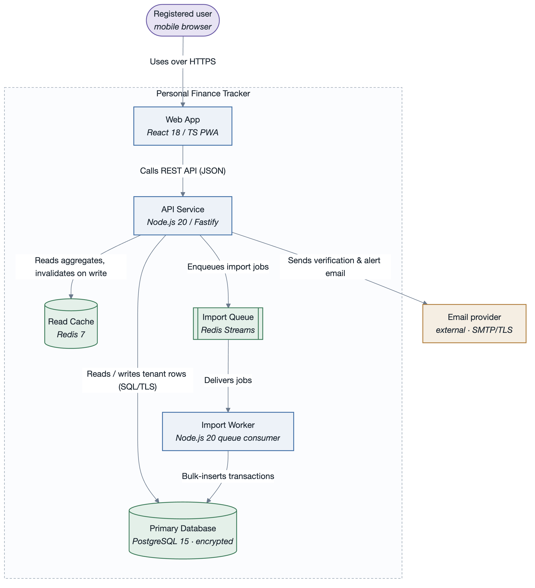
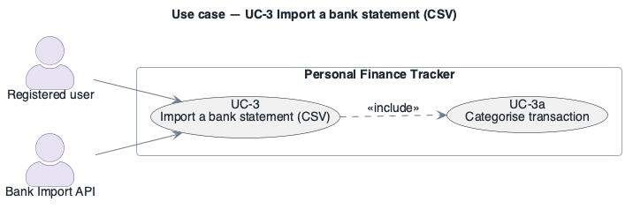

# SEI Architecture Methodology

A pluggable Claude Code skill set that automates the **SEI (Carnegie Mellon Software Engineering
Institute)** software-architecture practice end to end — from eliciting architectural drivers to
evaluating the finished architecture — and renders clean, verified UML / C4 diagrams to PNG.

It packages six activities as separate skills behind one router:

| Command | Skill | What it does | Output under `architecture/` |
|---------|-------|--------------|------------------------------|
| `/sei` | `sei-architecture` | Router — pick or infer the activity you need | — |
| `/drivers` | `architectural-drivers` | Collect & track the four driver kinds (business goals, use cases, constraints, quality attributes) with a traceability matrix | `architecture/drivers/` package — one file per driver + per-use-case UML diagrams + a utility tree |
| `/quality-attributes` | `quality-attributes` | Measurable six-part quality attribute scenarios (ISO/IEC 25010), each drawn as a UML scenario diagram | `quality-attributes/scenarios.md` |
| `/qaw` | `quality-attribute-workshop` | Facilitate the SEI 8-step Quality Attribute Workshop | `qaw/qaw-report.md` |
| `/add` | `attribute-driven-design` | Run an ADD 3.0 design session → architecture + C4/UML views + ADR log | `add/<slug>-session.md`, `add/<slug>-Architecture.md` |
| `/atam` | `atam` | Run a 9-step ATAM evaluation → risks, sensitivity/tradeoff points, risk themes | `atam/atam-report.md` |
| `/architecture-docs` | `architecture-documentation` | Produce a Views-and-Beyond architecture description (Module + C&C + Allocation views) | `docs/` package |
| `/sei-diagram` | `sei-diagrams` | Draw a clean, low-crossing UML / C4 diagram, render it to PNG, and visually cross-verify it | `diagrams/*.png` |

Every skill:

- **drafts first**, then refines with you — it doesn't interview you question by question;
- writes **Markdown** artifacts under `architecture/` as the single source of truth;
- keeps **traceability** — decisions and findings cite driver IDs;
- routes every diagram through `sei-diagrams`: **rendered to PNG and visually verified** (the
  model opens the image and checks correctness + edge crossings) before it is embedded anywhere;
- can emit its report as **Markdown or HTML** (`scripts/build-report.sh`).

---

## Install as a Claude Code plugin

This repository **is** a Claude Code plugin *and* a one-plugin marketplace
(`.claude-plugin/plugin.json` + `.claude-plugin/marketplace.json`). Install it into your personal
Claude Code so the `/sei`, `/drivers`, `/qaw`, `/add`, `/atam`, `/architecture-docs` and
`/sei-diagram` commands are available in **every** project.

### From GitHub (recommended)

In any Claude Code session:

```
/plugin marketplace add rtym/sei-architecture-methodology
/plugin install sei-architecture-methodology@sei-architecture-methodology
```

Then restart Claude Code (or run `/plugin` → *Manage* to confirm it's enabled). Update later with:

```
/plugin marketplace update sei-architecture-methodology
```

### From a local clone

```bash
git clone git@github.com:rtym/sei-architecture-methodology.git
```

```
/plugin marketplace add ./sei-architecture-methodology
/plugin install sei-architecture-methodology@sei-architecture-methodology
```

### Non-interactive / scripted

```bash
claude plugin marketplace add rtym/sei-architecture-methodology
claude plugin install sei-architecture-methodology@sei-architecture-methodology
```

### Use it in place (no install)

Open this folder as your project in Claude Code — the `.claude/commands/*` and the skills are
picked up directly. Good for hacking on the plugin itself.

### One-time diagram renderer setup

After the plugin is installed, from the plugin directory run:

```bash
bash skills/sei-diagrams/scripts/setup.sh
```

Installs `@mermaid-js/mermaid-cli` (+ `@mermaid-js/layout-elk`) locally under the skill and
downloads a headless Chromium once (~150 MB). Needs Node 18+. **PlantUML** (used for true-UML
use-case diagrams and canonical C4) needs a Java runtime — `brew install openjdk`;
`scripts/render-plantuml.sh` auto-detects a keg-only Homebrew JDK.

---

## The driver ID scheme

Architectural drivers get **specific, mnemonic codes** so they read at a glance and stay stable:

| Kind | Code | Example |
|------|------|---------|
| Business goal | `BG-<n>` | `BG-1` |
| Primary functional requirement (**use case**) | `UC-<n>` | `UC-1` |
| Constraint | `CON-<n>` | `CON-1` |
| Quality attribute scenario | `<ATTR>QA-<n>` | `AQA-1` (availability), `SQA-2` (security), `PQA-3` (performance), `MQA-1` (modifiability), … |

Quality attribute scenarios are numbered **within each attribute prefix** and classified against
**ISO/IEC 25010:2023**. The full prefix table (availability `AQA`, security `SQA`, performance
`PQA`, modifiability `MQA`, usability `UQA`, reliability `RQA`, safety `SFQA`, scalability `SCQA`,
…) is in `skills/architectural-drivers/SKILL.md` and `references/quality-attribute-taxonomy.md`.

---

## How the activities connect

```
[/drivers]  business goals + use cases + constraints + quality attributes
     │              ▲  (refined scenarios)
     │         [/qaw]  ◄─────  [/quality-attributes]
     ▼
 drivers register ──► consumed as input by …
     │
     ▼
 [/add]  ADD 3.0 iterations ──► architecture + C4/UML views + ADRs
     │
     ▼
 [/architecture-docs]  Views-and-Beyond description
     │
     ▼
 [/atam]  evaluation ──► risks, tradeoffs, risk themes ──► back to /drivers as status
        [/sei-diagram] supports every artifact above
```

Typical engagements:

- **Architecture vision / greenfield**: `/drivers` → `/quality-attributes` (or `/qaw`) → `/add` → `/architecture-docs`.
- **Assessment of an existing system**: `/drivers` → `/quality-attributes` → `/atam` → targeted `/add` for the top risk themes.
- **Just need scenarios or a diagram**: `/quality-attributes` or `/sei-diagram` alone.

---

## Examples

### 1. Turn a brief into tracked drivers

```
/drivers
```

> New register. Paste your product brief.
> …
> Drafted 4 business goals, 3 architecturally-significant use cases, 5 constraints, 6 quality
> attribute scenarios. Use case diagram for the core actor group below — rendered and verified.
> Traceability matrix has no orphan drivers. Written to `architecture/drivers/` (one file per driver + `index.md`).

See a completed register in
[`examples/personal-finance-tracker/drivers/`](examples/personal-finance-tracker/drivers/).

### 2. Measurable quality attribute scenarios, each as a UML diagram

```
/quality-attributes
```

Produces `architecture/quality-attributes/scenarios.md` — every scenario in the six-part SEI form
(source, stimulus, artifact, environment, response, **numeric** response measure), classified
against ISO/IEC 25010, and drawn as the canonical six-part scenario diagram:



### 3. Design the architecture with ADD 3.0

```
/add
```

Walks the seven ADD activities per iteration (review inputs → select drivers → choose elements →
choose design concepts → instantiate + interfaces → sketch views → analyse). Writes a session log
and a companion architecture document with context / container / component / sequence / deployment
views. Worked output:
[`examples/personal-finance-tracker/add/`](examples/personal-finance-tracker/add/).

Container view in the house style (SEI palette, one boundary, no crossings):



### 4. Evaluate an architecture with ATAM

```
/atam
```

Produces `architecture/atam/atam-report.md` — architectural approaches, a quality-attribute
utility tree, per-scenario analysis, and the **risk / non-risk / sensitivity point / tradeoff
point** registers consolidated into **risk themes** mapped to the business goals they threaten.

### 5. Document it — Views and Beyond

```
/architecture-docs
```

Produces the `architecture/docs/` package in the standard V&B layout: a documentation roadmap,
system overview, one **view packet** per view (Module + C&C + Allocation, plus any others
needed), mapping between views, rationale + ADR log, and a directory. Each view packet has the
five V&B sections (primary presentation, element catalog, context diagram, variability guide,
rationale).

### 6. Draw and verify a diagram

```
/sei-diagram
```

Writes the source, renders it to PNG, then opens the PNG and checks it against a correctness +
legibility checklist — reordering nodes, grouping, or switching to ELK layout until crossings are
minimal. **Use case diagrams use PlantUML** for true UML glyphs (stick-figure actors, ellipse use
cases, boundary rectangle, dashed `<<include>>` / `<<extend>>`):



### 7. Build a shareable report (Markdown or HTML, incl. a V&B report)

```bash
# a single artifact
scripts/build-report.sh architecture/atam/atam-report.md --format html --embed-diagrams \
  --title "ATAM Evaluation — Acme Platform"

# a full Views-and-Beyond documentation package, ordered per the V&B structure
scripts/build-report.sh --profile vandb architecture/docs/ --format html --embed-diagrams \
  --title "Architecture Description — Acme Platform"
```

`--embed-diagrams` renders every ```mermaid block to PNG and inlines it; `--profile vandb` orders
a `docs/` directory as roadmap → system overview → module → C&C → allocation views → mapping →
rationale → directory. Output is one self-contained HTML file styled with the SEI palette, with a
cover page and table of contents. Example:
[`examples/personal-finance-tracker/reports/architecture-package.html`](examples/personal-finance-tracker/reports/architecture-package.html).

---

## Diagram house style

- **Notation**: Mermaid or PlantUML — the ten rules and the render→verify loop are identical for
  both. Sensible defaults: **use case → PlantUML** (real UML glyphs); **context / container /
  component / deployment → Mermaid flowchart-C4** (honours the palette, lays out cleanly, still
  full C4 semantics — native Mermaid `C4*` is sketch-only); sequence / class / state / scenario /
  utility-tree → Mermaid.
- **Context & container diagrams follow C4 principles** — fixed abstraction level, every element
  typed + technologied + described, explicit system boundary, every relationship a labelled
  directed arrow, ≤ ~10 elements. Enforced by `tests/validate.py`.
- **Quality attribute scenario diagram** is the canonical SEI six-part box-and-arrow, **horizontal
  (`flowchart LR`)** — source → stimulus → (artifact in environment) → response → response measure.
- **Palette**: one calm, colour-blind-safe palette where colour is *semantic* — internal vs
  external vs datastore vs person vs emphasis. Defined once in
  `skills/sei-diagrams/assets/` (`mermaid-theme.json`, `palette.md`, `plantuml-theme.puml`).
- **Every diagram is rendered to PNG and visually cross-verified** (`Read` the image), then
  embedded in Markdown as **both** the ```mermaid/```plantuml source **and** a relative
  `` image line so it renders on GitHub and GitLab.

---

## Repository layout

```
sei-architecture-methodology/
├── .claude-plugin/
│   ├── plugin.json                    # plugin manifest (7 skills)
│   └── marketplace.json               # one-plugin marketplace (for /plugin marketplace add)
├── .claude/
│   ├── settings.json
│   └── commands/                      # /sei /drivers /quality-attributes /qaw /add /atam /architecture-docs /sei-diagram
├── skills/
│   ├── sei-architecture/              # router
│   ├── architectural-drivers/        # writes architecture/drivers/ as a directory, one file per driver
│   ├── quality-attributes/
│   ├── quality-attribute-workshop/
│   ├── attribute-driven-design/
│   ├── atam/
│   ├── architecture-documentation/
│   └── sei-diagrams/
│       ├── assets/                    # palette + theme files (mermaid + plantuml)
│       └── scripts/                   # setup.sh, render.sh, render-plantuml.sh
├── references/                        # deep method notes + best-practices checklist
├── templates/                         # blank artifact templates (one per driver kind, per report, per view)
├── scripts/
│   ├── mdreport.py                    # dependency-free Markdown → Markdown/HTML report builder (+ --profile vandb)
│   └── build-report.sh
├── examples/personal-finance-tracker/ # a full worked example, every activity, all diagrams rendered
│   └── drivers/                       #   business-goals/ use-cases/ constraints/ quality-attributes/ + index.md
└── tests/
    ├── validate.py                    # plugin + artifact validator (structure, C4 principles, six-part scenarios, traceability)
    ├── test_mdreport.py               # mdreport unit tests
    └── run.sh                         # full suite
```

### The drivers directory

```
architecture/drivers/
├── index.md                          # ID legend · traceability matrix · coverage check · prioritised list · change log
├── business-goals/BG-<n>.md
├── use-cases/UC-<n>.md               # + use-cases/diagrams/UC-<n>.puml|.png  (proper UML use case diagram, one per use case)
├── constraints/CON-<n>.md
└── quality-attributes/
    ├── <ATTR>QA-<n>.md               # full six-part scenario + its own horizontal scenario diagram
    ├── utility-tree.md               # the summary of the QA drivers (from the QAW), rendered as a mindmap
    └── diagrams/
```

---

## Tests

```bash
bash tests/run.sh            # everything
bash tests/run.sh --quick    # skip the render smoke test
```

Checks: `plugin.json` parses; every shell script parses; every skill has valid front-matter and
is registered; every commands file delegates to a `SKILL.md`; every embedded Mermaid diagram in
the shipped docs and examples obeys the ten rules; the deprecated flat `QAS-<n>` ID never
appears; `mdreport.py` converts a representative document correctly; the example artifacts
validate; a diagram renders to PNG.

Validate produced artifacts in a target project:

```bash
python path/to/sei-architecture-methodology/tests/validate.py architecture/**/*.md
```

---

## Sources

Encodes the public SEI body of knowledge:

- Bass, Clements, Kazman — *Software Architecture in Practice*, 3rd/4th ed.
- Cervantes, Kazman — *Designing Software Architectures: A Practical Approach*, 2nd ed. (ADD 3.0).
- Clements et al. — *Documenting Software Architectures: Views and Beyond*, 2nd ed.
- SEI technical reports: ATAM (CMU/SEI-2000-TR-004), QAW (CMU/SEI-2003-TR-016), ADD (CMU/SEI-2006-TR-023).
- ISO/IEC 25010:2023 (product quality model); ISO/IEC/IEEE 42010 (architecture description).
