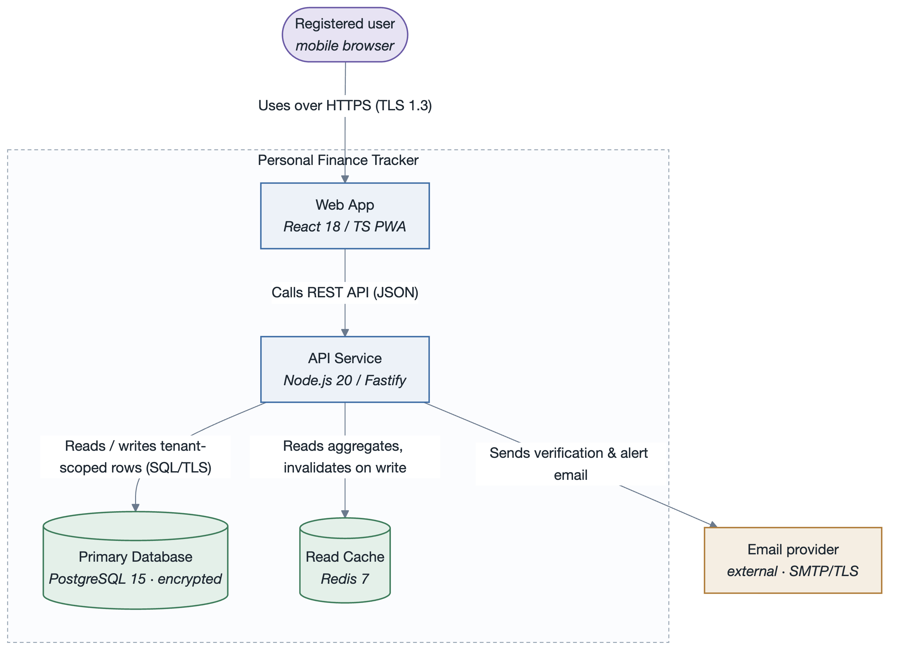

# SEI Architecture Methodology

A pluggable Claude Code skill set that automates the **SEI (Carnegie Mellon Software Engineering
Institute)** software-architecture practice end to end — from eliciting architectural drivers to
evaluating the finished architecture — and renders clean, verified UML / C4 diagrams to PNG.

It packages seven activities as separate skills behind one router:

| Command | Skill | What it does | Output under `architecture/` |
|---------|-------|--------------|------------------------------|
| `/sei` | `sei-architecture` | Router — pick or infer the activity you need | — |
| `/drivers` | `architectural-drivers` | Collect & track the four driver kinds (business goals, use cases, constraints, quality attributes) with a traceability matrix | `architecture/drivers/` package — one file per driver + a `README.md` index per directory + per-use-case UML diagrams + a **tabular** utility tree |
| `/quality-attributes` | `quality-attributes` | Measurable six-part quality attribute scenarios (ISO/IEC 25010), each drawn as a UML scenario diagram | `quality-attributes/scenarios.md` |
| `/qaw` | `quality-attribute-workshop` | Facilitate the SEI 8-step Quality Attribute Workshop | `qaw/qaw-report.md` |
| `/add` | `attribute-driven-design` | Run an ADD 3.0 design session → architecture + C4/UML views + ADR log | `add/<slug>-session.md`, `add/<slug>-Architecture.md` |
| `/atam` | `atam` | Run a 9-step ATAM evaluation → risks, sensitivity/tradeoff points, risk themes | `atam/atam-report.md` |
| `/architecture-docs` | `architecture-documentation` | Produce a Views-and-Beyond architecture description (Module + C&C + Allocation views) | `docs/` package |
| `/sei-diagram` | `sei-diagrams` | Draw a clean, low-crossing UML / C4 diagram, render it to PNG, and visually cross-verify it | `diagrams/*.png` |

Every skill:

- **drafts first**, then refines with you — it doesn't interview you question by question;
- writes **Markdown** artifacts under `architecture/` as the single source of truth;
- keeps **traceability** — decisions and findings cite driver IDs; ADD writes an ADR per decision,
  ATAM marks scenarios `at risk`, and both write statuses back to the drivers register;
- registers its output in `architecture/README.md`, the package index;
- routes every diagram through `sei-diagrams`: **rendered to PNG and visually verified** (the
  model opens the image and checks correctness + edge crossings) before it is embedded anywhere;
- can emit its report as **Markdown or HTML** (`scripts/build-report.sh`).

---

## Install as a Claude Code plugin

This repository **is** a Claude Code plugin *and* a one-plugin marketplace
(`.claude-plugin/plugin.json` + `.claude-plugin/marketplace.json`). Install it into your personal
Claude Code so the `/sei`, `/drivers`, `/qaw`, `/add`, `/atam`, `/architecture-docs` and
`/sei-diagram` commands are available in **every** project.

### From GitHub (recommended)

In any Claude Code session:

```
/plugin marketplace add rtym/sei-architecture-methodology
/plugin install sei-architecture-methodology@sei-architecture-methodology
```

Then restart Claude Code (or run `/plugin` → *Manage* to confirm it's enabled). Update later with:

```
/plugin marketplace update sei-architecture-methodology
```

### From a local clone

```bash
git clone git@github.com:rtym/sei-architecture-methodology.git
```

```
/plugin marketplace add ./sei-architecture-methodology
/plugin install sei-architecture-methodology@sei-architecture-methodology
```

### Non-interactive / scripted

```bash
claude plugin marketplace add rtym/sei-architecture-methodology
claude plugin install sei-architecture-methodology@sei-architecture-methodology
```

### Use it in place (no install)

Open this folder as your project in Claude Code — `.claude/commands` is a symlink to the
plugin's `commands/`, so the slash commands are picked up directly. Good for hacking on the
plugin itself. Note that `${CLAUDE_PLUGIN_ROOT}` is only set for an *installed* plugin; when
working in place, read the referenced `references/`, `templates/` and `scripts/` paths relative
to this folder.

### Auto-enable for a team

For a *consuming* project (not this repo) where you want the plugin to load automatically for
everyone who clones it — no one has to type `/plugin` — commit this to that project's
`.claude/settings.json`:

```json
{
  "extraKnownMarketplaces": {
    "sei": { "source": { "source": "github", "repo": "rtym/sei-architecture-methodology" } }
  },
  "enabledPlugins": ["sei-architecture-methodology@sei"]
}
```

Anyone who clones that project and trusts the folder gets the marketplace registered and the
plugin enabled with zero manual steps.

### Discoverability & trust

There is no central, curated Anthropic app-store for plugins — "submitting to a marketplace" is
just publishing `.claude-plugin/marketplace.json` in a repo. Being public on GitHub doesn't add it
to any searchable directory: people only find it if you point them at `rtym/sei-architecture-methodology`
(this README, a docs link, word of mouth). Installing runs the plugin's skills/commands with
whatever permissions the user's Claude Code session grants — same trust model as running any
third-party script — and Anthropic doesn't track installs or review the code beforehand.

### One-time diagram renderer setup

After the plugin is installed, from the plugin directory run:

```bash
bash skills/sei-diagrams/scripts/setup.sh
```

Installs `@mermaid-js/mermaid-cli` (+ `@mermaid-js/layout-elk`) locally under the skill and
downloads a headless Chromium once (~150 MB). Needs Node 18+. The versions are pinned by the
committed `package-lock.json`, so every clone renders identically. **PlantUML** (used for true-UML
use-case diagrams and canonical C4) needs a Java runtime plus PlantUML itself —
`brew install openjdk plantuml`, or `sudo apt-get install plantuml`;
`scripts/render-plantuml.sh` auto-detects a keg-only Homebrew JDK.

#### PlantUML includes

`render-plantuml.sh` puts the skill's `assets/` directory on PlantUML's include path
(`PLANTUML_INCLUDE_PATH`), so every `.puml` writes its includes as **bare, assets-relative
names** — never with `../`:

```
!include plantuml-theme.puml        ' non-C4 UML: palette + skinparams
!include c4/C4_Container.puml       ' canonical C4 macros (vendored, offline)
!include c4/sei-c4-palette.puml     ' SEI palette overlay for the C4 macros
```

This is what makes the diagrams portable. Your `.puml` files live in *your* project under
`architecture/diagrams/`, while the plugin lives under `~/.claude/plugins/…` — no number of
`../` walks from one to the other. A `!include` containing `../` is a bug, and
`tests/validate.py --self` rejects it.

---

## The driver ID scheme

Architectural drivers get **specific, mnemonic codes** so they read at a glance and stay stable:

| Kind | Code | Example |
|------|------|---------|
| Business goal | `BG-<n>` | `BG-1` |
| Primary functional requirement (**use case**) | `UC-<n>` | `UC-1` |
| Constraint | `CON-<n>` | `CON-1` |
| Quality attribute scenario | `<ATTR>QA-<n>` | `AQA-1` (availability), `SQA-2` (security), `PQA-3` (performance), `MQA-1` (modifiability), … |

Quality attribute scenarios are numbered **within each attribute prefix** and classified against
**ISO/IEC 25010:2023**. The full prefix table (availability `AQA`, security `SQA`, performance
`PQA`, modifiability `MQA`, usability `UQA`, reliability `RQA`, safety `SFQA`, scalability `SCQA`,
…) is in `skills/architectural-drivers/SKILL.md` and `references/quality-attribute-taxonomy.md`.

---

## How the activities connect

```
[/drivers]  business goals + use cases + constraints + quality attributes
     │              ▲  (refined scenarios)
     │         [/qaw]  ◄─────  [/quality-attributes]
     ▼
 drivers register ──► consumed as input by …
     │
     ▼
 [/add]  ADD 3.0 iterations ──► architecture + C4/UML views + ADRs
     │
     ▼
 [/architecture-docs]  Views-and-Beyond description
     │
     ▼
 [/atam]  evaluation ──► risks, tradeoffs, risk themes ──► back to /drivers as status
        [/sei-diagram] supports every artifact above
```

Typical engagements:

- **Architecture vision / greenfield**: `/drivers` → `/quality-attributes` (or `/qaw`) → `/add` → `/architecture-docs`.
- **Assessment of an existing system**: `/drivers` → `/quality-attributes` → `/atam` → targeted `/add` for the top risk themes.
- **Just need scenarios or a diagram**: `/quality-attributes` or `/sei-diagram` alone.

---

## Examples

A complete worked example — a personal-finance SaaS carried through every activity — ships in
**both notations**:
[`examples/personal-finance-tracker-mermaid/`](examples/personal-finance-tracker-mermaid/README.md)
(every diagram Mermaid) and
[`examples/personal-finance-tracker-plantuml/`](examples/personal-finance-tracker-plantuml/README.md)
(every diagram PlantUML / C4-PlantUML). Same prose, drivers, scenarios and decisions; only the
diagram notation differs.

### 1. Turn a brief into tracked drivers

```
/drivers
```

> New register. Paste your product brief.
> …
> Drafted 4 business goals, 3 architecturally-significant use cases, 5 constraints, 6 quality
> attribute scenarios. Use case diagram for the core actor group below — rendered and verified.
> Traceability matrix has no orphan drivers. Written to `architecture/drivers/` (one file per
> driver + a `README.md` index per directory + a tabular utility tree).

See a completed register in
[`examples/personal-finance-tracker-mermaid/drivers/`](examples/personal-finance-tracker-mermaid/drivers/README.md).

### 2. Measurable quality attribute scenarios, each as a UML diagram

```
/quality-attributes
```

Produces `architecture/quality-attributes/scenarios.md` — every scenario in the six-part SEI form
(source, stimulus, artifact, environment, response, **numeric** response measure), classified
against ISO/IEC 25010, and drawn as the canonical six-part scenario diagram:


### 3. Design the architecture with ADD 3.0

```
/add
```

Walks the seven ADD activities per iteration (review inputs → select drivers → choose elements →
choose design concepts → instantiate + interfaces → sketch views → analyse). Writes a session log
and a companion architecture document with context / container / component / sequence / deployment
views. Worked output:
[`examples/personal-finance-tracker-mermaid/add/`](examples/personal-finance-tracker-mermaid/add/personal-finance-tracker-Architecture.md).

Container view in the house style (SEI palette, one boundary, no crossings):



### 4. Evaluate an architecture with ATAM

```
/atam
```

Produces `architecture/atam/atam-report.md` — architectural approaches, a quality-attribute
utility tree (a table, `(V, R)` per leaf), per-scenario analysis, and the **risk / non-risk /
sensitivity point / tradeoff point** registers consolidated into **risk themes** mapped to the
business goals they threaten. A **Lightweight Architecture Evaluation** mode runs the same steps
in half a day with no formal report.

### 5. Document it — Views and Beyond

```
/architecture-docs
```

Produces the `architecture/docs/` package in the standard V&B layout: a documentation roadmap,
system overview, one **view packet** per view (Module + C&C + Allocation, plus any others
needed), mapping between views, rationale + ADR log, and a directory. Each view packet has the
five V&B sections (primary presentation, element catalog, context diagram, variability guide,
rationale).

### 6. Draw and verify a diagram

```
/sei-diagram
```

Writes the source, renders it to PNG, then opens the PNG and checks it against a correctness +
legibility checklist — reordering nodes, grouping, or switching to ELK layout until crossings are
minimal. **Use case diagrams use PlantUML** for true UML glyphs (stick-figure actors, ellipse use
cases, boundary rectangle, dashed `<<include>>` / `<<extend>>`):


### 7. Build a shareable report (Markdown or HTML, incl. a V&B report)

```bash
# a single artifact
scripts/build-report.sh architecture/atam/atam-report.md --format html --embed-diagrams \
  --title "ATAM Evaluation — Acme Platform"

# a full Views-and-Beyond documentation package, ordered per the V&B structure
scripts/build-report.sh --profile vandb architecture/docs/ --format html --embed-diagrams \
  --title "Architecture Description — Acme Platform"
```

`--embed-diagrams` renders every ```mermaid **and** ```plantuml block to PNG and inlines it;
`--profile vandb` orders a `docs/` directory as roadmap → system overview → module → C&C →
allocation views → mapping → rationale → directory. Output is one self-contained HTML file styled
with the SEI palette, with a cover page and table of contents. Example:
[`examples/personal-finance-tracker-mermaid/reports/architecture-package.html`](examples/personal-finance-tracker-mermaid/reports/architecture-package.html).

---

## Diagram house style

- **Notation**: Mermaid or PlantUML — the ten rules and the render→verify loop are identical for
  both. Sensible defaults: **use case → PlantUML** (real UML glyphs); **context / container /
  component / deployment → Mermaid flowchart-C4** (honours the palette, lays out cleanly, still
  full C4 semantics — native Mermaid `C4*` is sketch-only); sequence / class / state / scenario
  → Mermaid. Every diagram type also has a PlantUML pattern. The **utility tree is a table**, not
  a diagram.
- **Context & container diagrams follow C4 principles** — fixed abstraction level, every element
  typed + technologied + described, explicit system boundary, every relationship a labelled
  directed arrow, ≤ ~10 elements. Enforced by `tests/validate.py`.
- **Quality attribute scenario diagram** is the canonical SEI six-part box-and-arrow, **horizontal
  (`flowchart LR`)** — source → stimulus → (artifact in environment) → response → response measure.
- **Palette**: one calm, colour-blind-safe palette where colour is *semantic* — internal vs
  external vs datastore vs person vs emphasis. Defined once in
  `skills/sei-diagrams/assets/` (`mermaid-theme.json`, `palette.md`, `plantuml-theme.puml`).
- **Every diagram is rendered to PNG and visually cross-verified** (`Read` the image), then
  embedded in Markdown as **both** the ```mermaid/```plantuml source **and** a relative
  `` image line so it renders on GitHub and GitLab. A `%% name: x` comment in
  a Mermaid block names its PNG, so inserting a diagram never renumbers the others.

---

## Repository layout

```
sei-architecture-methodology/
├── .claude-plugin/
│   ├── plugin.json                    # plugin manifest (8 skills)
│   └── marketplace.json               # one-plugin marketplace (for /plugin marketplace add)
├── commands/                          # /sei /drivers /quality-attributes /qaw /add /atam /architecture-docs /sei-diagram
├── .claude/
│   └── commands -> ../commands        # symlink so the slash commands load when hacking on the plugin in place
│                                      # (settings.local.json — personal model pin / permissions — is gitignored)
├── skills/
│   ├── sei-architecture/              # router
│   ├── architectural-drivers/        # writes architecture/drivers/ as a directory, one file per driver
│   ├── quality-attributes/
│   ├── quality-attribute-workshop/
│   ├── attribute-driven-design/
│   ├── atam/
│   ├── architecture-documentation/
│   └── sei-diagrams/
│       ├── assets/                    # palette + theme files (mermaid + plantuml)
│       │   └── c4/                    #   vendored C4-PlantUML 2.10.0 (MIT) + sei-c4-palette.puml (offline)
│       │       ├── LICENSE            #     upstream MIT notice, verbatim
│       │       └── README.md          #     provenance: upstream, pinned version, unmodified
│       ├── scripts/                   # setup.sh, render.sh, render-plantuml.sh
│       └── package-lock.json          # pins the Mermaid renderer (npm ci in setup.sh)
├── references/                        # deep method notes + tactics catalog + patterns + checklist
├── templates/                         # blank artifact templates (one per driver kind, per report, per view)
├── scripts/
│   ├── mdreport.py                    # dependency-free Markdown → Markdown/HTML report builder (mermaid + plantuml embed)
│   └── build-report.sh
├── examples/
│   ├── personal-finance-tracker-mermaid/    # the full worked example, every diagram in Mermaid
│   └── personal-finance-tracker-plantuml/   # the same example, every diagram in PlantUML / C4-PlantUML
├── tests/
│   ├── validate.py                    # plugin + artifact validator (structure, C4 principles, six-part scenarios, traceability)
│   ├── test_mdreport.py               # mdreport unit tests
│   └── run.sh                         # full suite
├── CHANGELOG.md                       # release notes per version
├── CLAUDE.md                          # contributor notes: tests, conventions, release checklist
├── LICENSE                            # Apache-2.0 (provisional — see Licensing)
└── NOTICE                             # third-party attribution (vendored C4-PlantUML, MIT)
```

### The drivers directory

```
architecture/README.md                # package index — every activity registers its output here
architecture/drivers/
├── README.md                         # design purpose · ID legend · traceability matrix · coverage check · prioritised list · change log
├── stakeholders.md                   # ST-<n> — the one stakeholder register (QAW, ATAM, V&B read it)
├── concerns/README.md + AC-<n>.md    # architectural concerns (ADD input)
├── business-goals/README.md + BG-<n>.md
├── use-cases/README.md + UC-<n>.md   # + use-cases/diagrams/UC-<n>.puml|.mmd|.png  (proper UML use case diagram, one per use case)
├── constraints/README.md + CON-<n>.md
└── quality-attributes/
    ├── README.md                     # index: links every <ATTR>QA-<n>.md + the utility tree
    ├── <ATTR>QA-<n>.md               # full six-part scenario + its own horizontal scenario diagram
    ├── utility-tree.md               # the summary of the QA drivers as a table (from the QAW); (V, R) per leaf
    └── diagrams/
```

Every `README.md` links its files with relative Markdown links and ends with a Navigation footer
that links up to the package index and only to sibling packages that exist.

---

## Tests

```bash
bash tests/run.sh            # everything
bash tests/run.sh --quick    # skip the render smoke test
```

Checks: `plugin.json` parses; every shell script parses; every skill has valid front-matter and
is registered; every commands file delegates to a `SKILL.md`; every cross-file path in a
command, skill, template or reference is `${CLAUDE_PLUGIN_ROOT}`-anchored; every `!include`
resolves through the renderer's include path rather than `../` traversal; every embedded Mermaid
diagram in the shipped docs and examples obeys the ten rules; the deprecated flat `QAS-<n>` ID
never appears; the license actually grants something and `LICENSE` / `plugin.json` / `NOTICE`
agree; the vendored C4-PlantUML ships its MIT notice and its pinned version matches everywhere
it is asserted; `mdreport.py` converts a representative document correctly; the example
artifacts validate; a Mermaid diagram and a PlantUML diagram each render to PNG. Since 1.9.0 it
also checks that `plugin.json` and `marketplace.json` agree on the version; that every skill
aliased by a command is hidden from the slash menu (one picker entry per activity); that every
scenario in `scenarios.md` and every refined QAW scenario embeds a rendered diagram; and that
`mapping-between-views.md` contains real cross-view tables. Since 1.10.0: the package index
exists, retired drivers are excluded from the coverage check, `stakeholders.md` and `concerns/`
validate, refined QAW scenarios map to register IDs and raw ones carry a type, ATAM reports
declare their mode, §9 decisions link their ADRs, and the C&C view documents behaviour per use case.

Validate produced artifacts in a target project:

```bash
python path/to/sei-architecture-methodology/tests/validate.py architecture/**/*.md
```

### Continuous integration

[`.github/workflows/tests.yml`](.github/workflows/tests.yml) runs on every push to `main`, on
pull requests, and on manual dispatch, as three jobs:

| Job | What it runs | Needs |
|-----|--------------|-------|
| `test suite (no renderer)` | `tests/run.sh --quick` — everything but the render smoke test | Python only; finishes in seconds |
| `full suite (Mermaid renderer)` | `setup.sh` then the complete `tests/run.sh` | Node 20 + a headless Chromium (cached between runs) |
| `full suite (PlantUML renderer)` | the complete `tests/run.sh`, then renders every shipped example `.puml` | PlantUML + a JRE (apt) |

The split keeps feedback fast — only the Mermaid job pays the ~150 MB Chromium download — and a
failure names which renderer broke. Because `tests/run.sh` *skips* a render step without failing
when its toolchain is absent, both renderer jobs assert their binary exists first; otherwise
either could report success having rendered nothing.

The PlantUML smoke test deliberately renders from a temp directory **outside** the repository.
Rendering from inside it would pass even with broken includes, because a `../`-traversal path
happens to resolve here — and nowhere else.

---

## Deep method notes

For an **existing** system, `/sei brownfield` reads the repository first — docs and ADRs, build
manifests, entry points, integrations, deployment config, cross-cutting tactics, observability,
git history — and pre-drafts the drivers and as-built views with an evidence trail, so `/drivers`
starts from a draft to correct. Code shows the architecture, never the requirement: every derived
driver stays marked *derived — confirm*, and a missing tactic is an `/atam` finding, not a driver.

`references/` holds the encoded body of knowledge each skill draws on — see
[`references/README.md`](references/README.md) for the index and
[`references/glossary.md`](references/glossary.md) for the terminology. It covers architecture
fundamentals, the quality-attribute taxonomy + per-attribute general scenarios + tactics
catalog + patterns, ASR elicitation, ADD 3.0, ATAM + Lightweight Architecture Evaluation +
lightweight design reviews, Views-and-Beyond documentation, interfaces, architecture debt /
Agile / the architect's role, runtime environments (virtualization / cloud / mobile), and the
brownfield intake procedure.

## Sources

Encodes the public SEI body of knowledge:

- Bass, Clements, Kazman — *Software Architecture in Practice*, 3rd/4th ed.
- Cervantes, Kazman — *Designing Software Architectures: A Practical Approach*, 2nd ed. (ADD 3.0).
- Clements et al. — *Documenting Software Architectures: Views and Beyond*, 2nd ed.
- SEI technical reports: ATAM (CMU/SEI-2000-TR-004), QAW (CMU/SEI-2003-TR-016), ADD (CMU/SEI-2006-TR-023).
- ISO/IEC 25010:2023 (product quality model); ISO/IEC/IEEE 42010 (architecture description).

---

## Licensing

This project is licensed under the **Apache License 2.0** — see [`LICENSE`](LICENSE).

> **Status: provisional.** Apache-2.0 is applied so the plugin can actually be installed and
> evaluated; the author may release *future* versions under a different license. That does not
> qualify the grant: each released version stays under the license it shipped with.

### Third-party components

This repository redistributes one third-party component, under its own license:

| Component | Version | License | Location |
|-----------|---------|---------|----------|
| [C4-PlantUML](https://github.com/plantuml-stdlib/C4-PlantUML) | v2.10.0 (unmodified) | MIT — © 2018 Ricardo Niepel | [`skills/sei-diagrams/assets/c4/`](skills/sei-diagrams/assets/c4/README.md) |

The five vendored `C4*.puml` files are byte-identical to the upstream `v2.10.0` tag and are
covered by [their own MIT license](skills/sei-diagrams/assets/c4/LICENSE), **not** by this
repository's Apache-2.0 license. They are vendored rather than fetched so diagram rendering is
offline, reproducible and version-pinned. `sei-c4-palette.puml` in that directory is this
project's own work and is Apache-2.0 like the rest of the repo.

The SEI body of knowledge this project encodes (see **Sources** above) remains the copyright of
its respective authors and publishers; the license here covers only this repository's own text,
templates and code. *ATAM* and *Architecture Tradeoff Analysis Method* are service marks of
Carnegie Mellon University, used here nominatively to name the method.
