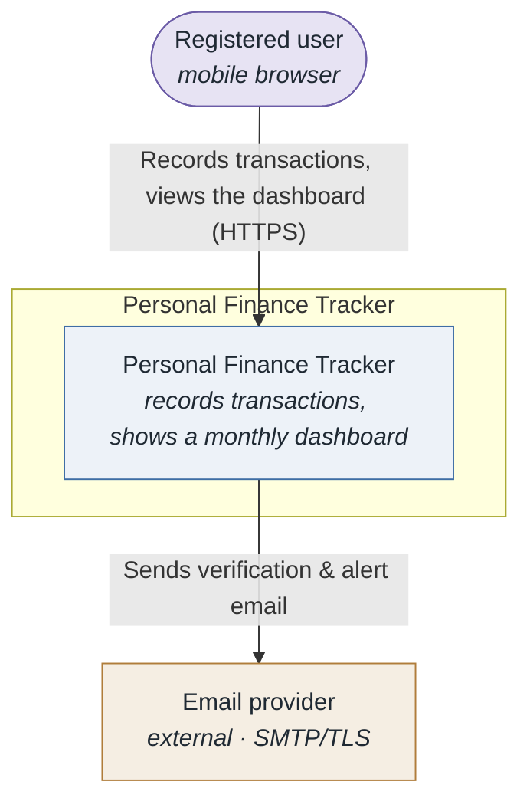
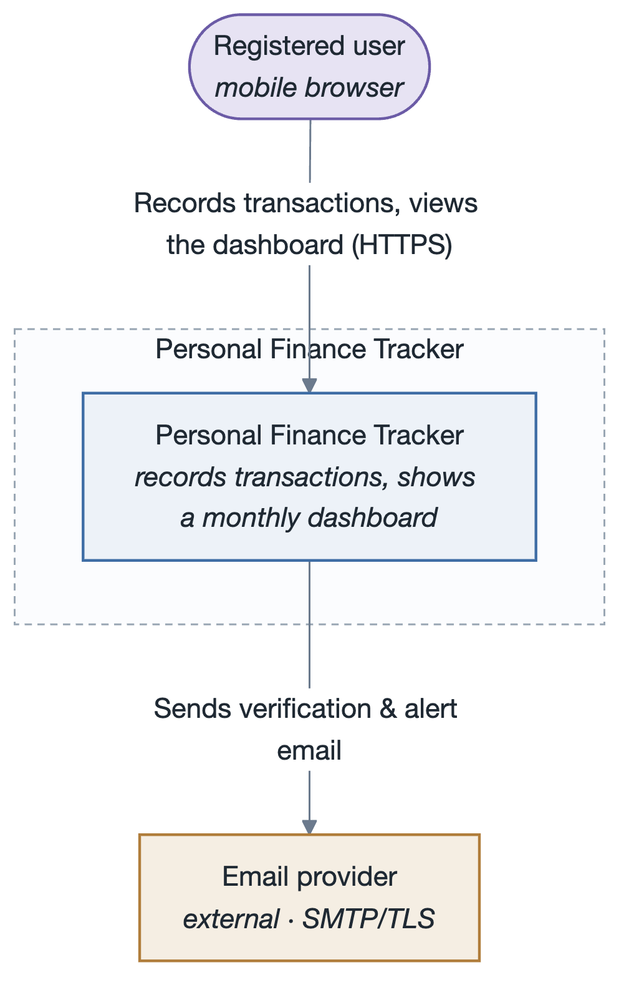
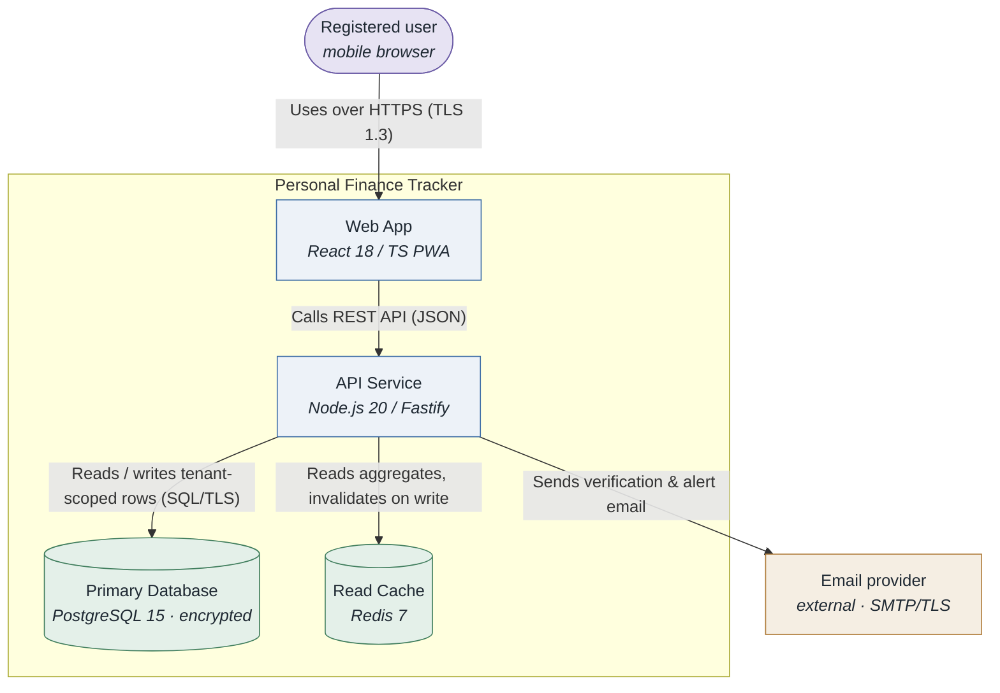
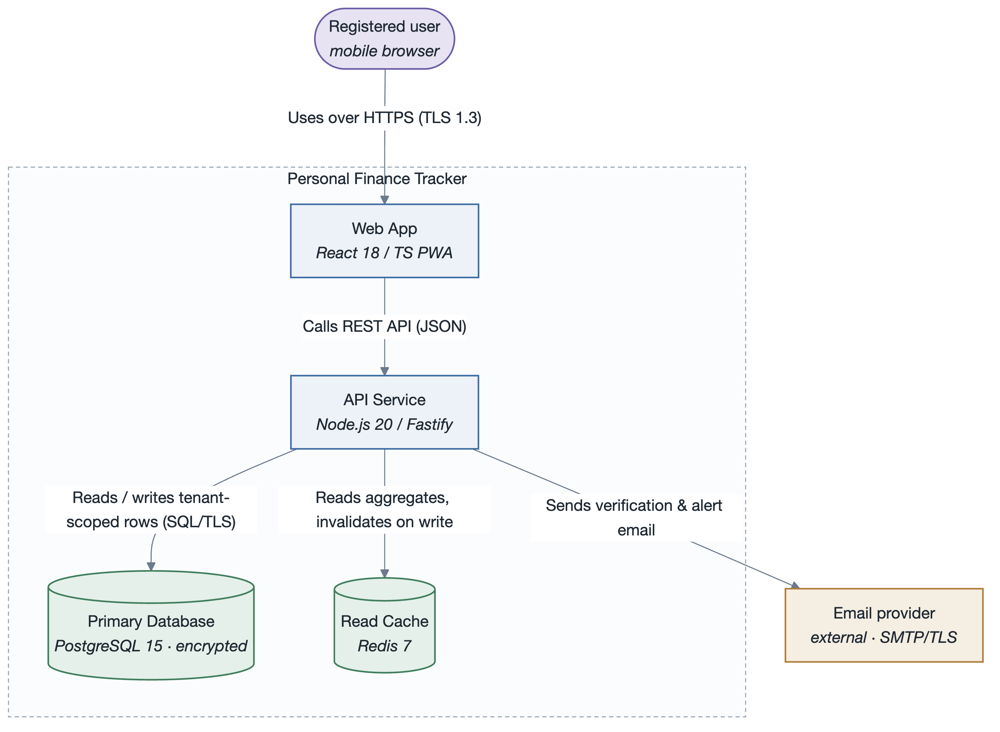
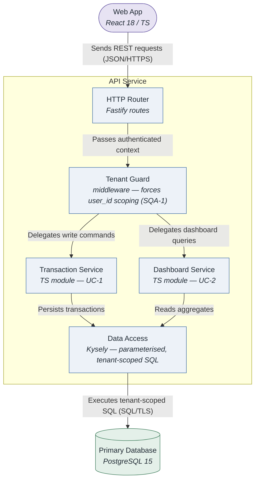
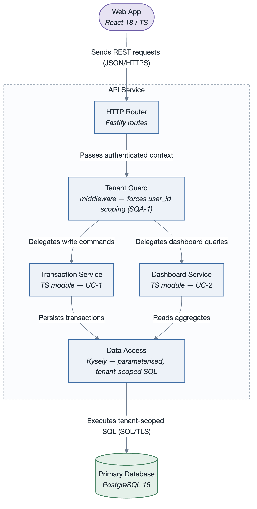
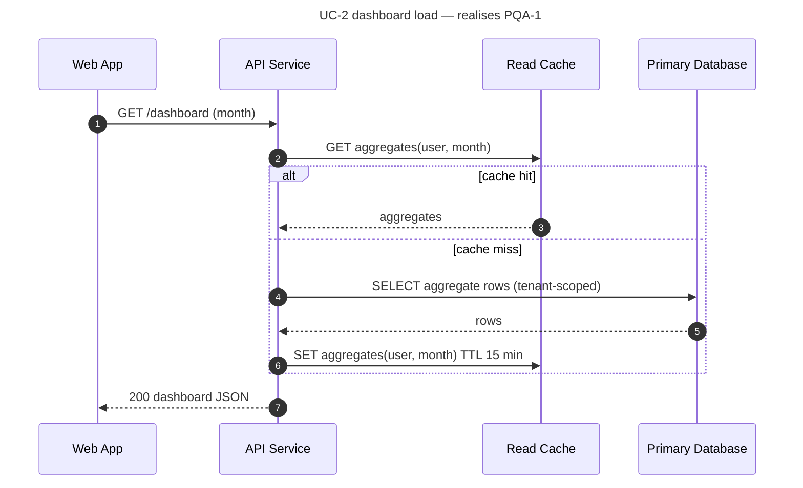
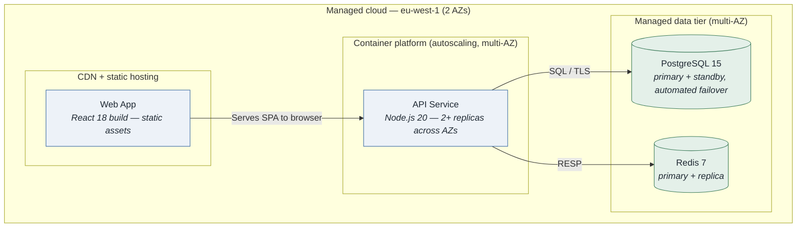

# Architecture: Personal Finance Tracker

- **System**: Web app for individuals to track income, expenses and savings goals.
- **Date**: 2026-09-06
- **Session**: `personal-finance-tracker-session.md`
- **Drivers**: [`../drivers/README.md`](../drivers/README.md)

## 1. Introduction

A mobile-web personal finance tracker. This document is the ADD 3.0 working architecture after
iteration 1 (overall structure, security, availability) and iteration 2 (dashboard read path).
Drivers: [`../drivers/README.md`](../drivers/README.md).

## 2. Context diagram

### Diagram

### Description

A single external dependency at launch: a transactional email provider. Everything else is owned
by the system, keeping the SOC 2 (CON-4) surface small.

## 3. Architectural drivers

### Quality Attribute Scenarios (key)

| ID | QA (ISO 25010) | Stimulus | Response | Measure | Priority |
|----|----------------|----------|----------|---------|----------|
| SQA-1 | Security / confidentiality | Cross-user data access attempt | Rejected and logged | 0 reads; 100 % logged | (H,H) |
| AQA-1 | Reliability / availability | Single-AZ failure | Recovers automatically | ≥ 99.5 %/mo; < 60 s | (H,H) |
| PQA-1 | Performance efficiency / time behaviour | 500 concurrent dashboard loads | Renders fully | < 1.5 s @ p95 | (H,M) |

### Primary functional requirements — use cases (key)

| ID | Name | Priority |
|----|------|----------|
| UC-1 | Record a transaction | high |
| UC-2 | View the monthly dashboard | high |

### Constraints (key)

| ID | Type | Description |
|----|------|-------------|
| CON-4 | regulatory | Encryption in transit (TLS 1.2+) and at rest |
| CON-5 | technical | Primary datastore is PostgreSQL |

## 4. Container diagram

### Diagram

### Description

The API service is the single write path and the single place tenant scoping (SQA-1) is enforced.
The Redis read cache serves the dashboard (PQA-1); it is a performance element, not a system of
record, so its loss degrades latency but not correctness (AQA-1).

## 5. Component diagrams

### API Service

#### Diagram

#### Description

Every request passes through the Tenant Guard before any service runs, so cross-tenant access
(SQA-1) is structurally prevented rather than checked per-endpoint.

## 6. Sequence diagrams

On a cache hit the database is not touched, which is the common path and keeps p95 under the
1.5 s budget (PQA-1). On a miss the API recomputes from tenant-scoped rows and repopulates the
cache; a stale cache is bounded by the 15-minute TTL.

## 7. Deployment diagram

### Diagram

### Description

The API runs as stateless replicas spread across two AZs behind the platform load balancer, and
the data tier uses managed primary/standby with automated failover — together these meet AQA-1
(single-AZ failure recovers < 60 s) within the CON-3 low-cost-tier constraint.

## 8. Interfaces and events

### Interfaces

| Component | Interface | Protocol | Description |
|-----------|-----------|----------|-------------|
| API Service | `POST /transactions` | REST / HTTPS | Create a transaction (UC-1) |
| API Service | `GET /dashboard?month=` | REST / HTTPS | Monthly aggregates + recent activity (UC-2) |
| Data Access | `query(userId, spec)` | in-process | Always injects `WHERE user_id = $userId` |

### Events

| Event | Publisher | Consumers | Description |
|-------|-----------|-----------|-------------|
| `TransactionWritten` | Transaction Service | Cache invalidator | Triggers dashboard-aggregate invalidation for the user/month |

## 9. Design decisions

| Decision | Rationale (cite driver IDs) | Alternatives discarded |
|----------|-----------------------------|------------------------|
| Single API service owns all writes and enforces tenant scoping in one middleware | SQA-1 needs one auditable choke point; CON-2 favours few moving parts | Per-service authz checks (easy to miss one) |
| Redis cache-aside for dashboard aggregates with 15-min TTL | PQA-1 p95 budget; DB alone won't meet it at 500 concurrent | Materialised views (slower to iterate — MQA-1); CDN caching (per-user data) |
| Managed PostgreSQL primary/standby, multi-AZ, automated failover | AQA-1 recovery target; CON-5 mandates PostgreSQL; CON-3 low-cost tier still offers this | Self-managed HA (CON-2 time), single instance (fails AQA-1) |

---

**Navigation**: [example root](../README.md) · [drivers](../drivers/README.md) · [session log](personal-finance-tracker-session.md) · [Views & Beyond docs](../docs/README.md) · [ATAM](../atam/atam-report.md)
