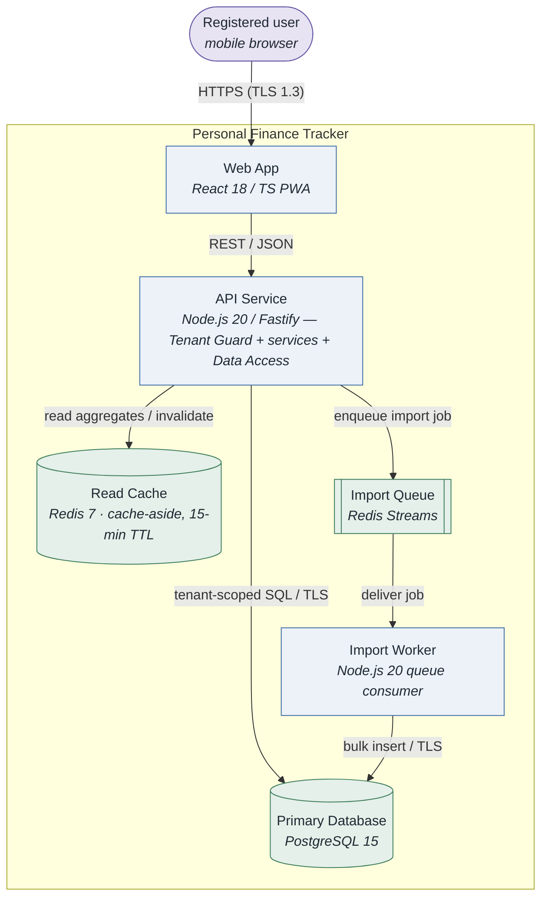
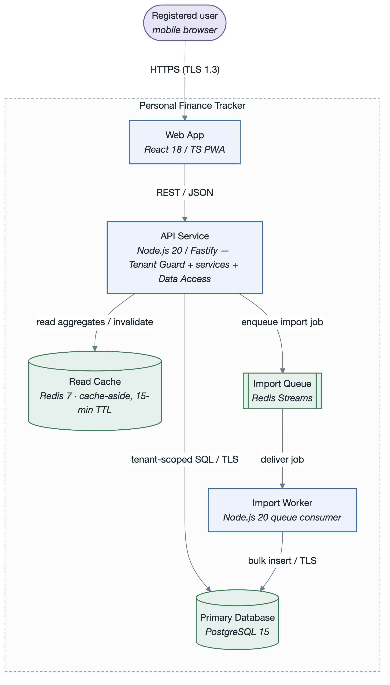

# View: Runtime (Component-and-Connector / service)

- **Viewtype**: Component-and-Connector
- **Style**: service-oriented (request/response + async queue)
- **Stakeholders / concerns addressed**: architect & developers (what runs, how parts interact),
  performance (`PQA-1` read path), security (`SQA-1` isolation control), operations
- **Date**: 2026-09-06

## 1. Primary presentation

_visually verified: yes · relative path renders on GitHub / GitLab_

## 2. Element catalog

### 2.1 Elements and their properties

| Component | Responsibility | Key properties |
|-----------|----------------|----------------|
| Web App | Render UI, call the API | stateless; no direct DB access |
| API Service | Auth, **tenant guard**, transaction/category/reporting services, Data Access | stateless, horizontally scalable; the only writer to the DB |
| Import Worker | Consume import jobs, parse CSV, bulk-insert | idempotent per job; reuses Data Access |
| Primary Database | System of record | tenant-scoped rows; encrypted at rest (`CON-4`) |
| Read Cache | Dashboard aggregates | strictly derived data; loss = latency only |
| Import Queue | Buffer import jobs | at-least-once delivery |

### 2.2 Relations and their properties

| From | Connector | To | Properties |
|------|-----------|----|-----------|
| Web App | REST/HTTPS | API Service | JSON; auth token per request |
| API Service | SQL/TLS | Primary Database | every query `user_id`-scoped via Data Access |
| API Service | RESP | Read Cache | cache-aside; write invalidates the user/month key |
| API Service | RESP (stream) | Import Queue | one job per uploaded file |
| Import Queue | RESP (stream) | Import Worker | consumer group; at-least-once |
| Import Worker | SQL/TLS | Primary Database | bulk insert; no direct client access |

### 2.3 Element interfaces

HTTP interface catalogue and events: ADD [`../add/personal-finance-tracker-Architecture.md`](../add/personal-finance-tracker-Architecture.md) §8.

### 2.4 Element behavior

Dashboard read (cache hit / miss) sequence: ADD `Architecture.md` §6.

## 3. Context diagram

External to this view: the user's browser and the email provider (notifications sent by the API
Service, omitted from the primary presentation to keep it to the runtime data paths).

## 4. Variability guide

- Import processing runs **in-process** in the API Service in local/dev (no queue/worker) and
  **out-of-process** in production; selected by config flag `IMPORTS_ASYNC`.
- Read Cache is optional: with it disabled the Dashboard Service reads straight from the DB
  (slower; used only in dev).

## 5. Rationale

- One API Service process holds the tenant guard so `SQA-1` isolation is enforced on every
  interactive path in a single auditable place ([`rationale.md`](rationale.md) ADR-2).
- Cache-aside with a bounded TTL meets `PQA-1`'s p95 budget while keeping the cache strictly
  derived, so its failure never threatens `AQA-1` correctness ([`rationale.md`](rationale.md) ADR-1).
- CSV import is pushed to a queue + worker so a large import cannot consume the request threads
  that serve interactive traffic (`PQA-2`).

---

**Navigation**: [docs README](README.md) · [example root](../README.md) · [drivers](../drivers/README.md) · [ADD architecture](../add/personal-finance-tracker-Architecture.md)
