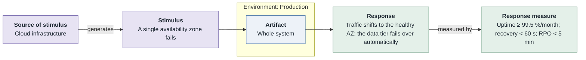
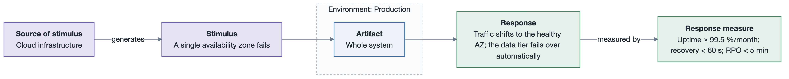

# AQA-1: Survive a single-AZ failure

- **Status**: open
- **Source**: authored here (kept in sync with `../../scenarios.md`)

Documented as a **six-part quality attribute scenario** and supported by its own **horizontal
six-part scenario diagram**.

| Part | Value |
|------|-------|
| **ID** | AQA-1 |
| **ISO/IEC 25010 characteristic** | Reliability |
| **Sub-characteristic** | availability |
| **Source of stimulus** | Cloud infrastructure |
| **Stimulus** | A single availability zone fails |
| **Artifact** | Whole system |
| **Environment** | Production |
| **Response** | Traffic shifts to the healthy AZ; the data tier fails over automatically |
| **Response measure** | Uptime ≥ 99.5 %/month; recovery < 60 s; RPO < 5 min |
| **Business goals supported** | BG-1, BG-4 |
| **Priority** | Importance = H · Difficulty = H |
| **Type** | concrete |

## Six-part scenario diagram

## Notes / assumptions

See [`../README.md`](../README.md) for traceability and the utility tree.

---

**Navigation**: [quality-attributes index](README.md) · [drivers README](../README.md) · [utility tree](utility-tree.md)
