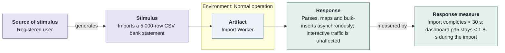
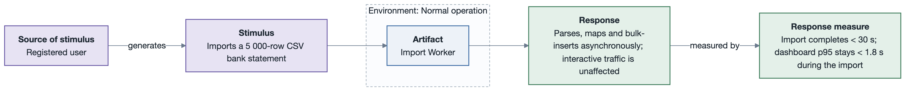

# PQA-2: Bulk import stays responsive

- **Status**: open
- **Source**: authored here (kept in sync with `../../scenarios.md`)

Documented as a **six-part quality attribute scenario** and supported by its own **horizontal
six-part scenario diagram**.

| Part | Value |
|------|-------|
| **ID** | PQA-2 |
| **ISO/IEC 25010 characteristic** | Performance efficiency |
| **Sub-characteristic** | capacity |
| **Source of stimulus** | Registered user |
| **Stimulus** | Imports a 5 000-row CSV bank statement |
| **Artifact** | Import Worker |
| **Environment** | Normal operation |
| **Response** | Parses, maps and bulk-inserts asynchronously; interactive traffic is unaffected |
| **Response measure** | Import completes < 30 s; dashboard p95 stays < 1.8 s during the import |
| **Business goals supported** | BG-1 |
| **Priority** | Importance = M · Difficulty = M |
| **Type** | concrete |

## Six-part scenario diagram

## Notes / assumptions

See [`../README.md`](../README.md) for traceability and the utility tree.

---

**Navigation**: [quality-attributes index](README.md) · [drivers README](../README.md) · [utility tree](utility-tree.md)
