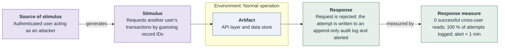
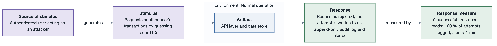

# SQA-1: No cross-user data access

- **Status**: open
- **Source**: authored here (kept in sync with [`../../quality-attributes/scenarios.md`](../../quality-attributes/scenarios.md))

Documented as a **six-part quality attribute scenario** and supported by its own **horizontal
six-part scenario diagram**.

| Part | Value |
|------|-------|
| **ID** | SQA-1 |
| **ISO/IEC 25010 characteristic** | Security |
| **Sub-characteristic** | confidentiality |
| **Source of stimulus** | Authenticated user acting as an attacker |
| **Stimulus** | Requests another user's transactions by guessing record IDs |
| **Artifact** | API layer and data store |
| **Environment** | Normal operation |
| **Response** | Request is rejected; the attempt is written to an append-only audit log and alerted |
| **Response measure** | 0 successful cross-user reads; 100 % of attempts logged; alert < 1 min |
| **Business goals supported** | BG-2 |
| **Priority** | Importance = H · Difficulty = H |
| **Type** | concrete |

## Six-part scenario diagram

## Notes / assumptions

See [`../README.md`](../README.md) for traceability and the utility tree.

---

**Navigation**: [quality-attributes index](README.md) · [drivers README](../README.md) · [utility tree](utility-tree.md)
