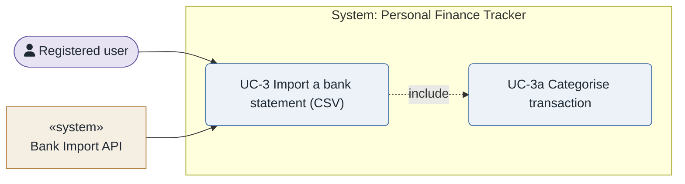
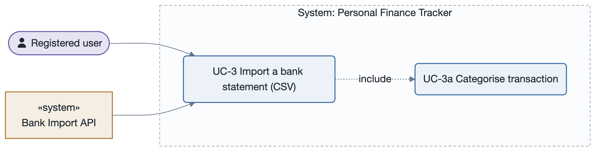

# UC-3: Import a bank statement (CSV)

- **Scope**: Personal Finance Tracker
- **Level**: user goal
- **Primary actor**: Registered user
- **Supporting actors**: Bank Import API
- **Trigger**: The user uploads a CSV file
- **Preconditions**: The user is authenticated
- **Postconditions**: the requested change is persisted and the dashboard reflects it
- **Priority**: high
- **Status**: open

## Main success scenario

1. The user uploads a CSV file.
2. The system parses the file and maps rows to transactions.
3. The system asks the user to confirm the category mapping.
4. The system bulk-inserts the transactions asynchronously.
5. The system updates the dashboard aggregates and reports per-row results.

## Extensions / alternate flows

- **2a.** Unrecognised format → the system offers a guided column-mapping step.
- **4a.** Partial failure → the system returns a per-row result report.

## Architectural significance

- **Drivers exercised**: Bulk write path; `<<include>>`s categorisation; the first candidate for asynchronous processing (PQA-2).

## Related drivers

`BG-1, PQA-2`

## Use case diagram

Mermaid `flowchart` fallback (this is the Mermaid tree). Source:
[`diagrams/UC-3.mmd`](diagrams/UC-3.mmd) · rendered + visually verified.

---

**Navigation**: [use-cases index](README.md) · [drivers README](../README.md)
