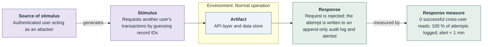
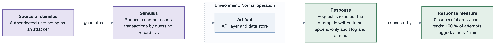
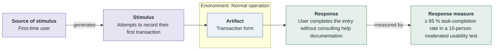
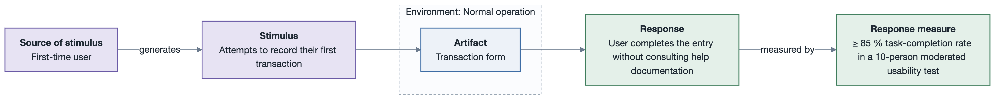

# Quality Attribute Workshop — Personal Finance Tracker

- **Date(s)**: 2026-08-20
- **Facilitator(s)**: R. Tymoshuk (lead), J. Doe (scribe)
- **Sponsor**: Founder
- **Status**: complete

> Condensed record. A real QAW runs half a day to a day; the structure below is the full method.

## Step 1 — QAW presentation and introductions

### Participants

Recorded in the stakeholder register [`../drivers/stakeholders.md`](../drivers/stakeholders.md).

| ID | Name | Role | Concerns brought |
|----|------|------|------------------|
| ST-1 | Founder | Sponsor / product owner | growth, cost, SOC 2 |
| ST-2 | Eng lead | Architect / developer | modifiability, delivery speed, team of one |
| ST-3 | Contractor QA | Tester | testability, usability |
| ST-4 | Advisor | Security | data isolation, audit logging |
| ST-5 | Design partner | End-user representative | ease of first use |

### Expected outputs
Raw scenarios · consolidated scenarios · prioritised scenarios · refined (six-part) scenarios.

## Step 2 — Business / mission drivers

| ID | Business driver / goal |
|----|------------------------|
| BG-1 | 10 000 active users within 12 months |
| BG-2 | Pass a SOC 2 Type II audit to sell to employers |
| BG-3 | Ship new report types weekly |
| BG-4 | Keep the infra bill within budget at launch scale |

**Quality attributes the business named**: security, availability, performance, low change cost.
**Key functional requirements**: record transactions, monthly dashboard, CSV import.
**Constraints**: mobile web only, one engineer / 3 months, low-cost cloud tiers, encryption, PostgreSQL.

## Step 3 — Architectural plan presentation

- **System boundary**: a single web app + API + datastore; one external dependency (email).
- **Known technical constraints**: CON-1..CON-5 from the brief.
- **External systems / interfaces**: transactional email provider (SMTP).
- **Existing architectural context**: none yet — greenfield.

## Step 4 — Architectural drivers

| ID | Architectural driver | Kind (QA / FR / constraint) | Supports |
|----|----------------------|----------------------------|----------|
| AD-1 | Cross-user data isolation | QA (security) | BG-2 |
| AD-2 | Dashboard latency under load | QA (performance) | BG-1 |
| AD-3 | Survive a single-AZ failure | QA (availability) | BG-1, BG-4 |
| AD-4 | Cheap to add report types | QA (modifiability) | BG-3 |
| AD-5 | First-use success without docs | QA (usability) | BG-1 |
| AD-6 | Encryption in transit and at rest | constraint | BG-2 |

## Step 5 — Scenario brainstorming (raw, verbatim)

| ID | Scenario (stimulus · environment · response) | Type | Contributor | Driver(s) |
|----|----------------------------------------------|------|-------------|-----------|
| S-1 | "Someone tries to open another person's data and the system says no and writes it down" | use-case | Advisor | AD-1 |
| S-2 | "Lots of people open the dashboard at once and it still comes up fast" | growth | Founder | AD-2 |
| S-3 | "A data centre goes dark and the app keeps working" | exploratory | Eng lead | AD-3 |
| S-4 | "I add a new chart type without breaking the old ones" | growth | Eng lead | AD-4 |
| S-5 | "A brand-new user adds their first expense and doesn't get stuck" | use-case | Design partner | AD-5 |
| S-6 | "A 5 000-row CSV import doesn't freeze the app for everyone else" | use-case | Contractor QA | AD-2 |
| S-7 | "We can prove every access attempt was logged for the auditor" | use-case | Advisor | AD-1, AD-6 |
| S-8 | "Restoring from backup after a bad deploy takes minutes, not hours" | exploratory | Eng lead | AD-3 |

## Step 6 — Scenario consolidation

| Consolidated ID | Merged from | Scenario |
|-----------------|-------------|----------|
| CS-1 | S-1, S-7 | Cross-user access attempt is rejected and fully logged |
| CS-2 | S-2 | Dashboard stays fast under concurrent load |
| CS-3 | S-3, S-8 | System survives an AZ loss and recovers quickly |
| CS-4 | S-4 | New report type added without regressions |
| CS-5 | S-5 | First-time user succeeds without help |
| CS-6 | S-6 | Bulk CSV import does not degrade interactive latency |

Dissent / notes: none — the S-7/S-1 merge was agreed since both concern the same isolation control.

## Step 7 — Scenario prioritisation

**Vote budget** = ceil(0.30 × 6) = **2** votes per stakeholder (5 stakeholders → 10 votes).

| Scenario | Founder | Eng lead | QA | Advisor | User rep | Total |
|----------|---------|----------|----|---------|----------|-------|
| CS-1 | 1 | 0 | 0 | 2 | 0 | 3 |
| CS-2 | 1 | 1 | 0 | 0 | 0 | 2 |
| CS-3 | 0 | 1 | 0 | 0 | 0 | 1 |
| CS-4 | 0 | 0 | 1 | 0 | 0 | 1 |
| CS-5 | 0 | 0 | 1 | 0 | 2 | 3 |
| CS-6 | 0 | 0 | 0 | 0 | 0 | 0 |

**Ranked**: CS-1 (3) = CS-5 (3) > CS-2 (2) > CS-3 (1) = CS-4 (1) > CS-6 (0).

## Step 8 — Scenario refinement (top scenarios)

### CS-1 — Cross-user access attempt is rejected and logged

| Part | Value |
|------|-------|
| Source of stimulus | Authenticated user acting as an attacker |
| Stimulus | Requests another user's transactions by guessing record IDs |
| Artifact | API layer + data store |
| Environment | Normal operation |
| Response | Request rejected; attempt logged and alerted |
| Response measure | 0 successful cross-user reads; 100 % of attempts logged; alert < 1 min |

- **Business goals**: BG-2
- **Relevant quality attributes (ISO/IEC 25010)**: Security / confidentiality, accountability
- **Six-part scenario diagram** (refined into `SQA-1` in the drivers register):

- **Questions**: Where is tenant scoping enforced — one place or many? Is the audit log tamper-evident?
- **Issues / assumptions**: assumes all data access goes through the API (no direct DB clients).

### CS-5 — First-time user succeeds without help

| Part | Value |
|------|-------|
| Source of stimulus | First-time user |
| Stimulus | Attempts to record their first transaction |
| Artifact | Transaction form |
| Environment | Normal operation |
| Response | User completes entry without consulting help |
| Response measure | ≥ 85 % task-completion rate in a 10-person usability test |

- **Business goals**: BG-1
- **Relevant quality attributes (ISO/IEC 25010)**: Interaction capability / operability, learnability
- **Six-part scenario diagram** (refined into `UQA-1` in the drivers register):

- **Questions**: Does the form need progressive disclosure? Are categories pre-seeded?
- **Issues / assumptions**: usability test to be run on a clickable prototype before build.

## Step 9 — Quality attribute utility tree

The utility tree assembled from the refined + surviving scenarios, **as a table**. It is the
summary of the workshop's quality attributes and is handed to `/drivers` as the QA summary
([`../drivers/quality-attributes/utility-tree.md`](../drivers/quality-attributes/utility-tree.md)).
ATAM step 5 reuses it.

`(V, R)` = **business value** (from the vote ranking + business-goal weight) and **technical
risk** (the architect's estimate), each `H`/`M`/`L`. `★` = architecturally significant `(H, H)`.

| Quality attribute (ISO/IEC 25010) | Refinement (concern) | Leaf scenario (ID — from CS-n — one line) | Priority (V, R) | Status |
|-----------------------------------|----------------------|------------------------------------------|:---------------:|:------:|
| Security | Confidentiality | SQA-1 (CS-1) — cross-user access rejected and logged; 0 reads; alert < 1 min | (H, H) `★` | in design |
| Reliability | Availability | AQA-1 (CS-3) — survive an AZ loss, recover < 60 s; ≥ 99.5 %/mo | (H, H) `★` | open |
| Performance efficiency | Time behaviour | PQA-1 (CS-2) — dashboard < 1.5 s @ p95, 500 concurrent | (H, M) | open |
| Performance efficiency | Capacity | PQA-2 (CS-6) — 5 000-row import < 30 s, interactive p95 unaffected | (M, M) | open |
| Maintainability | Modifiability | MQA-1 (CS-4) — add a report type in ≤ 1 person-day, 0 regressions | (M, M) | open |
| Interaction capability | Operability | UQA-1 (CS-5) — first transaction without help; ≥ 85 % completion | (M, M) | open |

_Reading the tree_: **SQA-1** and **AQA-1** are the `★` `(H, H)` leaves — they get the most
design attention. Every refinement has a leaf, so there is no obvious unrecorded ASR. These
scenarios become the `<ATTR>QA-n` drivers under
[`../drivers/quality-attributes/`](../drivers/quality-attributes/README.md).

## Next steps — hand-off to the drivers register

| Workshop ID | Becomes | Notes |
|-------------|---------|-------|
| CS-1 | [SQA-1](../drivers/quality-attributes/SQA-1.md) | refined here (Step 8) |
| CS-2 | [PQA-1](../drivers/quality-attributes/PQA-1.md) | refined in `/drivers` Step 5 |
| CS-3 | [AQA-1](../drivers/quality-attributes/AQA-1.md) | refined in `/drivers` Step 5 |
| CS-4 | [MQA-1](../drivers/quality-attributes/MQA-1.md) | refined in `/drivers` Step 5 |
| CS-5 | [UQA-1](../drivers/quality-attributes/UQA-1.md) | refined here (Step 8) |
| CS-6 | [PQA-2](../drivers/quality-attributes/PQA-2.md) | refined in `/drivers` Step 5 |
| AD-1 | SQA-1 | supports BG-2 |
| AD-2 | PQA-1 | supports BG-1 |
| AD-3 | AQA-1 | supports BG-1, BG-4 |
| AD-4 | MQA-1 | supports BG-3 |
| AD-5 | UQA-1 | supports BG-1 |
| AD-6 | [CON-4](../drivers/constraints/CON-4.md) | encryption in transit and at rest |

- Feed refined scenarios + the utility tree into `/drivers` (they become `SQA-1`, `AQA-1`, …
  under `architecture/drivers/quality-attributes/`), then into `/attribute-driven-design`.
- Schedule an ATAM once the ADD architecture exists — it reuses this utility tree at step 5.

---

**Navigation**: [example root](../README.md) · [drivers](../drivers/README.md) · [scenarios](../quality-attributes/scenarios.md) · [ADD](../add/personal-finance-tracker-Architecture.md) · [ATAM](../atam/atam-report.md)
