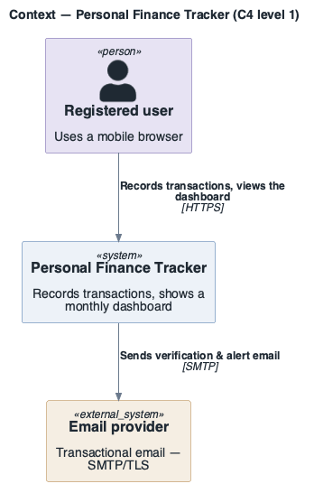
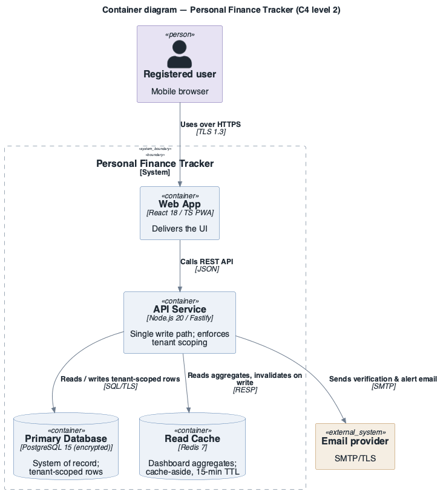
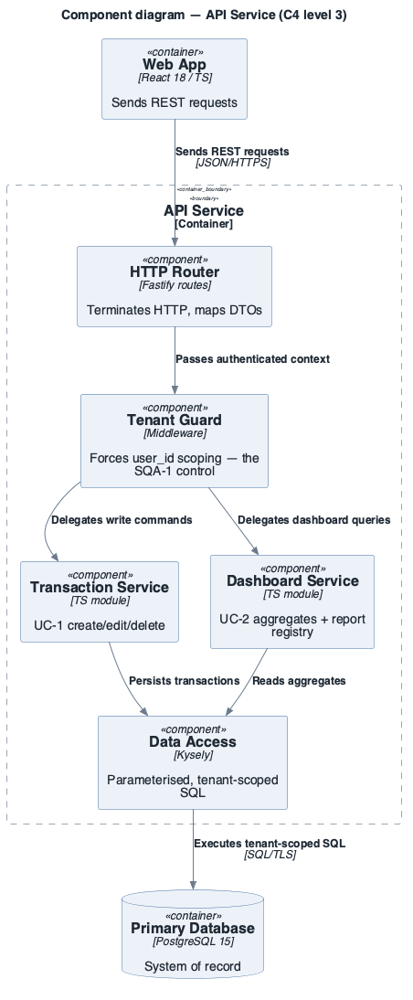
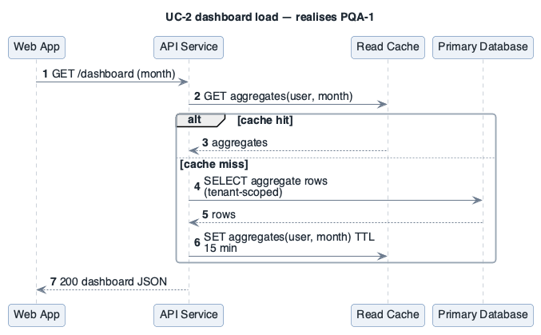
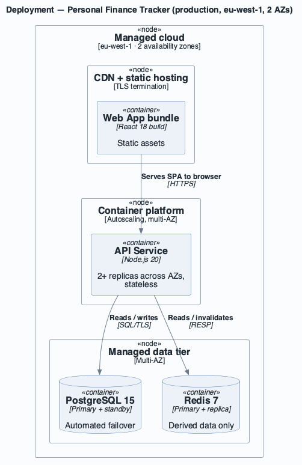

# Architecture: Personal Finance Tracker

- **System**: Web app for individuals to track income, expenses and savings goals.
- **Date**: 2026-09-06
- **Session**: `personal-finance-tracker-session.md`
- **Drivers**: [`../drivers/README.md`](../drivers/README.md)

## 1. Introduction

A mobile-web personal finance tracker. This document is the ADD 3.0 working architecture after
iteration 1 (overall structure, security, availability) and iteration 2 (dashboard read path).
Drivers: [`../drivers/README.md`](../drivers/README.md).

## 2. Context diagram

### Diagram

```plantuml
@startuml context
!include ../../../../skills/sei-diagrams/assets/c4/C4_Context.puml
!include ../../../../skills/sei-diagrams/assets/c4/sei-c4-palette.puml
LAYOUT_TOP_DOWN()
title Context — Personal Finance Tracker (C4 level 1)
Person(user, "Registered user", "Uses a mobile browser")
System(sys, "Personal Finance Tracker", "Records transactions, shows a monthly dashboard")
System_Ext(mail, "Email provider", "Transactional email — SMTP/TLS")
Rel(user, sys, "Records transactions, views the dashboard", "HTTPS")
Rel(sys, mail, "Sends verification & alert email", "SMTP")
@enduml
```



### Description

A single external dependency at launch: a transactional email provider. Everything else is owned
by the system, keeping the SOC 2 (CON-4) surface small.

## 3. Architectural drivers

### Quality Attribute Scenarios (key)

| ID | QA (ISO 25010) | Stimulus | Response | Measure | Priority |
|----|----------------|----------|----------|---------|----------|
| SQA-1 | Security / confidentiality | Cross-user data access attempt | Rejected and logged | 0 reads; 100 % logged | (H,H) |
| AQA-1 | Reliability / availability | Single-AZ failure | Recovers automatically | ≥ 99.5 %/mo; < 60 s | (H,H) |
| PQA-1 | Performance efficiency / time behaviour | 500 concurrent dashboard loads | Renders fully | < 1.5 s @ p95 | (H,M) |

### Primary functional requirements — use cases (key)

| ID | Name | Priority |
|----|------|----------|
| UC-1 | Record a transaction | high |
| UC-2 | View the monthly dashboard | high |

### Constraints (key)

| ID | Type | Description |
|----|------|-------------|
| CON-4 | regulatory | Encryption in transit (TLS 1.2+) and at rest |
| CON-5 | technical | Primary datastore is PostgreSQL |

## 4. Container diagram

### Diagram

```plantuml
@startuml container
!include ../../../../skills/sei-diagrams/assets/c4/C4_Container.puml
!include ../../../../skills/sei-diagrams/assets/c4/sei-c4-palette.puml
LAYOUT_TOP_DOWN()
title Container diagram — Personal Finance Tracker (C4 level 2)
Person(user, "Registered user", "Mobile browser")
System_Ext(mail, "Email provider", "SMTP/TLS")
System_Boundary(sys, "Personal Finance Tracker") {
  Container(spa, "Web App", "React 18 / TS PWA", "Delivers the UI")
  Container(api, "API Service", "Node.js 20 / Fastify", "Single write path; enforces tenant scoping")
  ContainerDb(db, "Primary Database", "PostgreSQL 15 (encrypted)", "System of record; tenant-scoped rows")
  ContainerDb(cache, "Read Cache", "Redis 7", "Dashboard aggregates; cache-aside, 15-min TTL")
}
Rel(user, spa, "Uses over HTTPS", "TLS 1.3")
Rel(spa, api, "Calls REST API", "JSON")
Rel(api, db, "Reads / writes tenant-scoped rows", "SQL/TLS")
Rel(api, cache, "Reads aggregates, invalidates on write", "RESP")
Rel(api, mail, "Sends verification & alert email", "SMTP")
@enduml
```



### Description

The API service is the single write path and the single place tenant scoping (SQA-1) is enforced.
The Redis read cache serves the dashboard (PQA-1); it is a performance element, not a system of
record, so its loss degrades latency but not correctness (AQA-1).

## 5. Component diagrams

### API Service

#### Diagram

```plantuml
@startuml component-api
!include ../../../../skills/sei-diagrams/assets/c4/C4_Component.puml
!include ../../../../skills/sei-diagrams/assets/c4/sei-c4-palette.puml
LAYOUT_TOP_DOWN()
title Component diagram — API Service (C4 level 3)
Container(spa, "Web App", "React 18 / TS", "Sends REST requests")
ContainerDb(db, "Primary Database", "PostgreSQL 15", "System of record")
Container_Boundary(api, "API Service") {
  Component(router, "HTTP Router", "Fastify routes", "Terminates HTTP, maps DTOs")
  Component(guard, "Tenant Guard", "Middleware", "Forces user_id scoping — the SQA-1 control")
  Component(txn, "Transaction Service", "TS module", "UC-1 create/edit/delete")
  Component(dash, "Dashboard Service", "TS module", "UC-2 aggregates + report registry")
  Component(repo, "Data Access", "Kysely", "Parameterised, tenant-scoped SQL")
}
Rel(spa, router, "Sends REST requests", "JSON/HTTPS")
Rel(router, guard, "Passes authenticated context")
Rel(guard, txn, "Delegates write commands")
Rel(guard, dash, "Delegates dashboard queries")
Rel(txn, repo, "Persists transactions")
Rel(dash, repo, "Reads aggregates")
Rel(repo, db, "Executes tenant-scoped SQL", "SQL/TLS")
@enduml
```



#### Description

Every request passes through the Tenant Guard before any service runs, so cross-tenant access
(SQA-1) is structurally prevented rather than checked per-endpoint.

## 6. Sequence diagrams

```plantuml
@startuml sequence-dashboard
!include ../../../../skills/sei-diagrams/assets/plantuml-theme.puml
title UC-2 dashboard load — realises PQA-1
autonumber
participant "Web App" as U
participant "API Service" as A
participant "Read Cache" as C
participant "Primary Database" as D
U -> A : GET /dashboard (month)
A -> C : GET aggregates(user, month)
alt cache hit
  C --> A : aggregates
else cache miss
  A -> D : SELECT aggregate rows (tenant-scoped)
  D --> A : rows
  A -> C : SET aggregates(user, month) TTL 15 min
end
A --> U : 200 dashboard JSON
@enduml
```



On a cache hit the database is not touched, which is the common path and keeps p95 under the
1.5 s budget (PQA-1). On a miss the API recomputes from tenant-scoped rows and repopulates the
cache; a stale cache is bounded by the 15-minute TTL.

## 7. Deployment diagram

### Diagram

```plantuml
@startuml deployment
!include ../../../../skills/sei-diagrams/assets/c4/C4_Deployment.puml
!include ../../../../skills/sei-diagrams/assets/c4/sei-c4-palette.puml
LAYOUT_TOP_DOWN()
title Deployment — Personal Finance Tracker (production, eu-west-1, 2 AZs)
Deployment_Node(cloud, "Managed cloud", "eu-west-1 · 2 availability zones") {
  Deployment_Node(edge, "CDN + static hosting", "TLS termination") {
    Container(spa, "Web App bundle", "React 18 build", "Static assets")
  }
  Deployment_Node(run, "Container platform", "Autoscaling, multi-AZ") {
    Container(api, "API Service", "Node.js 20", "2+ replicas across AZs, stateless")
  }
  Deployment_Node(data, "Managed data tier", "Multi-AZ") {
    ContainerDb(db, "PostgreSQL 15", "Primary + standby", "Automated failover")
    ContainerDb(cache, "Redis 7", "Primary + replica", "Derived data only")
  }
}
Rel(spa, api, "Serves SPA to browser", "HTTPS")
Rel(api, db, "Reads / writes", "SQL/TLS")
Rel(api, cache, "Reads / invalidates", "RESP")
@enduml
```



### Description

The API runs as stateless replicas spread across two AZs behind the platform load balancer, and
the data tier uses managed primary/standby with automated failover — together these meet AQA-1
(single-AZ failure recovers < 60 s) within the CON-3 low-cost-tier constraint.

## 8. Interfaces and events

### Interfaces

| Component | Interface | Protocol | Description |
|-----------|-----------|----------|-------------|
| API Service | `POST /transactions` | REST / HTTPS | Create a transaction (UC-1) |
| API Service | `GET /dashboard?month=` | REST / HTTPS | Monthly aggregates + recent activity (UC-2) |
| Data Access | `query(userId, spec)` | in-process | Always injects `WHERE user_id = $userId` |

### Events

| Event | Publisher | Consumers | Description |
|-------|-----------|-----------|-------------|
| `TransactionWritten` | Transaction Service | Cache invalidator | Triggers dashboard-aggregate invalidation for the user/month |

## 9. Design decisions

| Decision | Rationale (cite driver IDs) | Alternatives discarded |
|----------|-----------------------------|------------------------|
| Single API service owns all writes and enforces tenant scoping in one middleware | SQA-1 needs one auditable choke point; CON-2 favours few moving parts | Per-service authz checks (easy to miss one) |
| Redis cache-aside for dashboard aggregates with 15-min TTL | PQA-1 p95 budget; DB alone won't meet it at 500 concurrent | Materialised views (slower to iterate — MQA-1); CDN caching (per-user data) |
| Managed PostgreSQL primary/standby, multi-AZ, automated failover | AQA-1 recovery target; CON-5 mandates PostgreSQL; CON-3 low-cost tier still offers this | Self-managed HA (CON-2 time), single instance (fails AQA-1) |

---

**Navigation**: [example root](../README.md) · [drivers](../drivers/README.md) · [session log](personal-finance-tracker-session.md) · [Views & Beyond docs](../docs/README.md) · [ATAM](../atam/atam-report.md)
