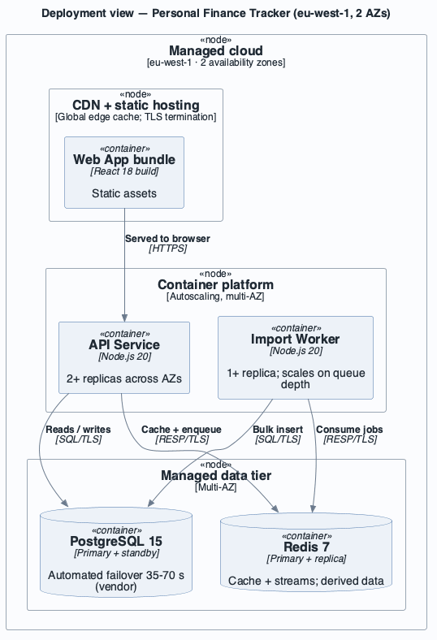

# View: Deployment (Allocation / deployment)

- **Viewtype**: Allocation
- **Style**: deployment
- **Stakeholders / concerns addressed**: operations (what runs where, how it survives failure —
  `AQA-1`), finance (`BG-4` cost), security (network boundaries, `CON-4`)
- **Date**: 2026-09-06

## 1. Primary presentation

```plantuml
@startuml view-allocation-deployment-01
!include ../../../../skills/sei-diagrams/assets/c4/C4_Deployment.puml
!include ../../../../skills/sei-diagrams/assets/c4/sei-c4-palette.puml
LAYOUT_TOP_DOWN()
title Deployment view — Personal Finance Tracker (eu-west-1, 2 AZs)
Deployment_Node(cloud, "Managed cloud", "eu-west-1 · 2 availability zones") {
  Deployment_Node(edge, "CDN + static hosting", "Global edge cache; TLS termination") {
    Container(spa, "Web App bundle", "React 18 build", "Static assets")
  }
  Deployment_Node(platform, "Container platform", "Autoscaling, multi-AZ") {
    Container(api, "API Service", "Node.js 20", "2+ replicas across AZs")
    Container(worker, "Import Worker", "Node.js 20", "1+ replica; scales on queue depth")
  }
  Deployment_Node(datatier, "Managed data tier", "Multi-AZ") {
    ContainerDb(db, "PostgreSQL 15", "Primary + standby", "Automated failover 35-70 s (vendor)")
    ContainerDb(redis, "Redis 7", "Primary + replica", "Cache + streams; derived data")
  }
}
Rel(spa, api, "Served to browser", "HTTPS")
Rel(api, db, "Reads / writes", "SQL/TLS")
Rel(api, redis, "Cache + enqueue", "RESP/TLS")
Rel(worker, redis, "Consume jobs", "RESP/TLS")
Rel(worker, db, "Bulk insert", "SQL/TLS")
@enduml
```



_visually verified: yes · relative path renders on GitHub / GitLab_

## 2. Element catalog

### 2.1 Elements and their properties

| Environment element | Hosts | Properties |
|---------------------|-------|------------|
| CDN + static hosting | Web App bundle | global edge cache; TLS termination |
| Container platform | API Service, Import Worker | autoscaling; replicas pinned across 2 AZs; rolling deploys |
| Managed data tier — PostgreSQL | Primary Database | primary + standby in separate AZs; automated failover 35–70 s (vendor); PITR backups |
| Managed data tier — Redis | Read Cache + Import Queue | primary + replica; not a system of record |

### 2.2 Relations and their properties

| From | Relation | To | Properties |
|------|----------|----|-----------|
| API Service replica | allocated-to | Container platform (AZ-a / AZ-b) | ≥ 1 replica per AZ |
| Import Worker | allocated-to | Container platform | scales on queue depth |
| Primary Database | allocated-to | data tier, AZ-a (primary), AZ-b (standby) | sync or near-sync replication |
| Redis | allocated-to | data tier, AZ-a (primary), AZ-b (replica) | async replication acceptable (derived data) |

### 2.3 Element interfaces

Network: only the CDN and the container platform's load balancer are public; the data tier is
private-subnet only. All hops use TLS (`CON-4`).

### 2.4 Element behavior

On an AZ-a loss: the load balancer drains AZ-a API replicas, the DB standby in AZ-b is promoted,
Redis fails over to its AZ-b replica; the API is stateless so no session loss.

## 3. Context diagram

Outside this view: the user's device/network and the email provider's infrastructure.

## 4. Variability guide

- **Region**: single region at launch; a second region is a future option — no region-partitioning
  seam exists yet (ATAM risk `R-6`).
- **Tier sizing**: instance classes and replica counts are environment config; the topology is fixed.
- **Redis split**: cache and streams share one Redis at launch; they can be split onto two
  instances by config without code change.

## 5. Rationale

- Stateless API replicas across two AZs plus a managed primary/standby database with automated
  failover is the cheapest topology that meets `AQA-1` (recover < 60 s, ≥ 99.5 %/mo) on the
  low-cost managed tiers required by `CON-3` and within `BG-4`'s budget ([`rationale.md`](rationale.md) ADR-3).
- Putting only the CDN and load balancer in public subnets shrinks the attack surface for
  `SQA-1` / `CON-4`.
- The measured failover time is not yet verified against the 60 s target — tracked as ATAM risk
  `R-3`; a game-day test is scheduled before launch.

---

**Navigation**: [docs README](README.md) · [example root](../README.md) · [drivers](../drivers/README.md) · [ADD architecture](../add/personal-finance-tracker-Architecture.md)
