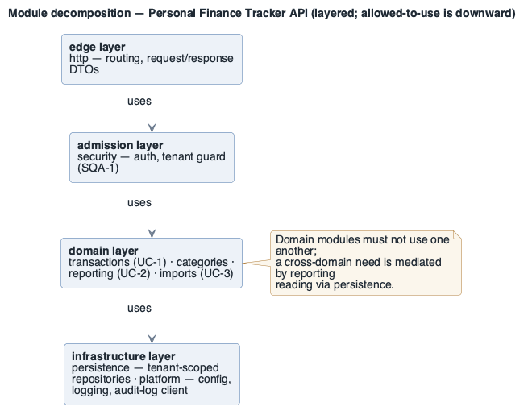

# View: Module decomposition  (Module / decomposition)

- **Viewtype**: Module
- **Style**: decomposition (with a dependency overlay)
- **Stakeholders / concerns addressed**: new developers (where code lives), architect (allowed
  dependencies), project lead (ownership), maintainer (change impact — `MQA-1`)
- **Date**: 2026-09-06

## 1. Primary presentation

Source: [`diagrams/view-module-decomposition-01.puml`](diagrams/view-module-decomposition-01.puml)
· rendered + visually verified.

> The **allowed-to-use** relation is shown between layers. `platform` is a cross-cutting utility
> used by every layer above it; those edges are omitted to keep the primary presentation legible
> (§2.2 lists them). Domain modules must not use one another.

_visually verified: yes · relative path renders on GitHub / GitLab_

Legend: [`diagrams/legend.png`](diagrams/legend.png) — what shape and colour mean (SEI palette), shared by every view in this package.

## 2. Element catalog

### 2.1 Elements and their properties

| Element | Responsibility / role | Owner | Key properties |
|---------|-----------------------|-------|----------------|
| `http` | HTTP routing, request validation, DTO mapping | Eng lead | no business logic; depends only on `security` |
| `security` | Authentication, session handling, **tenant guard** (forces `user_id` scoping) | Eng lead | the only module allowed to admit a request to the domain modules |
| `transactions` | `UC-1` create/edit/delete transactions | Eng lead | pure domain + calls to `persistence` |
| `categories` | User-defined categories | Eng lead | domain + `persistence` |
| `reporting` | `UC-2` dashboard aggregates; **report-type registry** (extension point for `MQA-1`) | Eng lead | new report types are added here without touching other modules |
| `imports` | `UC-3` CSV parse, column mapping, bulk insert; queue consumer entry point | Eng lead | uses `persistence`; runs in-process or as the worker |
| `persistence` | Tenant-scoped repositories, query builder, migrations | Eng lead | every query is parameterised and `user_id`-scoped |
| `platform` | Config, structured logging, append-only audit-log client, metrics | Eng lead | no dependencies on domain modules |

### 2.2 Relations and their properties

| From | Relation | To | Properties |
|------|----------|----|-----------|
| `http` | depends-on | `security` | the only downward edge from `http` |
| `security` | depends-on | each domain module | admits requests after tenant scoping |
| domain modules | depends-on | `persistence`, `platform` | never on each other |
| `persistence` | depends-on | `platform` | logging, config only |

**Allowed-dependency rule**: `http → security → {domain} → persistence → platform`. Domain modules
must not depend on one another; a cross-domain need is mediated by `reporting` reading via
`persistence`. Enforced in CI by a dependency-check rule.

### 2.3 Element interfaces

Module APIs are internal TypeScript module boundaries. The externally visible HTTP interface is in
the ADD [`../add/personal-finance-tracker-Architecture.md`](../add/personal-finance-tracker-Architecture.md) §8.

### 2.4 Element behavior

Runtime collaboration for the dashboard flow is the sequence diagram in the ADD `Architecture.md` §6.

## 3. Context diagram

This view covers the `api-service` deployable only. The `Web App` (React) and the `Import Worker`
process are outside it; the worker reuses the `imports` and `persistence` modules as a library.

## 4. Variability guide

- **Report types**: registered in `reporting` via a `ReportType` registry entry — add a class +
  a registry line, no other module changes (`MQA-1`).
- **Storage engine**: `persistence` isolates the query builder; swapping the SQL dialect is
  contained here (`CON-5` currently pins PostgreSQL).
- **Import formats**: `imports` has a `StatementParser` strategy; new bank formats are new
  strategy classes.

## 5. Rationale

- The `security` module is the **single choke point** for tenant scoping so `SQA-1` is enforced
  structurally and is auditable in one place (see [`rationale.md`](rationale.md) ADR-2). The alternative —
  per-endpoint checks in `http` — was rejected as too easy to miss.
- Forbidding domain-to-domain dependencies keeps change impact local, serving `MQA-1`
  (add a report type in ≤ 1 person-day, 0 regressions).
- `platform` has no domain dependencies so it can be extracted to a shared library later without
  untangling business code.

---

**Navigation**: [docs README](README.md) · [example root](../README.md) · [drivers](../drivers/README.md) · [ADD architecture](../add/personal-finance-tracker-Architecture.md)
