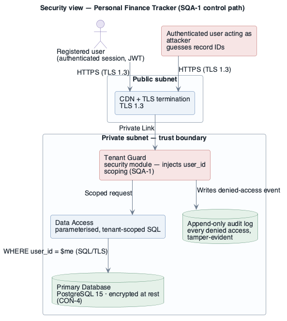

# View: Security  (Quality view)

- **Kind**: quality view — assembled by extracting the security-relevant pieces of the Module,
  C&C and Allocation views into one place for the security / audit concern.
- **Stakeholders / concerns addressed**: security advisor, SOC 2 auditor (`BG-2`), operations —
  *where is confidentiality enforced, how are attempts recorded, what is the trust boundary?*
- **Date**: 2026-09-06

## 1. Primary presentation

```plantuml
@startuml view-security-01
!include ../../../../skills/sei-diagrams/assets/plantuml-theme.puml
skinparam linetype ortho
hide stereotype
title Security view — Personal Finance Tracker (SQA-1 control path)

actor "Registered user\n(authenticated session, JWT)" as user
rectangle "Authenticated user acting as attacker\nguesses record IDs" as attacker <<emphasis>>

rectangle "Public subnet" as pub {
  rectangle "CDN + TLS termination\nTLS 1.3" as cdn
}
rectangle "Private subnet — trust boundary" as priv {
  rectangle "Tenant Guard\nsecurity module — injects user_id scoping (SQA-1)" as guard <<emphasis>>
  rectangle "Data Access\nparameterised, tenant-scoped SQL" as da
  database "Append-only audit log\nevery denied access, tamper-evident" as audit
  database "Primary Database\nPostgreSQL 15 · encrypted at rest (CON-4)" as db
}

user     --> cdn   : HTTPS (TLS 1.3)
attacker --> cdn   : HTTPS (TLS 1.3)
cdn      --> guard : Private Link
guard    --> da    : Scoped request
guard    --> audit : Writes denied-access event
da       --> db    : WHERE user_id = $me (SQL/TLS)
@enduml
```



_visually verified: yes · relative path renders on GitHub / GitLab_

## 2. Element catalog

### 2.1 Elements and their properties

| Element | Security role | Key properties |
|---------|--------------|----------------|
| CDN + TLS termination | terminates TLS; only public-facing element | TLS 1.3; forwards over Private Link only |
| Tenant Guard (`security` module) | **the SQA-1 control** — forces `user_id` scoping onto every request before any domain code runs | single, auditable choke point; not bypassable on the interactive path |
| Data Access | executes only parameterised, `user_id`-scoped SQL | no dynamic SQL; the `WHERE user_id = $me` clause is injected, not caller-supplied |
| Append-only audit log | records every denied cross-user access attempt | append-only store; retained for the SOC 2 observation window; alert within 1 min |
| Primary Database | system of record | encrypted at rest (`CON-4`); reachable only from the private subnet |

### 2.2 Relations and their properties

| From | Relation | To | Properties |
|------|----------|----|-----------|
| CDN | forwards-to | Tenant Guard | Private Link; HttpOnly; no direct Internet path to the guard |
| Tenant Guard | writes-to | Audit log | one event per denied access; before the request is rejected |
| Data Access | queries | Primary Database | every statement `user_id`-scoped; TLS |

### 2.3 Element interfaces

The Tenant Guard's contract (four agreement points — see `references/interfaces.md`):
- **scope**: every inbound request; the guard *is* the actor for every domain module.
- **interaction style**: synchronous, in-process middleware; fail-closed (deny on any error).
- **data representation**: the authenticated `user_id` is taken from the verified JWT, never
  from a request parameter.
- **error model**: unauthorised → `403`, event written to the audit log, alert raised; the
  request never reaches a domain module.

### 2.4 Element behavior

Denied-access sequence: the attacker requests another user's transaction by ID → the Tenant
Guard scopes the query to the attacker's own `user_id` → the row is not found → `403` returned →
a denied-access event is written to the append-only audit log and an alert is raised within
1 minute. 0 rows of another tenant's data are ever returned.

## 3. Context diagram

Outside this view: the user's device, and the email provider (security alerts are delivered by
the API Service via SMTP — omitted here to keep the control path clear).

## 4. Variability guide

- **Audit sink**: the append-only store is configurable (managed log service vs. an
  append-only table); the tamper-evidence mechanism is a variation point tracked as ATAM risk
  `R-2`.
- **Row-level security**: PostgreSQL RLS is a future alternative to the in-app Tenant Guard;
  the `Data Access` module isolates the choice.

## 5. Rationale

- One **Tenant Guard** choke point makes `SQA-1` enforceable and auditable in a single place;
  per-endpoint checks were rejected as too easy to omit (`rationale.md` ADR-2).
- Encryption in transit and at rest satisfies `CON-4` and shrinks the SOC 2 boundary for
  `BG-2`.
- Keeping only the CDN in a public subnet minimises the attack surface for `SQA-1`.

---

**Navigation**: [docs README](README.md) · [example root](../README.md) ·
[drivers](../drivers/README.md) · [ADD architecture](../add/personal-finance-tracker-Architecture.md)
