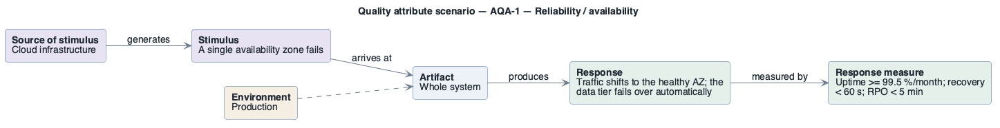

# AQA-1: Survive a single-AZ failure

- **Status**: open
- **Source**: authored here (kept in sync with `../../scenarios.md`)

Documented as a **six-part quality attribute scenario** and supported by its own **horizontal
six-part scenario diagram**.

| Part | Value |
|------|-------|
| **ID** | AQA-1 |
| **ISO/IEC 25010 characteristic** | Reliability |
| **Sub-characteristic** | availability |
| **Source of stimulus** | Cloud infrastructure |
| **Stimulus** | A single availability zone fails |
| **Artifact** | Whole system |
| **Environment** | Production |
| **Response** | Traffic shifts to the healthy AZ; the data tier fails over automatically |
| **Response measure** | Uptime ≥ 99.5 %/month; recovery < 60 s; RPO < 5 min |
| **Business goals supported** | BG-1, BG-4 |
| **Priority** | Importance = H · Difficulty = H |
| **Type** | concrete |

## Six-part scenario diagram

Drawn with the house PlantUML pattern (this is the PlantUML tree): five boxes left-to-right — source of stimulus → stimulus → artifact → response → response measure — with the environment attached to the artifact.

```plantuml
@startuml scenario-AQA-1
!include ../../../../../skills/sei-diagrams/assets/plantuml-theme.puml
left to right direction
hide stereotype
title Quality attribute scenario — AQA-1 — Reliability / availability
rectangle "<b>Source of stimulus</b>
Cloud infrastructure" as SRC #E7E3F3
rectangle "<b>Stimulus</b>
A single availability zone fails" as STIM #E7E3F3
rectangle "<b>Artifact</b>
Whole system" as ART #EDF2F8
rectangle "<b>Response</b>
Traffic shifts to the healthy AZ; the data tier fails over automatically" as RESP #E4F0E9
rectangle "<b>Response measure</b>
Uptime >= 99.5 %/month; recovery < 60 s; RPO < 5 min" as MEAS #E4F0E9
rectangle "<b>Environment</b>
Production" as ENV #F5EEE3
SRC  --> STIM : generates
STIM --> ART  : arrives at
ART  --> RESP : produces
RESP --> MEAS : measured by
ENV  ..> ART
@enduml
```



## Notes / assumptions

See [`../README.md`](../README.md) for traceability and the utility tree.

---

**Navigation**: [quality-attributes index](README.md) · [drivers README](../README.md) · [utility tree](utility-tree.md)
