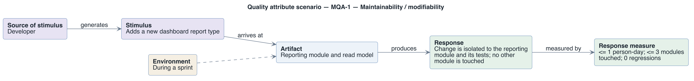

# MQA-1: Cheap to add a report type

- **Status**: open
- **Source**: authored here (kept in sync with [`../../quality-attributes/scenarios.md`](../../quality-attributes/scenarios.md))

Documented as a **six-part quality attribute scenario** and supported by its own **horizontal
six-part scenario diagram**.

| Part | Value |
|------|-------|
| **ID** | MQA-1 |
| **ISO/IEC 25010 characteristic** | Maintainability |
| **Sub-characteristic** | modifiability |
| **Source of stimulus** | Developer |
| **Stimulus** | Adds a new dashboard report type |
| **Artifact** | Reporting module and read model |
| **Environment** | During a sprint |
| **Response** | Change is isolated to the reporting module and its tests; no other module is touched |
| **Response measure** | ≤ 1 person-day; ≤ 3 modules touched; 0 regressions |
| **Business goals supported** | BG-3 |
| **Priority** | Importance = M · Difficulty = M |
| **Candidate tactics** | **Modifiability** — *reduce coupling*: encapsulate, restrict dependencies, abstract common services; *increase cohesion*: increase semantic coherence; *defer binding*: runtime binding through a report-type registry |
| **Type** | concrete |

## Six-part scenario diagram

Read left to right: the source of stimulus produces the stimulus, which arrives at the artifact in
the environment shown; the artifact's response follows, and the last box is how it is measured.

Source: [`diagrams/scenario-MQA-1.puml`](diagrams/scenario-MQA-1.puml).

## Notes / assumptions

See [`../README.md`](../README.md) for traceability and the utility tree.

---

**Navigation**: [quality-attributes index](README.md) · [drivers README](../README.md) · [utility tree](utility-tree.md)
