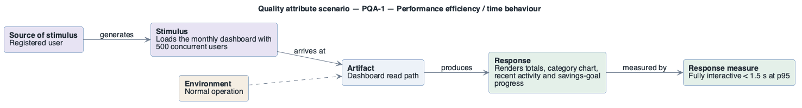

# PQA-1: Dashboard fast under load

- **Status**: open
- **Source**: authored here (kept in sync with [`../../quality-attributes/scenarios.md`](../../quality-attributes/scenarios.md))

Documented as a **six-part quality attribute scenario** and supported by its own **horizontal
six-part scenario diagram**.

| Part | Value |
|------|-------|
| **ID** | PQA-1 |
| **ISO/IEC 25010 characteristic** | Performance efficiency |
| **Sub-characteristic** | time behaviour |
| **Source of stimulus** | Registered user |
| **Stimulus** | Loads the monthly dashboard with 500 concurrent users |
| **Artifact** | Dashboard read path |
| **Environment** | Normal operation |
| **Response** | Renders totals, category chart, recent activity and savings-goal progress |
| **Response measure** | Fully interactive < 1.5 s at p95 |
| **Business goals supported** | BG-1 |
| **Priority** | Importance = H · Difficulty = M |
| **Type** | concrete |

## Six-part scenario diagram

Drawn with the house PlantUML pattern (this is the PlantUML tree): five boxes left-to-right — source of stimulus → stimulus → artifact → response → response measure — with the environment attached to the artifact.

Source: [`diagrams/scenario-PQA-1.puml`](diagrams/scenario-PQA-1.puml) · rendered + visually verified.

## Notes / assumptions

See [`../README.md`](../README.md) for traceability and the utility tree.

---

**Navigation**: [quality-attributes index](README.md) · [drivers README](../README.md) · [utility tree](utility-tree.md)
