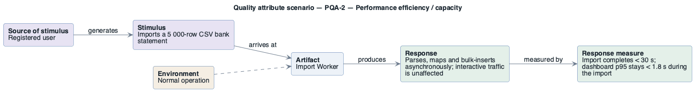

# PQA-2: Bulk import stays responsive

- **Status**: open
- **Source**: authored here (kept in sync with [`../../quality-attributes/scenarios.md`](../../quality-attributes/scenarios.md))

Documented as a **six-part quality attribute scenario** and supported by its own **horizontal
six-part scenario diagram**.

| Part | Value |
|------|-------|
| **ID** | PQA-2 |
| **ISO/IEC 25010 characteristic** | Performance efficiency |
| **Sub-characteristic** | capacity |
| **Source of stimulus** | Registered user |
| **Stimulus** | Imports a 5 000-row CSV bank statement |
| **Artifact** | Import Worker |
| **Environment** | Normal operation |
| **Response** | Parses, maps and bulk-inserts asynchronously; interactive traffic is unaffected |
| **Response measure** | Import completes < 30 s; dashboard p95 stays < 1.8 s during the import |
| **Business goals supported** | BG-1 |
| **Priority** | Importance = M · Difficulty = M |
| **Candidate tactics** | **Performance** — *control resource demand*: manage work requests (bound the arrival rate), prioritize events, bound execution times; *manage resources*: introduce concurrency (asynchronous import worker), bound queue sizes, schedule resources |
| **Type** | concrete |

## Six-part scenario diagram

Read left to right: the source of stimulus produces the stimulus, which arrives at the artifact in
the environment shown; the artifact's response follows, and the last box is how it is measured.

Source: [`diagrams/scenario-PQA-2.puml`](diagrams/scenario-PQA-2.puml).

## Notes / assumptions

`p95` is the 95th percentile: the limit holds for 95 % of requests, and the slowest 5 % may
exceed it.

See [`../README.md`](../README.md) for traceability and the utility tree.

---

**Navigation**: [quality-attributes index](README.md) · [drivers README](../README.md) · [utility tree](utility-tree.md)
