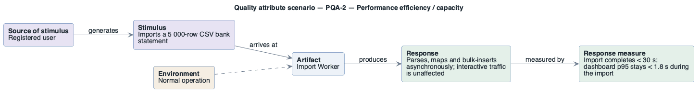

# PQA-2: Bulk import stays responsive

- **Status**: open
- **Source**: authored here (kept in sync with `../../scenarios.md`)

Documented as a **six-part quality attribute scenario** and supported by its own **horizontal
six-part scenario diagram**.

| Part | Value |
|------|-------|
| **ID** | PQA-2 |
| **ISO/IEC 25010 characteristic** | Performance efficiency |
| **Sub-characteristic** | capacity |
| **Source of stimulus** | Registered user |
| **Stimulus** | Imports a 5 000-row CSV bank statement |
| **Artifact** | Import Worker |
| **Environment** | Normal operation |
| **Response** | Parses, maps and bulk-inserts asynchronously; interactive traffic is unaffected |
| **Response measure** | Import completes < 30 s; dashboard p95 stays < 1.8 s during the import |
| **Business goals supported** | BG-1 |
| **Priority** | Importance = M · Difficulty = M |
| **Type** | concrete |

## Six-part scenario diagram

Drawn with the house PlantUML pattern (this is the PlantUML tree): five boxes left-to-right — source of stimulus → stimulus → artifact → response → response measure — with the environment attached to the artifact.

```plantuml
@startuml scenario-PQA-2
!include ../../../../../skills/sei-diagrams/assets/plantuml-theme.puml
left to right direction
hide stereotype
title Quality attribute scenario — PQA-2 — Performance efficiency / capacity
rectangle "<b>Source of stimulus</b>
Registered user" as SRC #E7E3F3
rectangle "<b>Stimulus</b>
Imports a 5 000-row CSV bank statement" as STIM #E7E3F3
rectangle "<b>Artifact</b>
Import Worker" as ART #EDF2F8
rectangle "<b>Response</b>
Parses, maps and bulk-inserts asynchronously; interactive traffic is unaffected" as RESP #E4F0E9
rectangle "<b>Response measure</b>
Import completes < 30 s; dashboard p95 stays < 1.8 s during the import" as MEAS #E4F0E9
rectangle "<b>Environment</b>
Normal operation" as ENV #F5EEE3
SRC  --> STIM : generates
STIM --> ART  : arrives at
ART  --> RESP : produces
RESP --> MEAS : measured by
ENV  ..> ART
@enduml
```



## Notes / assumptions

See [`../README.md`](../README.md) for traceability and the utility tree.

---

**Navigation**: [quality-attributes index](README.md) · [drivers README](../README.md) · [utility tree](utility-tree.md)
