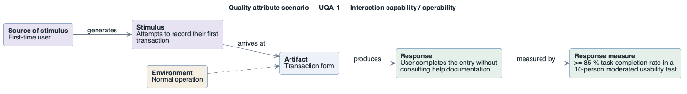

# UQA-1: First transaction without help

- **Status**: open
- **Source**: authored here (kept in sync with [`../../quality-attributes/scenarios.md`](../../quality-attributes/scenarios.md))

Documented as a **six-part quality attribute scenario** and supported by its own **horizontal
six-part scenario diagram**.

| Part | Value |
|------|-------|
| **ID** | UQA-1 |
| **ISO/IEC 25010 characteristic** | Interaction capability |
| **Sub-characteristic** | operability |
| **Source of stimulus** | First-time user |
| **Stimulus** | Attempts to record their first transaction |
| **Artifact** | Transaction form |
| **Environment** | Normal operation |
| **Response** | User completes the entry without consulting help documentation |
| **Response measure** | ≥ 85 % task-completion rate in a 10-person moderated usability test |
| **Business goals supported** | BG-1 |
| **Priority** | Importance = M · Difficulty = M |
| **Candidate tactics** | **Usability** — *support system initiative*: maintain task model, maintain user model (sensible defaults, progress feedback); *support user initiative*: cancel, undo |
| **Type** | concrete |

## Six-part scenario diagram

Drawn with the house PlantUML pattern (this is the PlantUML tree): five boxes left-to-right — source of stimulus → stimulus → artifact → response → response measure — with the environment attached to the artifact.

Source: [`diagrams/scenario-UQA-1.puml`](diagrams/scenario-UQA-1.puml) · rendered + visually verified.

## Notes / assumptions

See [`../README.md`](../README.md) for traceability and the utility tree.

---

**Navigation**: [quality-attributes index](README.md) · [drivers README](../README.md) · [utility tree](utility-tree.md)
