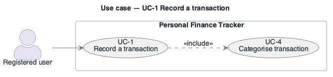

# UC-1: Record a transaction

- **Scope**: Personal Finance Tracker
- **Level**: user goal
- **Primary actor**: Registered user
- **Supporting actors**: —
- **Trigger**: The user submits the "add transaction" form
- **Preconditions**: The user is authenticated
- **Postconditions**: the requested change is persisted and the dashboard reflects it
- **Priority**: high
- **Status**: in design

## Main success scenario

1. The user enters amount, date, category and an optional note.
2. The system validates the input.
3. The system persists the transaction (tenant-scoped).
4. The system updates the affected dashboard aggregates.
5. The system confirms the save.

## Extensions / alternate flows

- **2a.** Validation fails → the system shows field-level errors and writes nothing.
- **3a.** The data store is unavailable → the write is queued and the user is told "saved, syncing".

## Architectural significance

- **Drivers exercised**: Dominates write load; sits on the p95 latency path (PQA-1); every modifiability change touches it (MQA-1); `<<include>>`s [UC-4](UC-4.md) (categorisation).

## Related drivers

`BG-1, PQA-1, MQA-1, CON-4`

## Use case diagram

Native PlantUML `usecase` notation (this is the PlantUML tree): stick-figure actors outside the
boundary rectangle, ellipse use cases inside, dashed `<<include>>` dependency. Source:
[`diagrams/UC-1.puml`](diagrams/UC-1.puml) · rendered + visually verified.

Source: [`diagrams/UC-1.puml`](diagrams/UC-1.puml) · rendered + visually verified.

---

**Navigation**: [use-cases index](README.md) · [drivers README](../README.md)
