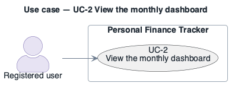

# UC-2: View the monthly dashboard

- **Scope**: Personal Finance Tracker
- **Level**: user goal
- **Primary actor**: Registered user
- **Supporting actors**: —
- **Trigger**: The user opens the app or navigates to "Dashboard"
- **Preconditions**: The user is authenticated and has zero or more transactions
- **Postconditions**: the requested change is persisted and the dashboard reflects it
- **Priority**: high
- **Status**: open

## Main success scenario

1. The system loads the user's month-to-date aggregates.
2. The system renders totals, a category breakdown chart, recent transactions and savings-goal progress.

## Extensions / alternate flows

- **1a.** Aggregates cache miss → the system recomputes from the tenant-scoped transaction store and repopulates the cache.

## Architectural significance

- **Drivers exercised**: The performance-critical read path (PQA-1); shapes the read-model / caching decision; first-use experience (UQA-1).

## Related drivers

`BG-1, PQA-1, UQA-1`

## Use case diagram

Native PlantUML `usecase` notation (this is the PlantUML tree): stick-figure actors outside the
boundary rectangle, ellipse use cases inside, dashed `<<include>>` dependency. Source:
[`diagrams/UC-2.puml`](diagrams/UC-2.puml) · rendered + visually verified.

```plantuml
@startuml UC-2
!include ../../../../../skills/sei-diagrams/assets/plantuml-theme.puml
skinparam actorStyle awesome
left to right direction
title Use case — UC-2 View the monthly dashboard
actor "Registered user" as pa
rectangle "Personal Finance Tracker" {
  usecase "UC-2
View the monthly dashboard" as uc2
}
pa --> uc2
@enduml
```



---

**Navigation**: [use-cases index](README.md) · [drivers README](../README.md)
