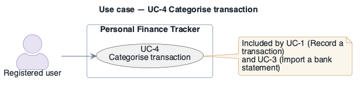

# UC-4: Categorise transaction

- **Scope**: Personal Finance Tracker
- **Level**: subfunction (shared `<<include>>` flow)
- **Primary actor**: Registered user
- **Supporting actors**: —
- **Trigger**: Reached only via `<<include>>` from [UC-1](UC-1.md) (record a transaction) or
  [UC-3](UC-3.md) (import a bank statement) — it has no independent entry point.
- **Preconditions**: A transaction (or a batch of imported rows) exists and needs a category.
- **Postconditions**: Every transaction in scope has a category assigned.
- **Priority**: high
- **Status**: in design

## Main success scenario

1. The system suggests a category based on the payee / description.
2. The user accepts the suggestion or picks a different category.
3. The system stores the category against the transaction(s).

## Extensions / alternate flows

- **1a.** No suggestion available → the user picks from the full category list.
- **2a.** (UC-3 only) Bulk import → the user can apply one category to all matching rows at once.

## Architectural significance

- **Drivers exercised**: Shared by the two highest-volume write paths (UC-1, UC-3); a single
  categorisation rule/engine change must be consistent across both.
- **Notes**: Modelled as its own use case (rather than inline in UC-1 / UC-3) because it is
  reused by two independent parents — giving it a single stable code keeps both `<<include>>`
  diagrams and this description consistent instead of drifting into per-parent labels
  (the earlier draft mislabelled it `UC-1a` in one diagram and `UC-3a` in the other).

## Related drivers

`BG-1, PQA-1, PQA-2`

## Use case diagram

Native PlantUML `usecase` notation (this is the PlantUML tree): stick-figure actor outside the
boundary rectangle, ellipse use case inside. Source:
[`diagrams/UC-4.puml`](diagrams/UC-4.puml) · rendered + visually verified.

Source: [`diagrams/UC-4.puml`](diagrams/UC-4.puml) · rendered + visually verified.

---

**Navigation**: [use-cases index](README.md) · [drivers README](../README.md)
