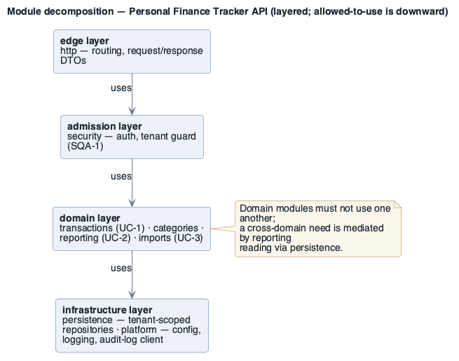

# Personal Finance Tracker — Architecture Package

> Generated 2026-09-22 · 2 source file(s)

## Contents

- [Architectural Drivers — Personal Finance Tracker](#architectural-drivers--personal-finance-tracker)
  - [Driver inventory](#driver-inventory)
    - [Business goals — [`business-goals/`](../drivers/business-goals/README.md)](#business-goals--business-goalsbusiness-goalsreadmemd)
    - [Use cases — [`use-cases/`](../drivers/use-cases/README.md)  (primary functional requirements)](#use-cases--use-casesuse-casesreadmemd--primary-functional-requirements)
    - [Constraints — [`constraints/`](../drivers/constraints/README.md)](#constraints--constraintsconstraintsreadmemd)
    - [Architectural concerns — [`concerns/`](../drivers/concerns/README.md)  (ADD input; not traced to a BG)](#architectural-concerns--concernsconcernsreadmemd--add-input-not-traced-to-a-bg)
    - [Quality attribute scenarios — [`quality-attributes/`](../drivers/quality-attributes/README.md)](#quality-attribute-scenarios--quality-attributesquality-attributesreadmemd)
  - [Traceability matrix](#traceability-matrix)
  - [Prioritised driver list (input to ADD / ATAM)](#prioritised-driver-list-input-to-add--atam)
  - [Change log](#change-log)
- [Architecture: Personal Finance Tracker](#architecture-personal-finance-tracker)
  - [1. Introduction](#1-introduction)
  - [2. Context diagram](#2-context-diagram)
    - [Diagram](#diagram)
    - [Description](#description)
  - [3. Architectural drivers](#3-architectural-drivers)
    - [Quality Attribute Scenarios (key)](#quality-attribute-scenarios-key)
    - [Primary functional requirements — use cases (key)](#primary-functional-requirements--use-cases-key)
    - [Constraints (key)](#constraints-key)
  - [4. Container diagram](#4-container-diagram)
    - [Diagram](#diagram-1)
    - [Description](#description-1)
  - [5. Component and module views](#5-component-and-module-views)
    - [API Service](#api-service)
      - [Diagram](#diagram-2)
      - [Description](#description-2)
    - [Module decomposition](#module-decomposition)
      - [Diagram](#diagram-3)
      - [Description](#description-3)
  - [6. Sequence diagrams](#6-sequence-diagrams)
  - [7. Deployment diagram](#7-deployment-diagram)
    - [Diagram](#diagram-4)
    - [Description](#description-4)
  - [8. Interfaces and events](#8-interfaces-and-events)
    - [Interfaces](#interfaces)
    - [`POST /transactions` — full interface spec (the four agreement points)](#post-transactions--full-interface-spec-the-four-agreement-points)
    - [Events](#events)
  - [9. Design decisions](#9-design-decisions)

---

# Architectural Drivers — Personal Finance Tracker

- **Date**: 2026-09-06
- **Owner**: Roman Tymoshuk
- **Status**: reviewed
- **QA model**: ISO/IEC 25010:2023
- **Design purpose**: greenfield system
- **Stakeholders**: [stakeholders.md](../drivers/stakeholders.md) (ST-1 … ST-6)

> The top aggregate file of `drivers/`. One file per driver lives under
> [`business-goals/`](../drivers/business-goals/README.md), [`use-cases/`](../drivers/use-cases/README.md),
> [`constraints/`](../drivers/constraints/README.md), [`quality-attributes/`](../drivers/quality-attributes/README.md),
> [`concerns/`](../drivers/concerns/README.md);
> each of those has its own `README.md` index. This file holds the ID legend, the traceability
> matrix, the coverage check, the prioritised list, and the change log.

## Driver inventory

### Business goals — [`business-goals/`](../drivers/business-goals/README.md)
| ID | Goal (short) | File |
|----|--------------|------|
| BG-1 | 10 000 active users within 12 months (seed metrics) | [BG-1](../drivers/business-goals/BG-1.md) |
| BG-2 | Pass SOC 2 Type II to sell to employers | [BG-2](../drivers/business-goals/BG-2.md) |
| BG-3 | Ship a new report type every week | [BG-3](../drivers/business-goals/BG-3.md) |
| BG-4 | Keep the infra bill within budget at launch scale | [BG-4](../drivers/business-goals/BG-4.md) |

### Use cases — [`use-cases/`](../drivers/use-cases/README.md)  (primary functional requirements)
| ID | Use case | Primary actor | Diagram | File |
|----|----------|---------------|---------|------|
| UC-1 | Record a transaction | Registered user | [diagram](../drivers/use-cases/diagrams/UC-1.png) | [UC-1](../drivers/use-cases/UC-1.md) |
| UC-2 | View the monthly dashboard | Registered user | [diagram](../drivers/use-cases/diagrams/UC-2.png) | [UC-2](../drivers/use-cases/UC-2.md) |
| UC-3 | Import a bank statement (CSV) | Registered user | [diagram](../drivers/use-cases/diagrams/UC-3.png) | [UC-3](../drivers/use-cases/UC-3.md) |
| UC-4 | Categorise transaction (`<<include>>`d by UC-1, UC-3) | Registered user | [diagram](../drivers/use-cases/diagrams/UC-4.png) | [UC-4](../drivers/use-cases/UC-4.md) |

Overview use case diagram: [`use-cases/diagrams/overview-core.png`](../drivers/use-cases/diagrams/overview-core.png)
(native PlantUML — this is the PlantUML tree).

### Constraints — [`constraints/`](../drivers/constraints/README.md)
| ID | Type | Constraint (short) | Hard / negotiable | File |
|----|------|--------------------|-------------------|------|
| CON-1 | technical | Mobile web only at launch | hard | [CON-1](../drivers/constraints/CON-1.md) |
| CON-2 | business | One engineer, 3-month MVP | hard | [CON-2](../drivers/constraints/CON-2.md) |
| CON-3 | business | Low-cost managed cloud tiers | negotiable | [CON-3](../drivers/constraints/CON-3.md) |
| CON-4 | regulatory | Encryption in transit and at rest | hard | [CON-4](../drivers/constraints/CON-4.md) |
| CON-5 | technical | PostgreSQL primary datastore | negotiable | [CON-5](../drivers/constraints/CON-5.md) |

### Architectural concerns — [`concerns/`](../drivers/concerns/README.md)  (ADD input; not traced to a BG)

| ID | Concern (short) | Kind | Priority | File |
|----|-----------------|------|:--------:|------|
| AC-1 | Keep the SOC 2 surface small | general | high | [AC-1](../drivers/concerns/AC-1.md) |
| AC-2 | Dashboard iteration speed must stay high | general | medium | [AC-2](../drivers/concerns/AC-2.md) |

### Quality attribute scenarios — [`quality-attributes/`](../drivers/quality-attributes/README.md)
| ID | ISO 25010 characteristic / sub | One-line scenario | (V, R) | Diagram | File |
|----|-------------------------------|-------------------|:------:|---------|------|
| AQA-1 | Reliability / availability | Single-AZ failure recovers < 60 s; ≥ 99.5 %/mo | (H, H) | [scenario](../drivers/quality-attributes/diagrams/scenario-AQA-1.png) | [AQA-1](../drivers/quality-attributes/AQA-1.md) |
| PQA-1 | Performance efficiency / time behaviour | Dashboard < 1.5 s @ p95, 500 concurrent | (H, M) | [scenario](../drivers/quality-attributes/diagrams/scenario-PQA-1.png) | [PQA-1](../drivers/quality-attributes/PQA-1.md) |
| PQA-2 | Performance efficiency / capacity | 5 000-row CSV import < 30 s, interactive unaffected | (M, M) | [scenario](../drivers/quality-attributes/diagrams/scenario-PQA-2.png) | [PQA-2](../drivers/quality-attributes/PQA-2.md) |
| SQA-1 | Security / confidentiality | Cross-user access rejected + logged; 0 reads | (H, H) | [scenario](../drivers/quality-attributes/diagrams/scenario-SQA-1.png) | [SQA-1](../drivers/quality-attributes/SQA-1.md) |
| MQA-1 | Maintainability / modifiability | Add a report type in ≤ 1 person-day, 0 regressions | (M, M) | [scenario](../drivers/quality-attributes/diagrams/scenario-MQA-1.png) | [MQA-1](../drivers/quality-attributes/MQA-1.md) |
| UQA-1 | Interaction capability / operability | First transaction without help; ≥ 85 % completion | (M, M) | [scenario](../drivers/quality-attributes/diagrams/scenario-UQA-1.png) | [UQA-1](../drivers/quality-attributes/UQA-1.md) |

**Utility tree** (summary of the quality attributes in these drivers, **as a table**):
[`quality-attributes/utility-tree.md`](../drivers/quality-attributes/utility-tree.md) — columns
*Quality attribute · Refinement (concern) · Leaf scenario · Priority (V, R) · Status*, one leaf
per row, `★` on each `(H, H)` leaf. `(V, R)` = business value and technical risk (`V ≈
Importance`, `R ≈ Difficulty`). Built from the QAW Step 9; ATAM step 5 reuses it.

**QA ID legend**: AQA availability · RQA reliability(other) · PQA performance · SQA security ·
SFQA safety · MQA modifiability · MNQA maintainability(other) · TQA testability · UQA usability ·
IQA interoperability · CQA compatibility · SCQA scalability · DQA deployability · PTQA portability
· ADQA adaptability · OQA observability · EQA energy · INQA integrability · FQA functional-suitability.
Never `QAS-`.

## Traceability matrix

| Driver | File | Supports BG | Realised / constrained by | Addressed in | Status |
|--------|------|-------------|---------------------------|--------------|--------|
| UC-1 | [UC-1](../drivers/use-cases/UC-1.md) | BG-1, BG-3 | PQA-1, MQA-1, CON-4 | ADD iter 1 | in design |
| UC-2 | [UC-2](../drivers/use-cases/UC-2.md) | BG-1 | PQA-1, UQA-1 | ADD iter 2 | open |
| UC-3 | [UC-3](../drivers/use-cases/UC-3.md) | BG-1 | PQA-2 | ADD iter 3 | open |
| UC-4 | [UC-4](../drivers/use-cases/UC-4.md) | BG-1 | UC-1, UC-3 (`<<include>>`) | ADD iter 1 | in design |
| AQA-1 | [AQA-1](../drivers/quality-attributes/AQA-1.md) | BG-1, BG-4 | CON-3, CON-5 | ADD iter 1 | at risk |
| PQA-1 | [PQA-1](../drivers/quality-attributes/PQA-1.md) | BG-1 | UC-1, UC-2 | ADD iter 2 | open |
| PQA-2 | [PQA-2](../drivers/quality-attributes/PQA-2.md) | BG-1 | UC-3 | ADD iter 3 | open |
| SQA-1 | [SQA-1](../drivers/quality-attributes/SQA-1.md) | BG-2 | CON-4 | ADD iter 1 | at risk |
| MQA-1 | [MQA-1](../drivers/quality-attributes/MQA-1.md) | BG-3 | UC-1 | ADD iter 1 | open |
| UQA-1 | [UQA-1](../drivers/quality-attributes/UQA-1.md) | BG-1 | UC-2 | ADD iter 2 | open |
| CON-1 | [CON-1](../drivers/constraints/CON-1.md) | BG-1 | UC-1, UC-2 | ADD iter 1 | open |
| CON-2 | [CON-2](../drivers/constraints/CON-2.md) | BG-4 | — | ADD iter 1 | open |
| CON-3 | [CON-3](../drivers/constraints/CON-3.md) | BG-4 | AQA-1 | ADD iter 1 | open |
| CON-4 | [CON-4](../drivers/constraints/CON-4.md) | BG-2 | SQA-1 | ADD iter 1 | in design |
| CON-5 | [CON-5](../drivers/constraints/CON-5.md) | BG-1 | AQA-1 | ADD iter 1 | open |

`Status` ∈ open / in design / partially / addressed / at risk (set by ATAM) / retired.

**Coverage check**: every BG (BG-1…BG-4) is supported by ≥ 1 UC or QA scenario; every UC / QA
scenario / CON traces up to ≥ 1 BG. Gaps found: **none**.

## Prioritised driver list (input to ADD / ATAM)

1. [SQA-1](../drivers/quality-attributes/SQA-1.md) (H,H) — cross-user access rejected + logged; 0 reads
2. [AQA-1](../drivers/quality-attributes/AQA-1.md) (H,H) — single-AZ failure recovers < 60 s; ≥ 99.5 %/mo
3. [PQA-1](../drivers/quality-attributes/PQA-1.md) (H,M) — dashboard < 1.5 s @ p95 at 500 concurrent
4. [UC-1](../drivers/use-cases/UC-1.md) — record a transaction (write load + latency + modifiability hot spot)
5. [UC-2](../drivers/use-cases/UC-2.md) — monthly dashboard (performance-critical read path)
6. [CON-4](../drivers/constraints/CON-4.md) (hard) — encryption in transit and at rest
7. [CON-2](../drivers/constraints/CON-2.md) (hard) — one engineer, 3-month MVP

## Change log

| Date | Change |
|------|--------|
| 2026-09-06 | initial driver set; reviewed with founder + eng lead; utility tree imported from the QAW |
| 2026-09-06 | ADD iterations 1–2: UC-1, UC-4, SQA-1 → in design; concerns AC-1, AC-2 recorded |
| 2026-09-07 | ATAM: SQA-1 (R-1, R-2) and AQA-1 (R-3, R-4) → at risk; see [ATAM report](../atam/atam-report.md) |

---

**Navigation**: [architecture package](../README.md) · [stakeholders](../drivers/stakeholders.md) · [quality attribute scenarios](../quality-attributes/scenarios.md) ·
[QAW](../qaw/qaw-report.md) · [ADD architecture](../add/personal-finance-tracker-Architecture.md) ·
[ATAM](../atam/atam-report.md) · [Views & Beyond docs](../docs/README.md)

---

# Architecture: Personal Finance Tracker

- **System**: Web app for individuals to track income, expenses and savings goals.
- **Date**: 2026-09-06
- **Session**: `personal-finance-tracker-session.md`
- **Drivers**: [`../drivers/README.md`](../drivers/README.md)

## 1. Introduction

A mobile-web personal finance tracker. This document is the ADD 3.0 working architecture after
iteration 1 (overall structure, security, availability) and iteration 2 (dashboard read path).
Drivers: [`../drivers/README.md`](../drivers/README.md).

## 2. Context diagram

### Diagram

Source: [`diagrams/context.puml`](../add/diagrams/context.puml) · rendered + visually verified.

### Description

A single external dependency at launch: a transactional email provider. Everything else is owned
by the system, keeping the SOC 2 (CON-4) surface small.

## 3. Architectural drivers

### Quality Attribute Scenarios (key)

| ID | QA (ISO 25010) | Stimulus | Response | Measure | Priority |
|----|----------------|----------|----------|---------|----------|
| SQA-1 | Security / confidentiality | Cross-user data access attempt | Rejected and logged | 0 reads; 100 % logged | (H,H) |
| AQA-1 | Reliability / availability | Single-AZ failure | Recovers automatically | ≥ 99.5 %/mo; < 60 s | (H,H) |
| PQA-1 | Performance efficiency / time behaviour | 500 concurrent dashboard loads | Renders fully | < 1.5 s @ p95 | (H,M) |

### Primary functional requirements — use cases (key)

| ID | Name | Priority |
|----|------|----------|
| UC-1 | Record a transaction | high |
| UC-2 | View the monthly dashboard | high |

### Constraints (key)

| ID | Type | Description |
|----|------|-------------|
| CON-4 | regulatory | Encryption in transit (TLS 1.2+) and at rest |
| CON-5 | technical | Primary datastore is PostgreSQL |

## 4. Container diagram

### Diagram

Source: [`diagrams/container.puml`](../add/diagrams/container.puml) · rendered + visually verified.

### Description

The API service is the single write path and the single place tenant scoping (SQA-1) is enforced.
The Redis read cache serves the dashboard (PQA-1); it is a performance element, not a system of
record, so its loss degrades latency but not correctness (AQA-1).

## 5. Component and module views

### API Service

#### Diagram

Source: [`diagrams/component-api.puml`](../add/diagrams/component-api.puml) · rendered + visually verified.

#### Description

Every request passes through the Tenant Guard before any service runs, so cross-tenant access
(SQA-1) is structurally prevented rather than checked per-endpoint.

### Module decomposition

#### Diagram

Source: [`diagrams/module-decomposition.puml`](../add/diagrams/module-decomposition.puml) · rendered + visually verified.

#### Description

Four layers inside the single deployable; a layer may use only the layer below it, and the four
domain modules may not use one another (a cross-domain need is mediated by `reporting` reading
through `persistence`). The `security` layer is the one place tenant scoping is applied (SQA-1,
ADR-2); the `reporting` module's report-type registry is what keeps MQA-1 to a one-day change.
This is the seed of the Views-and-Beyond [module decomposition view](../docs/view-module-decomposition.md).

## 6. Sequence diagrams

Source: [`diagrams/sequence-dashboard.puml`](../add/diagrams/sequence-dashboard.puml) · rendered + visually verified.

On a cache hit the database is not touched, which is the common path and keeps p95 under the
1.5 s budget (PQA-1). On a miss the API recomputes from tenant-scoped rows and repopulates the
cache; a stale cache is bounded by the 15-minute TTL.

## 7. Deployment diagram

### Diagram

Source: [`diagrams/deployment.puml`](../add/diagrams/deployment.puml) · rendered + visually verified.

### Description

The API runs as stateless replicas spread across two AZs behind the platform load balancer, and
the data tier uses managed primary/standby with automated failover — together these meet AQA-1
(single-AZ failure recovers < 60 s) within the CON-3 low-cost-tier constraint.

## 8. Interfaces and events

### Interfaces

| Component | Interface | Protocol | Description |
|-----------|-----------|----------|-------------|
| API Service | `POST /transactions` | REST / HTTPS | Create a transaction (UC-1) |
| API Service | `GET /dashboard?month=` | REST / HTTPS | Monthly aggregates + recent activity (UC-2) |
| Data Access | `query(userId, spec)` | in-process | Always injects `WHERE user_id = $userId` |

### `POST /transactions` — full interface spec (the four agreement points)

The one interface `UC-1` and `SQA-1` both run through, specified per `references/interfaces.md`:

| Agreement point | Specification |
|-----------------|---------------|
| **Scope** | available to the Web App only, via the CDN + Tenant Guard; not exposed to any other actor. The Tenant Guard is the actor for the Transaction Service. |
| **Interaction style** | synchronous request/response over REST + HTTPS (TLS 1.3); idempotency key header so a client retry is safe; no long-poll. |
| **Data representation & structure** | request `{amount: integer (minor units), date: ISO-8601 date, categoryId: uuid, note?: string ≤ 280}`; response `201 {id: uuid, ...echo}`; JSON (matches the SPA's parser; compact; interceptable for debugging). `user_id` is **never** in the body — it is taken from the verified JWT. |
| **Error model** | `400` field-level validation errors (nothing written) · `401` missing/expired token · `403` cross-tenant attempt (written to the append-only audit log, alert < 1 min — `SQA-1`) · `409` duplicate idempotency key · `503` store unavailable → the client is told "saved, syncing" and the write is queued (`UC-1` 3a). |

### Events

| Event | Publisher | Consumers | Description |
|-------|-----------|-----------|-------------|
| `TransactionWritten` | Transaction Service | Cache invalidator | Triggers dashboard-aggregate invalidation for the user/month |

## 9. Design decisions

Each significant decision is an ADR in [`adr/`](../add/adr/ADR-1.md); this table is the log.

| Decision | Rationale (cite driver IDs) | Alternatives discarded | ADR |
|----------|-----------------------------|------------------------|-----|
| Single API service owns all writes and enforces tenant scoping in one middleware | SQA-1 needs one auditable choke point; CON-2 favours few moving parts | Per-service authz checks (easy to miss one) | [ADR-2](../add/adr/ADR-2.md) |
| Redis cache-aside for dashboard aggregates with 15-min TTL | PQA-1 p95 budget; DB alone won't meet it at 500 concurrent | Materialised views (slower to iterate — MQA-1); CDN caching (per-user data) | [ADR-1](../add/adr/ADR-1.md) |
| Managed PostgreSQL primary/standby, multi-AZ, automated failover | AQA-1 recovery target; CON-5 mandates PostgreSQL; CON-3 low-cost tier still offers this | Self-managed HA (CON-2 time), single instance (fails AQA-1) | [ADR-3](../add/adr/ADR-3.md) |

---

**Navigation**: [architecture package](../README.md) · [ADRs](../add/adr/ADR-1.md) · [drivers](../drivers/README.md) · [session log](../add/personal-finance-tracker-session.md) · [Views & Beyond docs](../docs/README.md) · [ATAM](../atam/atam-report.md)

