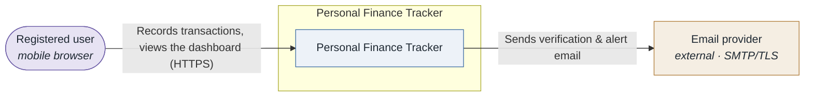
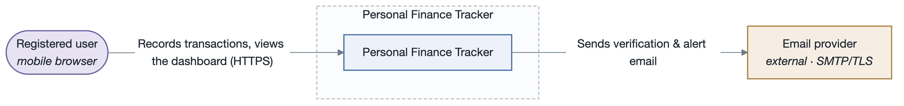

# System overview — Personal Finance Tracker

## What it does

A mobile-web application that lets an individual record income and expense transactions, organise
them into user-defined categories, see a monthly dashboard (totals, a category breakdown, recent
activity, savings-goal progress), and import transactions from a bank CSV statement.

## Context

Single-tenant-per-user SaaS. One external dependency at launch: a transactional email provider
(account verification, security alerts). No payment processing. Runs in mobile browsers; there is
no native app at launch (`CON-1`).

## Primary functional requirements (use cases)

- `UC-1` Record a transaction
- `UC-2` View the monthly dashboard
- `UC-3` Import a bank statement (CSV)

## Driving quality attribute scenarios

See `../scenarios.md` for the six-part detail. The architecture is shaped mainly by:

- `SQA-1` (security / confidentiality) — cross-user access rejected and logged; 0 successful reads.
- `AQA-1` (reliability / availability) — survive a single-AZ failure, recover < 60 s, ≥ 99.5 %/mo.
- `PQA-1` (performance / time behaviour) — dashboard interactive < 1.5 s at p95, 500 concurrent users.
- `MQA-1` (maintainability / modifiability) — add a report type in ≤ 1 person-day, 0 regressions.
