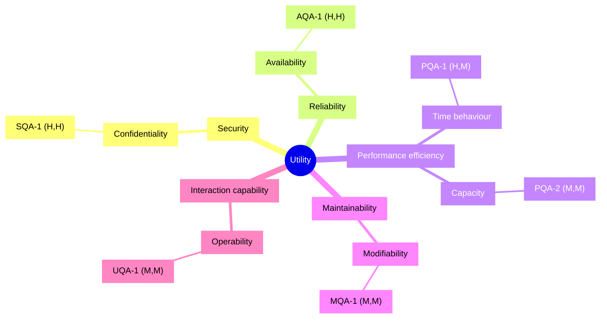
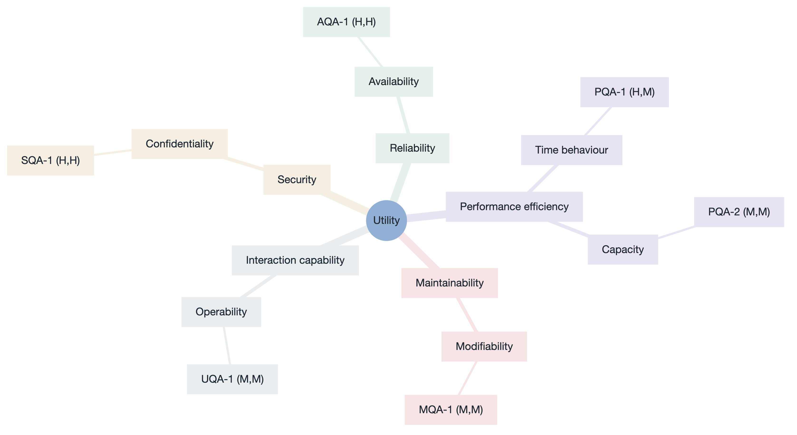

# Quality Attribute Utility Tree — Personal Finance Tracker

- **Date**: 2026-09-06
- **Built from**: the QAW refined scenarios (`../../qaw/qaw-report.md` Step 9)
- **Purpose**: the summary of the quality attributes in the architectural drivers; ATAM step 5 reuses it.

`Utility → quality attribute (ISO/IEC 25010) → refinement → scenario (Importance, Difficulty)`.
Importance = to the business (from vote ranking + business-goal weight). Difficulty = the
architect's estimate of technical/architectural challenge.

## Indented list

- **Utility**
  - **Security** (ISO/IEC 25010: Security)
    - Confidentiality
      - `(H, H)` SQA-1 — cross-user access rejected and logged; 0 successful reads
  - **Reliability** (ISO/IEC 25010: Reliability)
    - Availability
      - `(H, H)` AQA-1 — single-AZ failure recovers < 60 s; ≥ 99.5 %/month
  - **Performance efficiency** (ISO/IEC 25010: Performance efficiency)
    - Time behaviour
      - `(H, M)` PQA-1 — dashboard interactive < 1.5 s @ p95 at 500 concurrent users
    - Capacity
      - `(M, M)` PQA-2 — 5 000-row CSV import < 30 s without hurting interactive p95
  - **Maintainability** (ISO/IEC 25010: Maintainability)
    - Modifiability
      - `(M, M)` MQA-1 — add a report type in ≤ 1 person-day, ≤ 3 modules, 0 regressions
  - **Interaction capability** (ISO/IEC 25010: Interaction capability)
    - Operability
      - `(M, M)` UQA-1 — first-time user records a transaction without help; ≥ 85 % completion

## Mindmap

## Analysis targets

The `(H,H)` and `(H,M)` leaves are what ADD iterations and ATAM analysis target first:
**SQA-1, AQA-1, PQA-1**.
