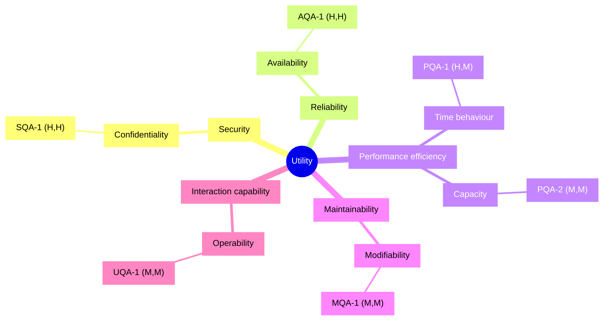

# Quality Attribute Workshop — Personal Finance Tracker

- **Date(s)**: 2026-08-20
- **Facilitator(s)**: R. Tymoshuk (lead), J. Doe (scribe)
- **Sponsor**: Founder
- **Status**: complete

> Condensed record. A real QAW runs half a day to a day; the structure below is the full method.

## Step 1 — QAW presentation and introductions

### Participants

| Name | Role | Concerns brought |
|------|------|------------------|
| Founder | Sponsor / product owner | growth, cost, SOC 2 |
| Eng lead | Architect / developer | modifiability, delivery speed, team of one |
| Contractor QA | Tester | testability, usability |
| Advisor | Security | data isolation, audit logging |
| Design partner | End-user representative | ease of first use |

### Expected outputs
Raw scenarios · consolidated scenarios · prioritised scenarios · refined (six-part) scenarios.

## Step 2 — Business / mission drivers

| ID | Business driver / goal |
|----|------------------------|
| BG-1 | 10 000 active users within 12 months |
| BG-2 | Pass a SOC 2 Type II audit to sell to employers |
| BG-3 | Ship new report types weekly |
| BG-4 | Keep the infra bill within budget at launch scale |

**Quality attributes the business named**: security, availability, performance, low change cost.
**Key functional requirements**: record transactions, monthly dashboard, CSV import.
**Constraints**: mobile web only, one engineer / 3 months, low-cost cloud tiers, encryption, PostgreSQL.

## Step 3 — Architectural plan presentation

- **System boundary**: a single web app + API + datastore; one external dependency (email).
- **Known technical constraints**: CON-1..CON-5 from the brief.
- **External systems / interfaces**: transactional email provider (SMTP).
- **Existing architectural context**: none yet — greenfield.

## Step 4 — Architectural drivers

| ID | Architectural driver | Kind (QA / FR / constraint) | Supports |
|----|----------------------|----------------------------|----------|
| AD-1 | Cross-user data isolation | QA (security) | BG-2 |
| AD-2 | Dashboard latency under load | QA (performance) | BG-1 |
| AD-3 | Survive a single-AZ failure | QA (availability) | BG-1, BG-4 |
| AD-4 | Cheap to add report types | QA (modifiability) | BG-3 |
| AD-5 | First-use success without docs | QA (usability) | BG-1 |
| AD-6 | Encryption in transit and at rest | constraint | BG-2 |

## Step 5 — Scenario brainstorming (raw, verbatim)

| ID | Scenario (stimulus · environment · response) | Contributor | Driver(s) |
|----|----------------------------------------------|-------------|-----------|
| S-1 | "Someone tries to open another person's data and the system says no and writes it down" | Advisor | AD-1 |
| S-2 | "Lots of people open the dashboard at once and it still comes up fast" | Founder | AD-2 |
| S-3 | "A data centre goes dark and the app keeps working" | Eng lead | AD-3 |
| S-4 | "I add a new chart type without breaking the old ones" | Eng lead | AD-4 |
| S-5 | "A brand-new user adds their first expense and doesn't get stuck" | Design partner | AD-5 |
| S-6 | "A 5 000-row CSV import doesn't freeze the app for everyone else" | Contractor QA | AD-2 |
| S-7 | "We can prove every access attempt was logged for the auditor" | Advisor | AD-1, AD-6 |
| S-8 | "Restoring from backup after a bad deploy takes minutes, not hours" | Eng lead | AD-3 |

## Step 6 — Scenario consolidation

| Consolidated ID | Merged from | Scenario |
|-----------------|-------------|----------|
| CS-1 | S-1, S-7 | Cross-user access attempt is rejected and fully logged |
| CS-2 | S-2 | Dashboard stays fast under concurrent load |
| CS-3 | S-3, S-8 | System survives an AZ loss and recovers quickly |
| CS-4 | S-4 | New report type added without regressions |
| CS-5 | S-5 | First-time user succeeds without help |
| CS-6 | S-6 | Bulk CSV import does not degrade interactive latency |

Dissent / notes: none — the S-7/S-1 merge was agreed since both concern the same isolation control.

## Step 7 — Scenario prioritisation

**Vote budget** = ceil(0.30 × 6) = **2** votes per stakeholder (5 stakeholders → 10 votes).

| Scenario | Founder | Eng lead | QA | Advisor | User rep | Total |
|----------|---------|----------|----|---------|----------|-------|
| CS-1 | 1 | 0 | 0 | 2 | 0 | 3 |
| CS-2 | 1 | 1 | 0 | 0 | 0 | 2 |
| CS-3 | 0 | 1 | 0 | 0 | 0 | 1 |
| CS-4 | 0 | 0 | 1 | 0 | 0 | 1 |
| CS-5 | 0 | 0 | 1 | 0 | 2 | 3 |
| CS-6 | 0 | 0 | 0 | 0 | 0 | 0 |

**Ranked**: CS-1 (3) = CS-5 (3) > CS-2 (2) > CS-3 (1) = CS-4 (1) > CS-6 (0).

## Step 8 — Scenario refinement (top scenarios)

### CS-1 — Cross-user access attempt is rejected and logged

| Part | Value |
|------|-------|
| Source of stimulus | Authenticated user acting as an attacker |
| Stimulus | Requests another user's transactions by guessing record IDs |
| Artifact | API layer + data store |
| Environment | Normal operation |
| Response | Request rejected; attempt logged and alerted |
| Response measure | 0 successful cross-user reads; 100 % of attempts logged; alert < 1 min |

- **Business goals**: BG-2
- **Relevant quality attributes (ISO/IEC 25010)**: Security / confidentiality, accountability
- **Six-part scenario diagram**: `../diagrams/scenario-SQA-1.png` (visually verified: yes)
- **Questions**: Where is tenant scoping enforced — one place or many? Is the audit log tamper-evident?
- **Issues / assumptions**: assumes all data access goes through the API (no direct DB clients).

### CS-5 — First-time user succeeds without help

| Part | Value |
|------|-------|
| Source of stimulus | First-time user |
| Stimulus | Attempts to record their first transaction |
| Artifact | Transaction form |
| Environment | Normal operation |
| Response | User completes entry without consulting help |
| Response measure | ≥ 85 % task-completion rate in a 10-person usability test |

- **Business goals**: BG-1
- **Relevant quality attributes (ISO/IEC 25010)**: Interaction capability / operability, learnability
- **Questions**: Does the form need progressive disclosure? Are categories pre-seeded?
- **Issues / assumptions**: usability test to be run on a clickable prototype before build.

## Step 9 — Quality attribute utility tree

The proper utility tree assembled from the refined + surviving scenarios. It is the summary of the
workshop's quality attributes and is handed to `/drivers` as the QA summary
(`../drivers/quality-attributes/utility-tree.md`). ATAM step 5 reuses it.

`Utility → quality attribute (ISO/IEC 25010) → refinement → scenario (Importance, Difficulty)`

- **Utility**
  - **Security**
    - Confidentiality → `(H, H)` SQA-1 (from CS-1) — cross-user access rejected and logged
  - **Reliability**
    - Availability → `(H, H)` AQA-1 (from CS-3) — survive an AZ loss, recover < 60 s
  - **Performance efficiency**
    - Time behaviour → `(H, M)` PQA-1 (from CS-2) — dashboard < 1.5 s @ p95, 500 concurrent
    - Capacity → `(M, M)` PQA-2 (from CS-6) — 5 000-row import < 30 s, interactive unaffected
  - **Maintainability**
    - Modifiability → `(M, M)` MQA-1 (from CS-4) — add a report type in ≤ 1 person-day
  - **Interaction capability**
    - Operability → `(M, M)` UQA-1 (from CS-5) — first transaction without help, ≥ 85 %

## Next steps

- Feed refined scenarios + the utility tree into `/drivers` (they become `SQA-1`, `AQA-1`, …
  under `architecture/drivers/quality-attributes/`), then into `/attribute-driven-design`.
- Schedule an ATAM once the ADD architecture exists — it reuses this utility tree at step 5.
