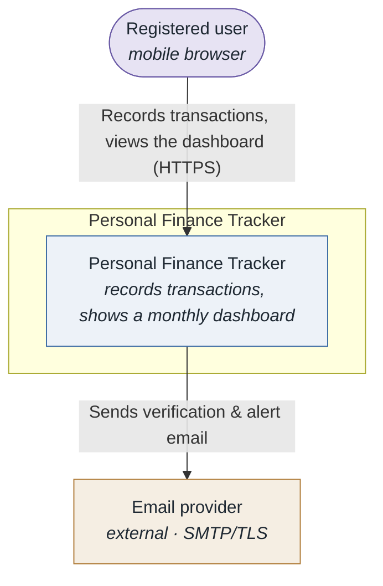
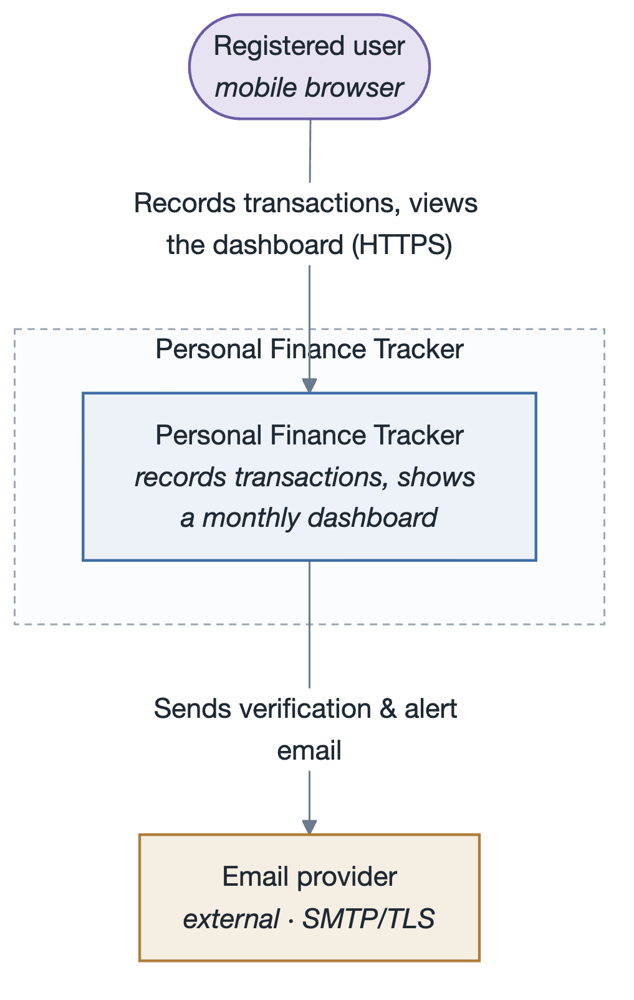
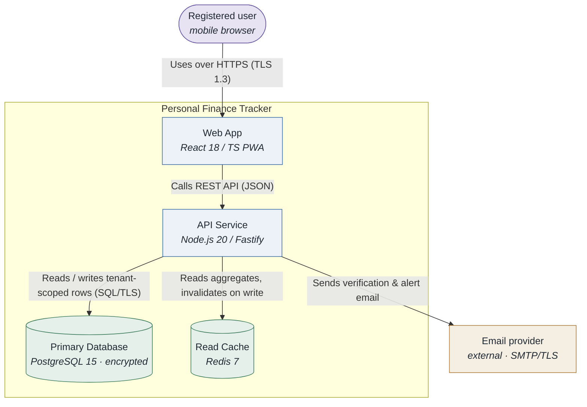
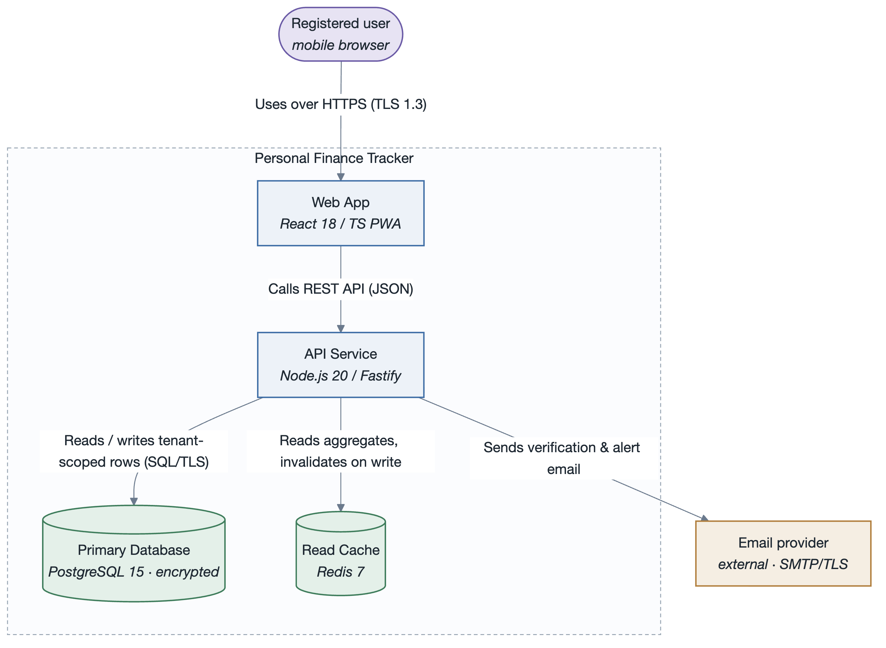
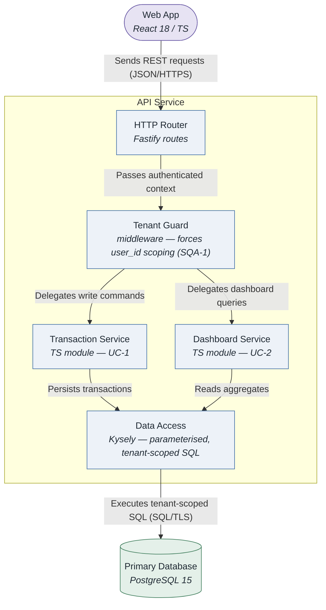
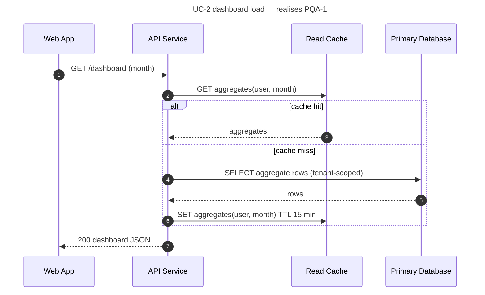
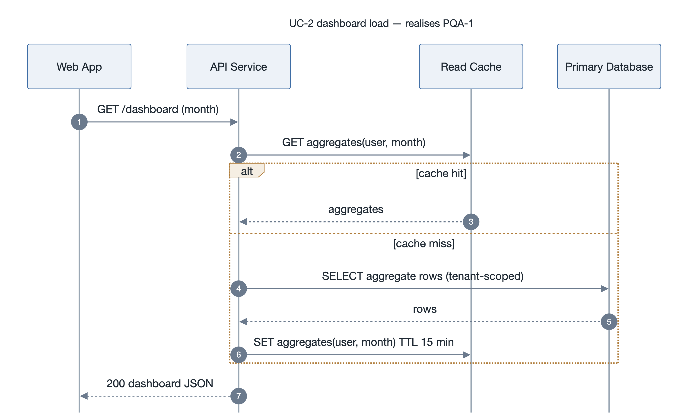
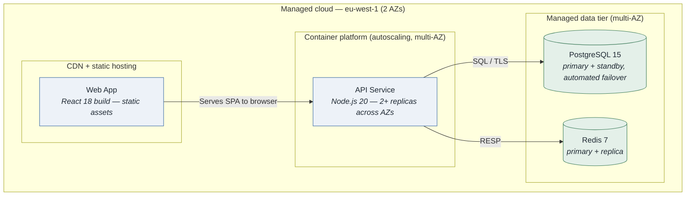
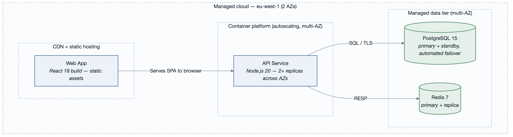

# Personal Finance Tracker — Architecture Package

_SEI drivers + ADD architecture (worked example)_

> Generated 2026-09-06 · 2 source file(s)

## Contents

- [1. Business goals](#1-business-goals)
- [2. Primary functional requirements — use cases](#2-primary-functional-requirements--use-cases)
  - [UC-1 — Record a transaction](#uc-1--record-a-transaction)
  - [UC-2 — View the monthly dashboard](#uc-2--view-the-monthly-dashboard)
  - [UC-3 — Import a bank statement (CSV)](#uc-3--import-a-bank-statement-csv)
  - [Use case diagram](#use-case-diagram)
- [3. Constraints](#3-constraints)
- [4. Quality attributes](#4-quality-attributes)
- [5. Traceability matrix](#5-traceability-matrix)
- [6. Prioritised driver list (input to ADD / ATAM)](#6-prioritised-driver-list-input-to-add--atam)
- [Change log](#change-log)
- [1. Introduction](#1-introduction)
- [2. Context diagram](#2-context-diagram)
  - [Diagram](#diagram)
  - [Description](#description)
- [3. Architectural drivers](#3-architectural-drivers)
  - [Quality Attribute Scenarios (key)](#quality-attribute-scenarios-key)
  - [Primary functional requirements — use cases (key)](#primary-functional-requirements--use-cases-key)
  - [Constraints (key)](#constraints-key)
- [4. Container diagram](#4-container-diagram)
  - [Diagram](#diagram)
  - [Description](#description)
- [5. Component diagrams](#5-component-diagrams)
  - [API Service](#api-service)
    - [Diagram](#diagram)
    - [Description](#description)
- [6. Sequence diagrams](#6-sequence-diagrams)
- [7. Deployment diagram](#7-deployment-diagram)
  - [Diagram](#diagram)
  - [Description](#description)
- [8. Interfaces and events](#8-interfaces-and-events)
  - [Interfaces](#interfaces)
  - [Events](#events)
- [9. Design decisions](#9-design-decisions)

---

# Architectural Drivers: Personal Finance Tracker

- **Date**: 2026-09-06
- **Owner**: Roman Tymoshuk
- **Status**: reviewed
- **Related artifacts**: `scenarios.md`, `qaw-report.md`
- **QA model**: ISO/IEC 25010:2023
- **QA ID legend**: AQA availability · SQA security · PQA performance · MQA modifiability ·
  UQA usability · RQA reliability(other)

> Worked example. Shows the four SEI driver kinds with the attribute-prefixed ID scheme and a
> full traceability matrix.

---

## 1. Business goals

| ID | Goal | Category | Stakeholder | Status |
|----|------|----------|-------------|--------|
| BG-1 | The founder needs 10 000 active users within 12 months so that the product reaches seed-round metrics | growth / market position | Founder | open |
| BG-2 | The company needs to pass a SOC 2 Type II audit so that it can sell to employers offering the app as a benefit | responsibility to society & law | Founder / Compliance | open |
| BG-3 | Engineering needs to ship new report types weekly so that the product keeps pace with competitor feature velocity | quality of process | Eng lead | open |
| BG-4 | Operations needs the monthly infra bill to stay under budget at launch scale so that runway is preserved | financial | Founder | open |

## 2. Primary functional requirements — use cases

### UC-1 — Record a transaction
- **Primary actor**: Registered user
- **Supporting actors**: —
- **Trigger**: User submits the "add transaction" form
- **Preconditions**: User is authenticated
- **Main success scenario**: 1. User enters amount, date, category, note. 2. System validates. 3. System persists the transaction. 4. System updates the dashboard aggregates. 5. System confirms.
- **Key alternate / exception flows**: 2a. Validation fails → field-level errors, no write. 3a. Store unavailable → queued write, user told "saved, syncing".
- **Architectural significance**: dominates write load; on the p95 latency path (PQA-1); touched by every modifiability change (MQA-1).
- **Related drivers**: BG-1, PQA-1, MQA-1

### UC-2 — View the monthly dashboard
- **Primary actor**: Registered user
- **Supporting actors**: —
- **Trigger**: User opens the app or navigates to "Dashboard"
- **Preconditions**: User is authenticated; has ≥ 0 transactions
- **Main success scenario**: 1. System loads the user's month-to-date aggregates. 2. System renders totals, a category breakdown chart, recent transactions, and savings-goal progress.
- **Key alternate / exception flows**: 1a. Aggregates cache miss → recompute from the transaction store.
- **Architectural significance**: the performance-critical read path (PQA-1); shapes the read-model / caching decision.
- **Related drivers**: BG-1, PQA-1, UQA-1

### UC-3 — Import a bank statement (CSV)
- **Primary actor**: Registered user
- **Supporting actors**: —
- **Trigger**: User uploads a CSV file
- **Preconditions**: User is authenticated
- **Main success scenario**: 1. User uploads CSV. 2. System parses and maps rows to transactions. 3. System asks the user to confirm category mapping. 4. System bulk-inserts. 5. System updates aggregates.
- **Key alternate / exception flows**: 2a. Unrecognised format → guided column mapping. 4a. Partial failure → per-row result report.
- **Architectural significance**: bulk write path; `<<include>>`s categorisation; first candidate for async processing.
- **Related drivers**: BG-1, PQA-2

### Use case diagram

`diagrams/usecases-core.mmd` → `diagrams/usecases-core.png` (visually verified: yes)

## 3. Constraints

| ID | Type | Constraint | Source | Hard / negotiable | Conflicts with |
|----|------|-----------|--------|-------------------|----------------|
| CON-1 | technical | Must run in the browser on iOS Safari and Android Chrome; no native app at launch | Product | hard | — |
| CON-2 | business | One founding engineer; MVP in 3 months | Founder | hard | BG-3 (velocity risk) |
| CON-3 | business | Launch on managed cloud free/low tiers; a paid upgrade path must exist | Founder | negotiable | — |
| CON-4 | regulatory | All financial data encrypted in transit (TLS 1.2+) and at rest | SOC 2 scope | hard | — |
| CON-5 | technical | Primary datastore must be PostgreSQL (team skill, managed availability) | Eng lead | negotiable | — |

## 4. Quality attributes

Detail in `scenarios.md`. Summary:

| ID | ISO/IEC 25010 characteristic / sub | One-line scenario | (Imp, Diff) |
|----|-----------------------------------|-------------------|-------------|
| PQA-1 | Performance efficiency / time behaviour | Dashboard interactive < 1.5 s @ p95 under 500 concurrent users | (H, M) |
| PQA-2 | Performance efficiency / capacity | CSV import of 5 000 rows completes < 30 s, dashboard stays responsive | (M, M) |
| SQA-1 | Security / confidentiality | Cross-user data access attempt is rejected and logged; 0 successful reads | (H, H) |
| AQA-1 | Reliability / availability | ≥ 99.5 % monthly uptime; single-AZ failure recovers < 60 s | (H, H) |
| MQA-1 | Maintainability / modifiability | Add a new report type in ≤ 1 person-day with 0 regressions | (M, M) |
| UQA-1 | Interaction capability / operability | First-time user records a transaction without help docs; ≥ 85 % task completion | (M, M) |

## 5. Traceability matrix

| Driver | Supports BG | Realised / constrained by | Addressed in | Status |
|--------|-------------|---------------------------|--------------|--------|
| UC-1 | BG-1 | PQA-1, MQA-1, CON-4 | ADD iter 1 | in design |
| UC-2 | BG-1 | PQA-1, UQA-1 | ADD iter 2 | open |
| UC-3 | BG-1 | PQA-2 | ADD iter 3 | open |
| PQA-1 | BG-1 | UC-1, UC-2 | ADD iter 2 | open |
| PQA-2 | BG-1 | UC-3 | ADD iter 3 | open |
| SQA-1 | BG-2 | CON-4 | ADD iter 1 | in design |
| AQA-1 | BG-1, BG-4 | CON-3, CON-5 | ADD iter 1 | open |
| MQA-1 | BG-3 | UC-1 | ADD iter 1 | open |
| UQA-1 | BG-1 | UC-2 | ADD iter 2 | open |
| CON-1 | BG-1 | UC-1, UC-2 | ADD iter 1 | open |
| CON-2 | BG-4 | — | ADD iter 1 | open |
| CON-3 | BG-4 | AQA-1 | ADD iter 1 | open |
| CON-4 | BG-2 | SQA-1 | ADD iter 1 | in design |
| CON-5 | BG-1 | AQA-1 | ADD iter 1 | open |

`Status` ∈ open / in design / partially / addressed / retired.
**Coverage check**: every BG (BG-1…BG-4) has ≥ 1 UC or QA scenario; every UC / QA scenario / CON
traces to ≥ 1 BG. Gaps found: none.

## 6. Prioritised driver list (input to ADD / ATAM)

1. SQA-1 (H,H) — reject and log cross-user access; 0 successful reads
2. AQA-1 (H,H) — 99.5 % monthly uptime; AZ failure recovers < 60 s
3. PQA-1 (H,M) — dashboard interactive < 1.5 s @ p95 at 500 concurrent users
4. UC-1 — record a transaction (write-load + latency + modifiability hot spot)
5. UC-2 — monthly dashboard (performance-critical read path)
6. CON-4 (hard) — encryption in transit and at rest
7. CON-2 (hard) — one engineer, 3-month MVP

## Change log

| Date | Change |
|------|--------|
| 2026-09-06 | initial register; reviewed with founder + eng lead |

---

# Architecture: Personal Finance Tracker

- **System**: Web app for individuals to track income, expenses and savings goals.
- **Date**: 2026-09-06
- **Session**: `personal-finance-tracker-session.md`
- **Drivers**: `../drivers.md`

## 1. Introduction

A mobile-web personal finance tracker. This document is the ADD 3.0 working architecture after
iteration 1 (overall structure, security, availability) and iteration 2 (dashboard read path).
Drivers: `../drivers.md`.

## 2. Context diagram

### Diagram

### Description

A single external dependency at launch: a transactional email provider. Everything else is owned
by the system, keeping the SOC 2 (CON-4) surface small.

## 3. Architectural drivers

### Quality Attribute Scenarios (key)

| ID | QA (ISO 25010) | Stimulus | Response | Measure | Priority |
|----|----------------|----------|----------|---------|----------|
| SQA-1 | Security / confidentiality | Cross-user data access attempt | Rejected and logged | 0 reads; 100 % logged | (H,H) |
| AQA-1 | Reliability / availability | Single-AZ failure | Recovers automatically | ≥ 99.5 %/mo; < 60 s | (H,H) |
| PQA-1 | Performance efficiency / time behaviour | 500 concurrent dashboard loads | Renders fully | < 1.5 s @ p95 | (H,M) |

### Primary functional requirements — use cases (key)

| ID | Name | Priority |
|----|------|----------|
| UC-1 | Record a transaction | high |
| UC-2 | View the monthly dashboard | high |

### Constraints (key)

| ID | Type | Description |
|----|------|-------------|
| CON-4 | regulatory | Encryption in transit (TLS 1.2+) and at rest |
| CON-5 | technical | Primary datastore is PostgreSQL |

## 4. Container diagram

### Diagram

### Description

The API service is the single write path and the single place tenant scoping (SQA-1) is enforced.
The Redis read cache serves the dashboard (PQA-1); it is a performance element, not a system of
record, so its loss degrades latency but not correctness (AQA-1).

## 5. Component diagrams

### API Service

#### Diagram

#### Description

Every request passes through the Tenant Guard before any service runs, so cross-tenant access
(SQA-1) is structurally prevented rather than checked per-endpoint.

## 6. Sequence diagrams

On a cache hit the database is not touched, which is the common path and keeps p95 under the
1.5 s budget (PQA-1). On a miss the API recomputes from tenant-scoped rows and repopulates the
cache; a stale cache is bounded by the 15-minute TTL.

## 7. Deployment diagram

### Diagram

### Description

The API runs as stateless replicas spread across two AZs behind the platform load balancer, and
the data tier uses managed primary/standby with automated failover — together these meet AQA-1
(single-AZ failure recovers < 60 s) within the CON-3 low-cost-tier constraint.

## 8. Interfaces and events

### Interfaces

| Component | Interface | Protocol | Description |
|-----------|-----------|----------|-------------|
| API Service | `POST /transactions` | REST / HTTPS | Create a transaction (UC-1) |
| API Service | `GET /dashboard?month=` | REST / HTTPS | Monthly aggregates + recent activity (UC-2) |
| Data Access | `query(userId, spec)` | in-process | Always injects `WHERE user_id = $userId` |

### Events

| Event | Publisher | Consumers | Description |
|-------|-----------|-----------|-------------|
| `TransactionWritten` | Transaction Service | Cache invalidator | Triggers dashboard-aggregate invalidation for the user/month |

## 9. Design decisions

| Decision | Rationale (cite driver IDs) | Alternatives discarded |
|----------|-----------------------------|------------------------|
| Single API service owns all writes and enforces tenant scoping in one middleware | SQA-1 needs one auditable choke point; CON-2 favours few moving parts | Per-service authz checks (easy to miss one) |
| Redis cache-aside for dashboard aggregates with 15-min TTL | PQA-1 p95 budget; DB alone won't meet it at 500 concurrent | Materialised views (slower to iterate — MQA-1); CDN caching (per-user data) |
| Managed PostgreSQL primary/standby, multi-AZ, automated failover | AQA-1 recovery target; CON-5 mandates PostgreSQL; CON-3 low-cost tier still offers this | Self-managed HA (CON-2 time), single instance (fails AQA-1) |

