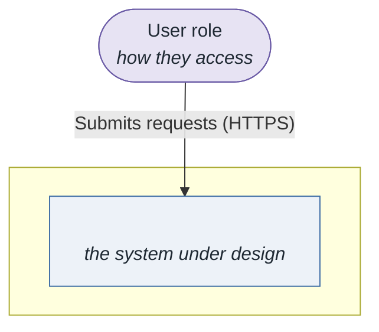
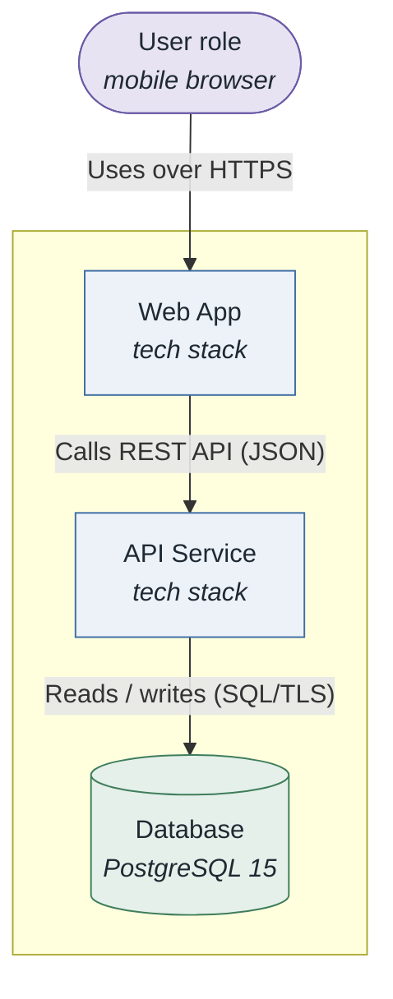
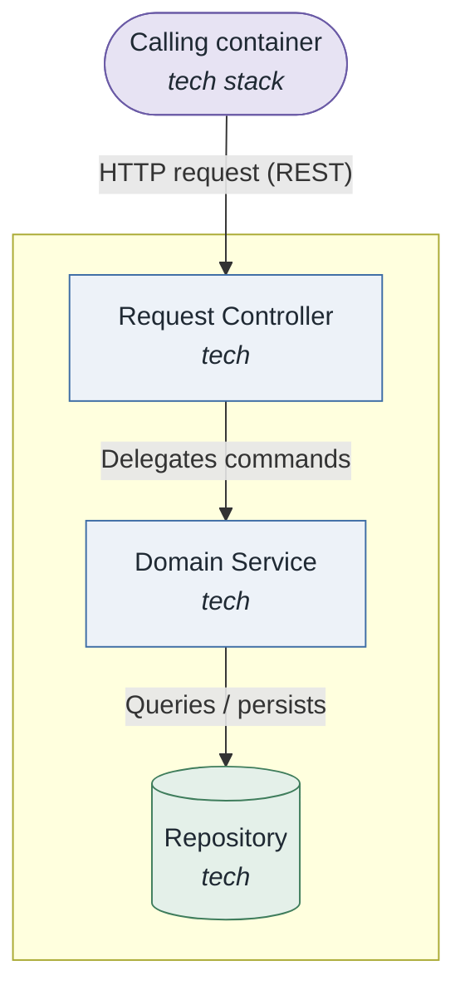
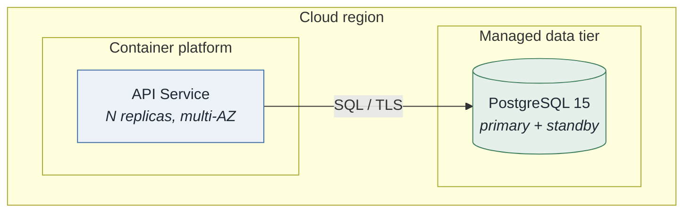

# Attribute-Driven Design (ADD 3.0)

Facilitate a short SEI ADD 3.0 design session. **Two living Markdown files per session are the
single source of truth** — update them after every step.

Working directory: `architecture/add/` (create it).
- `architecture/add/<slug>-session.md` — the session log
- `architecture/add/<slug>-Architecture.md` — the architecture document

Deep references: `${CLAUDE_PLUGIN_ROOT}/references/add-method.md`, `${CLAUDE_PLUGIN_ROOT}/references/design-concepts.md` (the concept
catalog + how to identify/select), `${CLAUDE_PLUGIN_ROOT}/references/interfaces.md` (Step 5),
`${CLAUDE_PLUGIN_ROOT}/references/architecture-in-the-lifecycle.md` (Iteration 0, architecture debt). Diagram rules:
the `sei-diagrams` skill
(`${CLAUDE_PLUGIN_ROOT}/skills/sei-diagrams/SKILL.md`) — **all** diagrams in both files follow it.

**Keep prompts and findings short** — a sentence or two. Offer choices as numbered lists.
**Draft first**: at each step propose a complete draft, then refine with the user.

## Start

On invocation, ask in one line whether to:
1. **New** — start a fresh session.
2. **Continue** — list `architecture/add/*-session.md`, let the user pick, read it, resume.
3. **Report** — the session file already *is* the report; give its path.

For a new session get a short **name** (slug) and a one-line **system purpose**, then create both
files from the templates below. If `architecture/quality-attributes/scenarios.md` or a QAW report
exists, offer to import its drivers instead of re-entering them.

## Session file template

```markdown
# ADD Session: <name>

- **Date**: <YYYY-MM-DD>
- **Purpose**: <one line>
- **Status**: active
- **Architecture**: `<slug>-Architecture.md`
- **Drivers imported from**: <path or "entered here">

## Drivers

### Quality Attribute Scenarios
IDs are attribute-prefixed (`AQA-`, `SQA-`, `PQA-`, `MQA-`, … — see the `architectural-drivers` skill).
| ID | QA (ISO 25010) | Source | Stimulus | Artifact | Environment | Response | Measure | Priority (Imp,Diff) |
|----|----------------|--------|----------|----------|-------------|----------|---------|---------------------|

### Primary functional requirements (use cases)
| ID | Use case name | Primary actor | Architectural significance | Priority |
|----|---------------|---------------|---------------------------|----------|
| UC-1 | | | | |

### Constraints
| ID | Type | Description |
|----|------|-------------|

### Architectural Concerns
| ID | Concern |
|----|---------|

## Iteration Plan

| Iteration | Goal | Drivers |
|-----------|------|---------|

<!-- iterations appended below as they happen -->
```

Each iteration appends:

```markdown
## Iteration N — <goal>

- **Drivers selected**: PQA-1, UC-2
- **Element(s) refined**: <element>

### Step 2 — Iteration goal
**Goal:** <one sentence>

| Driver | Importance | Difficulty |
|--------|------------|------------|

### Step 3 — Element(s) chosen
<one line: which element and why>

### Step 4 — Design concepts

| Design concept | Decision (chosen/discarded) | Rationale (cite driver IDs) | Alternatives discarded |
|----------------|-----------------------------|-----------------------------|------------------------|

### Step 5 — Instantiation, responsibilities, interfaces

| Instantiation decision | Responsibility |
|------------------------|----------------|

| Element | Provided interface | Required interface | Protocol |
|---------|-------------------|-------------------|----------|

### Step 6 — Views and design decisions
<which Architecture.md sections were updated>

| Decision | Rationale (cite driver IDs) | Alternatives discarded |
|----------|-----------------------------|------------------------|

### Step 7 — Analysis

| Driver | Achieved? (yes/partially/no) | Notes (risks, assumptions) |
|--------|------------------------------|----------------------------|

- **Iteration goal achieved:** <yes / partially / no>
- **Remaining drivers/concerns:** <list>
```

## Architecture.md template

~~~markdown
# Architecture: <name>

- **System**: <one line>
- **Date**: <YYYY-MM-DD>
- **Session**: `<slug>-session.md`

<!-- Every diagram below appears as BOTH a ```mermaid block AND, right after it, a
      line pointing at the verified render in ./diagrams/ .
     The relative path renders on GitHub and GitLab. -->

## 1. Introduction
<Purpose, scope, high-level description.>

## 2. Context diagram
### Diagram



### Description
<Plain-English explanation.>

## 3. Architectural drivers
### Quality Attribute Scenarios (key)
| ID | QA (ISO 25010) | Stimulus | Response | Measure | Priority |
|----|----------------|----------|----------|---------|----------|
### Primary functional requirements — use cases (key)
| ID | Name | Priority |
|----|------|----------|
### Constraints (key)
| ID | Type | Description |
|----|------|-------------|

## 4. Container diagram
### Diagram

### Description
<Plain-English explanation.>

## 5. Component diagrams
### <Container name>
#### Diagram

#### Description
<Plain-English explanation.>

## 6. Sequence diagrams
<One per key scenario. Each followed immediately by a plain-English description paragraph.>

## 7. Deployment diagram
### Diagram

### Description
<Plain-English explanation.>

## 8. Interfaces and events
### Interfaces
| Component | Interface | Protocol | Description |
|-----------|-----------|----------|-------------|
### Events
| Event | Publisher | Consumers | Description |
|-------|-----------|-----------|-------------|

## 9. Design decisions
| Decision | Rationale (cite driver IDs) | Alternatives discarded |
|----------|-----------------------------|------------------------|
<!-- records appended by Step 6 -->
~~~

## Process

Announce each step in one line, then write its result to the session file.

### Step 1 — Review inputs (once, before iterations)

- **Design purpose** (choose one): greenfield system · greenfield feature · brownfield replacement
  · brownfield extension · brownfield migration.
- **Business goals** (`BG-`) — import from the `architectural-drivers` register if it exists.
- **Primary functional requirements** — the architecturally significant **use cases** (`UC-`),
  each with primary actor, trigger, and main success scenario.
- **Quality attribute scenarios** — six-part form, ISO/IEC 25010 classification, attribute-prefixed
  IDs (`AQA-`, `SQA-`, `PQA-`, …), priority `(Importance, Difficulty)`. Import from
  `architecture/drivers/drivers.md` or `scenarios.md` / QAW report if present.
- **Constraints** (`CON-`) — business, technical, regulatory.
- **Architectural concerns** (`AC-`) — extensibility, team skills, tech-stack mandates, etc.

End with a one-line summary of the most architecturally significant drivers.

### Iteration Plan / design backlog (pragmatic addition)

Group drivers into N iterations, each with a bounded goal, ordered by the **design roadmap** for
the system type (`${CLAUDE_PLUGIN_ROOT}/references/add-method.md` → *Design roadmap*):
- **greenfield, mature domain**: iter 1 = establish overall structure (reference architecture +
  deployment pattern); iter 2 = structures for the primary use cases; later iters = refine for
  the remaining quality-attribute drivers;
- **greenfield, novel domain**: lead with prototypes to retire the hardest QA risks;
- **brownfield**: start from the existing architecture; iterations refine it to meet the new or
  violated drivers.

Keep the plan as a living **design backlog** on a Kanban board with columns **Not Yet Addressed
· Partially Addressed · Completely Addressed · Discarded**: seed with one item per driver, add
supporting items (a prototype to retire a QA risk, reverse-engineering, review findings,
concerns discovered while adopting a concept). Step 2 moves a card to *Partially Addressed*;
Step 7 moves it to *Completely Addressed* against an explicit criterion (analysed, or prototyped
and verified). End the round when the highest-priority drivers are *Completely Addressed*.
Note: **Steps 2 and 3 may be reversed** for greenfield / reference-architecture work (pick an
element first). Deep reference: `${CLAUDE_PLUGIN_ROOT}/references/add-method.md`.

**Coverage check (mandatory):** list every driver ID from Step 1 and confirm each appears in ≥ 1
iteration / backlog item before presenting. Present, wait for review, write the agreed plan into
`## Iteration Plan`.

### Step 2 — Establish the iteration goal by selecting drivers

Review unaddressed / partially-satisfied drivers. Select the subset for this iteration —
prioritise drivers that are **both** high-importance and high-difficulty. State the goal in one
sentence. **Present and wait for confirmation.**

### Step 3 — Choose element(s) to refine

Iteration 1 on greenfield = the whole system. Later = a subsystem/service/component from a prior
iteration. **State the choice and why. Wait for confirmation.**

### Step 4 — Choose design concept(s)

**Identify** candidates from the **design concept catalog** (coarse → fine): reference
architectures · deployment patterns · architectural & design patterns · **tactics** ·
externally developed components — drawing on best-practice catalogs
(`${CLAUDE_PLUGIN_ROOT}/references/tactics-catalog.md`, `${CLAUDE_PLUGIN_ROOT}/references/architecture-patterns.md`), your own experience,
and a peer brainstorm. **Select** with a pros/cons table keyed to the iteration's drivers; for a
high-stakes choice, add a SWOT or CBAM (ROI) analysis. Every rationale cites ≥ 1 driver ID;
record the discarded alternatives and why. Name tactics from the catalog so Step 7 and ATAM can
question them with the matching questionnaire. **Present the table and wait for review.**

### Step 5 — Instantiate elements, allocate responsibilities, define interfaces

Two tables: **instantiation decisions** (elements created/modified + responsibility) and
**interfaces** (provided / required / protocol per element). For each significant interface
capture the four agreement points from `${CLAUDE_PLUGIN_ROOT}/references/interfaces.md` — scope, interaction style,
data representation & structure, error model — and apply the design principles (least surprise,
small interfaces, uniform access, DRY, consistency). **Present both and wait for review.**

### Step 6 — Sketch views and record design decisions

Update the relevant `Architecture.md` sections (§2 §3 §4 §5 §6 §7 §8). Follow the **interactive
diagram review** protocol from the `sei-diagrams` skill:
1. Open with **"Diagrams modified this step: §N Title [, §M Title]"**.
2. Render each modified diagram as a fenced mermaid block, applying every diagram rule.
3. After each diagram, one sentence on what changed and why.
4. Every sequence diagram gets a plain-English description paragraph immediately below it.
5. Render each diagram to `architecture/add/diagrams/<name>.png`, `Read` it and visually
   cross-verify (correctness + minimal crossings), then embed it in `Architecture.md` as the
   diagram per the `sei-diagrams` *Embedding in Markdown* rule (Mermaid → fenced block + image
   line; PlantUML → image line + a link to the `.puml` source), relative paths.

Record significant decisions in §9. **Present diagrams + decisions table; wait for review before
writing to `Architecture.md`.**

### Step 7 — Analyse and review the iteration goal

Analysis table: each selected driver → **yes / partially / no** + notes. Drive the analysis with
the **tactics-based questionnaire** for each attribute in play (`${CLAUDE_PLUGIN_ROOT}/references/tactics-catalog.md`):
for every relevant tactic, is it used, where, and what is the risk if it is not? State whether
the goal was achieved and which drivers/concerns remain. Ask whether to run another iteration.
Yes → Step 2 with remaining drivers. No → set **Status: completed**, print both file paths, and
offer to run `/architecture-docs` (Views & Beyond) and `/atam` (evaluation).

## Rules

- IDs are sequential per session: `BG-1`, `UC-1`, `CON-1`, `AC-1`, and attribute-prefixed QA scenarios (`PQA-1`, `SQA-1`, …).
- Every Step-4 and Step-6 rationale cites ≥ 1 driver ID.
- The session Markdown stays current — write as you go, never only at the end.
- Design decisions → `Architecture.md` §9; interfaces → §8; diagrams → their dedicated sections.
- Every diagram satisfies the `sei-diagrams` rules: `title` line, aliases without spaces, concrete
  technology on every element, specific relationship labels, ≤ 10 nodes, explicit `Boundary`,
  minimised crossings. Always render in the conversation before writing to the file.
- Every sequence diagram in `Architecture.md` is followed immediately by a plain-English description.
- Wait for user review at the Iteration Plan step and at Steps 2, 3, 4, 5, 6, 7.
- After the session, `python tests/validate.py architecture/add/*.md` must pass.

## Quality gate — cross-check the output before you're done

Do not declare the activity complete until the generated artifact passes both:

1. **Automated**: `python tests/validate.py architecture/add/*.md` — exits 0 (from the plugin root, or point at
   the plugin's `tests/validate.py`). It checks IDs, structure, six-part scenarios with numeric
   measures, traceability with no orphans, diagram rules, and the deprecated-`QAS-` guard.
2. **Best-practice checklist**: walk the relevant section of
   `${CLAUDE_PLUGIN_ROOT}/references/best-practices-checklist.md` and report each item `ok` / `fix: …`. Fix,
   re-run, repeat.

Every embedded diagram must additionally have been rendered to PNG and **visually cross-verified**
(`Read` the image — correctness + minimal crossings) per the `sei-diagrams` skill.
