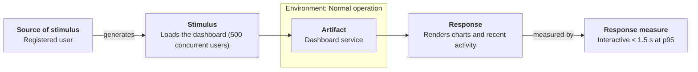

# Quality attribute scenarios

Produce **measurable** quality attribute scenarios in the SEI six-part form, plus a prioritised
driver list that ADD and ATAM can consume directly.

Output file: `architecture/quality-attributes/scenarios.md` (create the folder).
Deep reference: `${CLAUDE_PLUGIN_ROOT}/references/quality-attribute-taxonomy.md`.

## Where the output goes — one source of truth

Check whether `architecture/drivers/` exists **before** writing anything:

- **Register mode** (the drivers directory exists): each scenario is written **directly** as
  `architecture/drivers/quality-attributes/<ATTR>QA-<n>.md` from
  `${CLAUDE_PLUGIN_ROOT}/templates/quality-attribute-scenario.md`, with its diagram in
  `architecture/drivers/quality-attributes/diagrams/scenario-<ATTR>QA-<n>.*`; the utility tree goes to
  `architecture/drivers/quality-attributes/utility-tree.md`; the drivers `README.md` inventory,
  traceability matrix and change log get their rows. `scenarios.md` is then a **generated
  summary** — business goals, the one-row-per-scenario table, links to each register file, the
  prioritised list — with **no** duplicated six-part detail or diagrams. Nothing has to be "kept in
  sync" because there is only one copy.
- **Standalone mode** (no register yet): `scenarios.md` carries the full detail and every diagram
  (in `architecture/quality-attributes/diagrams/`), as the template below shows. `/drivers` imports
  it later.

Either way, finish by updating the `/quality-attributes` row of the package index
`architecture/README.md` (create it from `${CLAUDE_PLUGIN_ROOT}/templates/architecture-readme.md` if absent).

**Keep prompts short.** Draft first, refine second. Offer choices as numbered lists.

## The six-part scenario

Every scenario has exactly these parts (SEI / Bass-Clements-Kazman):

| Part | Question it answers | Example |
|------|---------------------|---------|
| **Source of stimulus** | Who or what generates the stimulus? | A registered user; a downstream service; an operator; a code commit |
| **Stimulus** | What event arrives at the system? | 1 000 concurrent dashboard requests; a malformed message; a request to add a report type |
| **Artifact** | What part is stimulated? | The whole system; the checkout service; the data store; the CI pipeline |
| **Environment** | What is the system's state when it happens? | Normal operation; peak load; degraded mode; during deployment |
| **Response** | What must the system do? | Processes all requests; rejects and logs; change is made with no ripple |
| **Response measure** | How is success measured, numerically? | p95 latency < 1.5 s; 0 successful cross-tenant reads; ≤ 1 person-day, 0 regressions |

A scenario without a **numeric response measure** is not finished — push until there is one.

## Quality attribute taxonomy — ISO/IEC 25010:2023

Classify every scenario against the **ISO/IEC 25010:2023** product quality model. This is the
standard taxonomy; the SEI six-part scenario is the *form*, ISO 25010 supplies the *vocabulary*.
Full definitions, the sub-characteristic breakdown, the **general-scenario "portions"** menu
(the range of values each of the six parts can take), and the per-attribute tactics-based
questionnaire are in `${CLAUDE_PLUGIN_ROOT}/references/quality-attribute-taxonomy.md` (with tactic and pattern lists
in `${CLAUDE_PLUGIN_ROOT}/references/tactics-catalog.md` and `${CLAUDE_PLUGIN_ROOT}/references/architecture-patterns.md`). The full
**general-scenario portion tables for all 10 attributes** (availability, deployability, energy
efficiency, integrability, modifiability, performance, safety, security, testability, usability)
— the menu of values for each of the six parts, plus a worked concrete example — are in
`${CLAUDE_PLUGIN_ROOT}/references/quality-attribute-scenarios.md`. Build each concrete scenario by choosing values
from the portions and making the response measure numeric.
For a cloud or mobile system, `${CLAUDE_PLUGIN_ROOT}/references/runtime-environments.md` lists the environment-specific
stimuli worth a scenario (cold start, zone loss, autoscale lag, offline operation, battery,
OS eviction).

| # | ISO/IEC 25010:2023 characteristic | Sub-characteristics | SEI / BCK term often used |
|---|-----------------------------------|---------------------|--------------------------|
| 1 | **Functional suitability** | completeness, correctness, appropriateness | (functional — usually FRs, not QAS) |
| 2 | **Performance efficiency** | time behaviour, resource utilization, capacity | performance |
| 3 | **Compatibility** | co-existence, interoperability | interoperability |
| 4 | **Interaction capability** | appropriateness recognizability, learnability, operability, user error protection, user engagement, inclusivity, user assistance, self-descriptiveness | usability |
| 5 | **Reliability** | faultlessness, availability, fault tolerance, recoverability | availability |
| 6 | **Security** | confidentiality, integrity, non-repudiation, accountability, authenticity, resistance | security |
| 7 | **Maintainability** | modularity, reusability, analysability, modifiability, testability | modifiability, testability |
| 8 | **Flexibility** | adaptability, scalability, installability, replaceability | scalability, portability, deployability |
| 9 | **Safety** | operational constraint, risk identification, fail safe, hazard warning, safe integration | safety |

For each characteristic (and, where useful, each sub-characteristic) decide:
**not a concern** / **implicit (default is fine)** / **architecturally significant → write a scenario**.

Record every scenario with its ISO characteristic **and** sub-characteristic, e.g.
`QA: Reliability / availability`. If the project mandates the older **ISO/IEC 25010:2011** 8-model
(no *Flexibility* / *Safety*; *Usability* and *Portability* instead), say so in the file header and
use that column set.

## Procedure

### Step 1 — Gather raw material

Ask for whatever exists: a product brief, PRD, business goals, SLA/SLO text, an existing NFR list,
a system description. Read any files the user points at. If nothing exists, ask three questions:
what does the system do, who uses it, what would make it fail in the eyes of its sponsor.

### Step 2 — Elicit business goals

List the **business goals** (`BG-1`, `BG-2`, …) the architecture must serve — each in the form
*"<stakeholder> needs <outcome> so that <business value>"*. Scenarios trace back to these. Keep to
3–7 goals. Present and confirm.

### Step 3 — Draft scenarios

Propose a **complete first-draft set** of 8–15 scenarios covering the significant attributes from
the taxonomy. For each, fill all six parts and give:

- an **attribute-prefixed ID** — `<ATTR>QA-<n>`, numbered per prefix: availability `AQA-1`,
  security `SQA-1`, performance `PQA-1`, modifiability `MQA-1`, usability `UQA-1`, … (full code
  table in the `architectural-drivers` skill),
- the **ISO/IEC 25010 characteristic and sub-characteristic**,
- the **business goal(s)** it supports,
- a **priority pair** `(Importance, Difficulty)` each `H` / `M` / `L` — Importance = to the
  business; Difficulty = expected architectural/technical challenge (the architect's estimate),
- **candidate tactics** — the tactic families this attribute is normally met with, from the table
  below. This is a *hint for ADD Step 4*, not a decision: it turns "design for availability" into
  a shortlist the designer can accept, reject or extend, and tells ATAM Step 6 which
  tactics-based questionnaire to walk. Never let it narrow the scenario itself — the measure is
  the requirement, the tactic is one way to meet it.

### Candidate tactics by attribute (`${CLAUDE_PLUGIN_ROOT}/references/tactics-catalog.md`)

| ISO/IEC 25010 characteristic | Tactics-catalog section | Categories to shortlist from |
|------------------------------|-------------------------|------------------------------|
| Reliability / availability, fault tolerance, recoverability | **Availability** | detect faults · recover (preparation & repair) · recover (reintroduction) · prevent faults |
| Performance efficiency | **Performance** | control resource demand · manage resources |
| Security | **Security** | detect attacks · resist attacks · react to attacks · recover from attacks |
| Maintainability / modifiability | **Modifiability** | reduce module size · increase cohesion · reduce coupling · defer binding |
| Maintainability / testability | **Testability** | control and observe state · limit complexity |
| Interaction capability | **Usability** | support user initiative · support system initiative |
| Compatibility / interoperability | **Integrability** | limit dependencies · adapt · coordinate |
| Flexibility / scalability | **Scalability** | statelessness · partitioning · elastic pools · load balancing · async processing |
| Flexibility / installability (deployability) | **Deployability** | manage the deployment pipeline · manage the deployed system |
| Flexibility / adaptability, replaceability (portability) | **Portability** | intermediary · portability layer · defer binding to the platform · adhere to standards |
| Safety | **Safety** | detect unsafe state · contain / recover · prevent unsafe state |

Present as a table. Tell the user which parts you guessed so they correct the right cells.

### Step 4 — Refine and fill gaps

For weak scenarios: replace generic sources ("user") with specific roles, replace "should be fast"
with a number and a percentile, name the concrete artifact, state the environment explicitly.
Add scenarios for any taxonomy attribute the user flags as significant but uncovered.

### Step 5 — Visualise each scenario as a UML scenario diagram

Every quality attribute scenario is also drawn as the canonical SEI **six-part scenario diagram**
so the whole picture — *source → stimulus → (artifact, in environment) → response → response
measure* — is visible at a glance. Use the `sei-diagrams` skill's **"Quality attribute scenario"**
diagram pattern (`${CLAUDE_PLUGIN_ROOT}/skills/sei-diagrams/SKILL.md`, section *Quality attribute scenario diagram*).

For each `<ATTR>QA-n`:
1. Write the six-part diagram source — Mermaid `flowchart LR` (default) or the PlantUML pattern —
   to `architecture/quality-attributes/diagrams/scenario-<ATTR>QA-<n>.mmd|.puml`, filled with the
   scenario's six parts, using the shared theme. Show the source in the conversation.
2. **Render it to PNG** (`${CLAUDE_PLUGIN_ROOT}/skills/sei-diagrams/scripts/render.sh` or
   `render-plantuml.sh`) as `diagrams/scenario-<ATTR>QA-<n>.png`, then **`Read` the PNG and
   visually cross-verify** it (six boxes left-to-right, artifact inside the environment, labels
   intact, no crossings). Rendering is not optional — the quality gate below requires it.
3. Embed it in `scenarios.md` directly under the scenario's `### <ATTR>QA-<n> — scenario diagram`
   heading per the `sei-diagrams` *Embedding in Markdown* rule: Mermaid → the fenced block **plus**
   ``; PlantUML → that image
   line plus a link to the `.puml` source. Never a bare backtick path.

The same file names (`scenario-<ATTR>QA-<n>.*`) are what `/drivers` copies into
`architecture/drivers/quality-attributes/diagrams/`, so the two stay in sync by construction.

### Step 6 — Build the utility tree (optional but recommended)

Organise the scenarios into a **utility tree — a table, not a diagram**: one row per leaf
scenario with columns *Quality attribute · Refinement (concern) · Leaf scenario (ID + response
measure) · Priority (V, R) · Status*. `(V, R)` = business value and technical risk, each H/M/L
(`V ≈ Importance`, `R ≈ Difficulty`); mark a `(H, H)` leaf `★`. This is the same structure ATAM
step 5 uses. Template: `${CLAUDE_PLUGIN_ROOT}/templates/utility-tree.md`.

### Step 7 — Prioritised driver list

Emit the final **architectural drivers** section: the `(H,H)` and `(H,M)` scenarios first — these
are what ADD iterations and ATAM analysis target. List functional requirements with architectural
impact — recorded as use cases (`UC-n`) — and constraints (`CON-n`) alongside.

### Step 8 — Write the file(s)

**Register mode**: write / update the per-scenario files, diagrams, utility tree and README rows
in `architecture/drivers/quality-attributes/`, then write `scenarios.md` as the summary (the
template below minus the per-scenario diagram sections; each table row's ID links to
`../drivers/quality-attributes/<ATTR>QA-<n>.md`). **Standalone mode**: write
`architecture/quality-attributes/scenarios.md` from the full template below. Confirm the paths.

## Output template

```markdown
# Quality Attribute Scenarios: <SystemName>

- **Date**: <YYYY-MM-DD>
- **Source material**: <brief / PRD / interview>
- **Status**: draft | reviewed | baselined
- **Mode**: standalone | register (per-scenario files in `../drivers/quality-attributes/`)

## Business goals

| ID | Goal | Stakeholder |
|----|------|-------------|
| BG-1 | <stakeholder needs outcome so that value> | <role> |

## Quality attribute scenarios

QA column = `ISO/IEC 25010 characteristic / sub-characteristic`.

| ID | QA (ISO 25010) | Source | Stimulus | Artifact | Environment | Response | Response measure | BG | Imp | Diff |
|----|----------------|--------|----------|----------|-------------|----------|------------------|----|-----|------|
| PQA-1 | Performance efficiency / time behaviour | Registered user | Loads dashboard (500 concurrent) | Dashboard service | Normal operation | Renders charts + recent activity | Interactive < 1.5 s @ p95 | BG-1 | H | M |

### PQA-1 — scenario diagram




## Primary functional requirements — use cases with architectural impact

| ID | Use case name | Why it shapes the architecture |
|----|---------------|--------------------------------|
| UC-1 | | |

## Constraints

| ID | Type (business / technical / regulatory) | Description |
|----|-----------------------------------------|-------------|

## Utility tree

| Quality attribute | Refinement (concern) | Leaf scenario (ID — one line + measure) | Priority (V, R) | Status |
|-------------------|----------------------|----------------------------------------|:---------------:|:------:|
| Security | Confidentiality | SQA-1 — 0 cross-tenant reads; 100 % logged | (H, H) `★` | open |
| Performance efficiency | Time behaviour | PQA-1 — dashboard < 1.5 s @ p95, 500 concurrent | (H, M) | open |

_Reading the tree_: a refinement with no leaf → look for an unrecorded ASR; the `★` `(H,H)`
leaves get the most attention.

## Architectural drivers (prioritised)

1. SQA-1 (H,H) — <one line>
2. PQA-1 (H,M) — <one line>
...
```

## Rules

- Every scenario has all six parts **and** a numeric response measure.
- Every scenario is classified against **ISO/IEC 25010:2023** (characteristic + sub-characteristic);
  note in the header if the 2011 model is used instead.
- Every scenario is visualised as a six-part UML scenario diagram (Step 5), rendered to
  `diagrams/scenario-<ATTR>QA-<n>.png`, visually verified, and embedded (fenced block + image line,
  or image line + `.puml` link) directly under its `### <ATTR>QA-<n> — scenario diagram` heading.
- IDs: `BG-`, `UC-` (use cases), `CON-`, and attribute-prefixed QA scenarios (`AQA-`, `SQA-`, `PQA-`, … — see the architectural-drivers skill). Sequential within each prefix; never reused.
- Every scenario cites ≥ 1 business goal.
- Priority is the `(Importance, Difficulty)` pair, not a single word.
- Every scenario names its **candidate tactics** (category + specific tactics) from the catalog —
  a shortlist for ADD Step 4, never a design decision taken here.
- Keep the total set small enough to act on: 8–15 scenarios; more than 20 means the net is too wide.
- One copy of each scenario: in register mode the per-scenario file in `architecture/drivers/`
  is the source of truth and `scenarios.md` only links to it; in standalone mode `scenarios.md`
  is. Write it before declaring the activity done.

## Quality gate — cross-check the output before you're done

Do not declare the activity complete until the generated artifact passes both:

1. **Automated**: `python ${CLAUDE_PLUGIN_ROOT}/tests/validate.py architecture/quality-attributes/scenarios.md` — exits 0. It checks IDs, structure, six-part scenarios with numeric
   measures, traceability with no orphans, diagram rules, and the deprecated-`QAS-` guard.
2. **Best-practice checklist**: walk the relevant section of
   `${CLAUDE_PLUGIN_ROOT}/references/best-practices-checklist.md` and report each item `ok` / `fix: …`. Fix,
   re-run, repeat.

Every embedded diagram must additionally have been rendered to PNG and **visually cross-verified**
(`Read` the image — correctness + minimal crossings) per the `sei-diagrams` skill.
