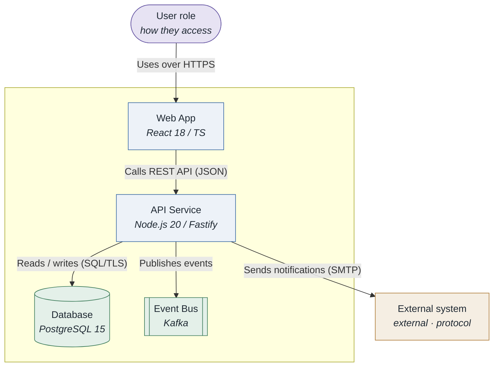
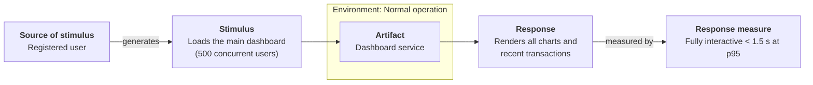
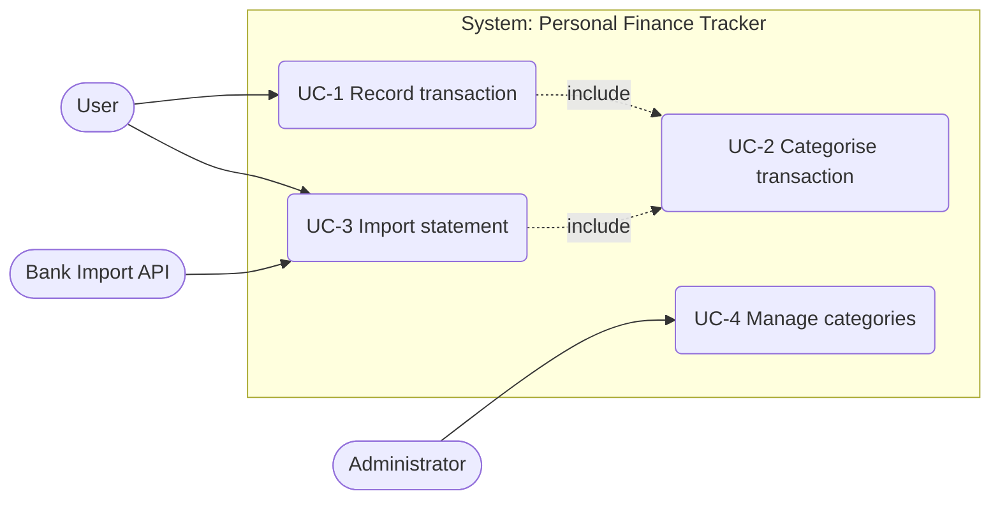
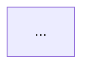
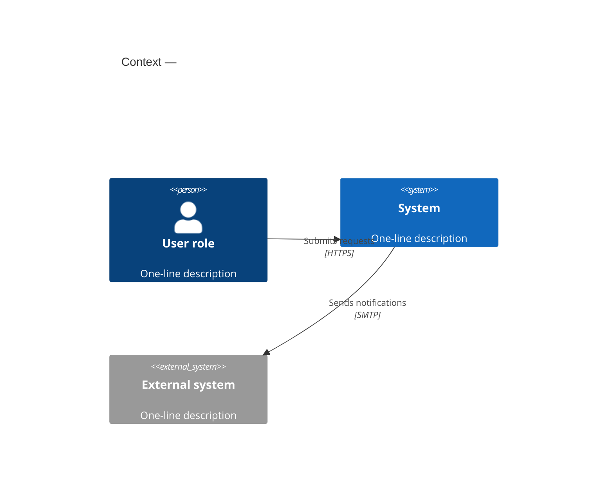
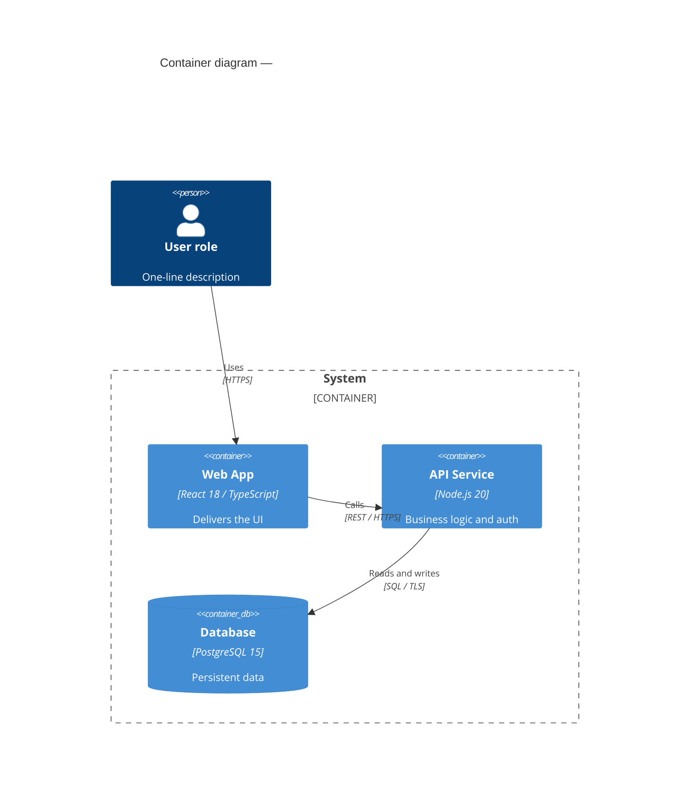

# SEI diagrams — clean UML / C4, rendered to PNG

Produce diagrams that are **readable at a glance**: few crossings, aligned flow, concrete labels,
one curated palette. Then render them to PNG.

- Diagram sources: `architecture/diagrams/*.mmd` (Mermaid) or `*.puml` (PlantUML).
- Rendered output: `architecture/diagrams/*.png`.
- Theme + palette: `assets/mermaid-theme.json`, `assets/palette.md`, `assets/plantuml-theme.puml`.
- Renderers: `scripts/render.sh` (Mermaid), `scripts/render-plantuml.sh` (PlantUML), `scripts/setup.sh`.

## Notation: ask the user

Both notations are supported for every diagram type below. **Ask which one to use** before
writing the source (offer it as a two-item numbered list), unless the user or the calling skill
already stated a preference:

1. **Mermaid** *(default / recommended)* — renders with no Java, matches the other SEI skills,
   `.mmd` source, rendered by `scripts/render.sh`.
2. **PlantUML** — full UML notation (stick-figure actors, `<<extend>>` arrowheads, proper
   component/deployment shapes), `.puml` source, rendered by `scripts/render-plantuml.sh`
   (needs a Java runtime; the script explains how to install one).

If the user has no preference, use Mermaid. **The rules and the visual-verification process below
are identical for both notations** — only the source syntax and the render script differ.

## Workflow

1. Pick the diagram type (table below) and confirm the **notation** (Mermaid or PlantUML — ask).
2. Write the source file to `architecture/diagrams/<name>.mmd` (Mermaid) or `<name>.puml` (PlantUML).
3. **Show the diagram source in the conversation** (a fenced ```mermaid or ```plantuml block) and
   get review.
4. **Render to PNG**:
   - Mermaid: `bash skills/sei-diagrams/scripts/render.sh architecture/diagrams/<name>.mmd`
     (first run: `bash skills/sei-diagrams/scripts/setup.sh`).
   - PlantUML: `bash skills/sei-diagrams/scripts/render-plantuml.sh architecture/diagrams/<name>.puml`.
5. **Visually cross-verify** — mandatory, same for both notations. `Read` the generated PNG and
   check it against the verification checklist below. If it fails, fix the source and go back to
   step 4. Only a PNG that passes may be embedded in a document or handed to the user.
6. Report the PNG path. Re-render **and re-verify** whenever the source changes.

## Visual verification (mandatory after every render)

After `render.sh` produces the PNG, open it with the `Read` tool and look at the actual image.
Walk this checklist explicitly and state the result:

**Correctness**
- Every element and relationship from the source is present in the image, none invented.
- Labels are the intended text, not truncated or overlapping their box.
- Arrow directions match the intended flow; response/return arrows are dashed where they should be.
- The `title` is visible; the legend (if any) is readable.
- C4: boundaries drawn around the right elements; datastores render as the datastore shape.
- Sequence: participant order matches call order; activation bars and `autonumber` present as intended.
- Use case: actors outside the system boundary, use cases inside, `<<include>>` / `<<extend>>` dashed.

**Legibility / crossings**
- Count edge crossings. If any crossing is avoidable by reordering nodes, changing direction,
  grouping into a subgraph, routing a hub, or switching to ELK layout — do it and re-render.
- No element overlaps another element or an edge label.
- No edge passes *through* an unrelated node.
- Text is large enough to read at 100 %; nothing clipped at the image edge.
- Aspect ratio is reasonable (not an extreme ribbon); if it is, split the diagram.

**If it fails**: adjust the `.mmd` source (see the Layout playbook), re-render, and `Read` the new
PNG again. Iterate until both sections pass. Note in the conversation what you changed and why.
Never present or embed a diagram you have not looked at as a rendered image.

## Diagram types

| Purpose | Notation | How to draw it |
|---------|----------|----------------|
| System context | C4 L1 | **Mermaid `flowchart` in C4 style** (pattern below) or PlantUML C4-PlantUML |
| Containers (apps, services, stores) | C4 L2 | **Mermaid `flowchart` in C4 style** or PlantUML C4-PlantUML |
| Components inside one container | C4 L3 | **Mermaid `flowchart` in C4 style** or PlantUML C4-PlantUML |
| Production topology | C4 deployment | **Mermaid `flowchart` in C4 style** (nested `subgraph` = nodes) or PlantUML |
| Runtime flow for a scenario | UML sequence | Mermaid `sequenceDiagram` |
| Domain / class model | UML class | Mermaid `classDiagram` |
| Lifecycle / mode logic | UML state | Mermaid `stateDiagram-v2` |
| **Use case model** | UML use case | Mermaid `flowchart LR` (pattern below) or PlantUML `usecase` |
| Quality attribute scenario (6-part) | box-and-arrow | Mermaid `flowchart LR` (pattern below) |
| Utility tree | tree | Mermaid `mindmap` |

### Why `flowchart` in C4 style and not native `C4Context`/`C4Container`

Mermaid's native `C4*` renderer **ignores the theme file** (diagrams come out in default blue,
not the SEI palette) and has weak edge routing (labels collide, arrows cross). For any diagram
that will be **rendered to PNG** or embedded in a document, draw structural diagrams as a
`flowchart` styled with the semantic `classDef`s — it honours the palette, lays out cleanly, and
works with ELK. Use native `C4Context`/`C4Container`/`C4Component`/`C4Deployment` only for a
quick sketch shown inline in chat where PNG polish doesn't matter; the syntax reference for it is
kept at the end of this file.

### Structural diagram — house style (context / container / component / deployment)



Conventions: `([ ])` = person/actor (`source` class), `[ ]` = software element, `[( )]` =
datastore, `[[ ]]` = queue/bus (both `datastore` class), external elements get the `external`
class and sit **outside** the `subgraph` boundary. Put the tech stack on an `<i>` line. Name each
relationship with an action phrase. For a **deployment** diagram, nest `subgraph`s for
region → cluster → node and place containers in the leaf `subgraph`.

## Quality attribute scenario diagram

The canonical SEI six-part scenario, drawn so every part is visible. **Use this for every `<ATTR>QA-n`**
in the `quality-attributes` and `quality-attribute-workshop` skills.



Rules for this pattern: exactly the six parts, left-to-right; the `Artifact` node lives **inside**
the `Environment` subgraph; the ISO/IEC 25010 characteristic goes in the `%%` comment title line;
use `classDef` names `source`, `artifact`, `response` (defined in the theme) for consistent colour.

## Use case diagram

Mermaid has no native UML use-case diagram, so use this **convention** (it renders cleanly and
survives the palette): actors as stadium nodes `([Actor])` on the left, use cases as rounded
nodes `(Use case)` inside a `subgraph` that is the system boundary, `<<include>>` / `<<extend>>`
as dashed labelled edges between use cases. One diagram per actor group or subsystem, ≤ ~10 use
cases.



If the user picks **PlantUML** (stick figures, ovals, proper `<<extend>>` arrowheads):

```plantuml
@startuml
!include ../../skills/sei-diagrams/assets/plantuml-theme.puml
left to right direction
actor "User" as user
actor "Administrator" as admin
rectangle "Personal Finance Tracker" {
  usecase "UC-1 Record transaction" as uc1
  usecase "UC-2 Categorise transaction" as uc2
  usecase "UC-3 Import statement" as uc3
  usecase "UC-4 Manage categories" as uc4
}
user --> uc1
user --> uc3
admin --> uc4
uc1 ..> uc2 : <<include>>
uc3 ..> uc2 : <<include>>
@enduml
```

Render the PlantUML variant with `scripts/render-plantuml.sh` (needs Java — the script tells you
how to install it if missing). **Whichever notation the user chose, the verification is the
same**: `Read` the rendered PNG and check actors are outside the boundary, use cases inside,
include/extend dashed, and no avoidable crossings — iterate on the source until it passes.

## The ten diagram rules

1. **Title.** Every diagram starts with a title: native `C4*` diagrams use a `title` line right
   after the keyword; `sequenceDiagram` uses `title …` on line 2; `flowchart` / `classDiagram` /
   `stateDiagram` / `mindmap` put the title in a top `%%` comment.
2. **Aliases** are `camelCase` or `snake_case` — never contain spaces (`apiService`, not `api service`).
3. **Descriptions.** Every element carries a specific role/description — a last string argument in
   native C4, an `<i>…</i>` line in flowchart-C4.
4. **Concrete technology.** Every software element and datastore names a real stack
   (`PostgreSQL 15`, `React 18 / TypeScript`, `Spring Boot 3`).
5. **Specific relationship labels** — an action phrase (`"Publishes OrderPlaced via Kafka"`),
   never a bare verb (`"uses"`, `"calls"`).
6. **Size ≤ 10 nodes** per diagram. More than that → split into sub-diagrams.
7. **Boundaries.** Container and component diagrams wrap system-owned elements in a boundary —
   a `subgraph "<System>"` in flowchart-C4, `Boundary(id, "Label") { … }` in native C4. External
   elements sit outside it.
8. **Sequence syntax.** Declare all participants at the top; `autonumber` when > 4 steps; `->>`
   for sync calls, `-->>` for responses, `-)` for async fire-and-forget. No `;` in message text
   (Mermaid treats it as a statement separator) — use a comma or em dash.
9. **Minimise crossings** — see the layout playbook below. A diagram with avoidable crossings is
   not finished.
10. **One palette.** Never set ad-hoc `style`/`fill` colours inline. Use the theme file and the
    named `classDef`s. Colour must carry meaning (external vs internal, datastore, emphasis),
    not decoration.

## Layout playbook — fewer crossings

- **One primary flow direction.** `flowchart LR` for pipelines and scenario diagrams, `TB` for
  hierarchies/layers. Don't mix.
- **Order nodes to match call order.** In sequence diagrams, place participants left→right in the
  order they are first invoked. In C4, place the user on the left, datastores on the right, and
  services in call order between.
- **Group with subgraphs / `Boundary`.** Related nodes in the same box localise their edges.
- **Route shared dependencies to an edge.** Put a cache / bus / auth service that everything talks
  to on one side so its fan-in doesn't cross the middle.
- **Prefer a hub over a mesh.** If N components all talk to each other, introduce a connector
  (event bus, gateway) — it's both truer to the architecture and far cleaner.
- **≤ 10 nodes, ≤ ~15 edges.** Past that, split by concern into multiple diagrams and add a
  parent context diagram.
- **No long back-edges.** If an arrow runs against the main direction across the whole diagram,
  reorder nodes or split the diagram.
- **Optional ELK layout.** After `setup.sh` installs `@mermaid-js/layout-elk`, add
  `---\nconfig:\n  layout: elk\n---` at the top of a `flowchart` to let ELK route edges with
  far fewer crossings. Dagre (default) still renders if ELK isn't present.

## Interactive diagram review protocol

When one or more diagrams are added or changed in a session:

1. Open with one line: **"Diagrams modified this step: §N Title [, §M Title]"**.
2. Render each as a fenced ```mermaid block in the conversation.
3. After each, one sentence: what changed and why.
4. Every sequence diagram gets a plain-English description paragraph immediately below it.
5. Wait for the user's OK on the source.
6. Render to PNG and **`Read` the PNG** — run the Visual verification checklist and report each
   result briefly (`correctness: ok`, `crossings: 1 avoidable → reordered nodes, re-rendered`).
   Iterate source → render → `Read` until it passes.
7. Only then embed it in the target document — see **Embedding in Markdown** below.

## Embedding in Markdown (GitHub / GitLab friendly)

Store the diagram's `.mmd`/`.puml` source and its rendered `.png` in a `diagrams/` sub-folder
**next to the Markdown file** that references them (e.g. `architecture/add/diagrams/`). In the
document, embed the diagram as **both**:

1. the fenced ```mermaid source block (GitHub and GitLab render this natively; it is also the
   editable source of truth), and
2. a standard Markdown image with a **relative path** to the verified PNG:
   ``.

```markdown
### Diagram




```

Rules for the image line:
- Path is **relative to the `.md` file**, forward slashes, no leading `/`, no `file://`, no
  absolute paths — this is what makes it render on GitHub and GitLab.
- Alt text = the diagram title.
- The PNG must be the one you visually verified; re-render and the file (same path) updates in place.
- If a document must stay diagram-free in the body, still add the `` line — never replace a
  diagram with a bare "see `diagrams/x.png`" text reference.

## Rendering

```bash
# one-time
bash skills/sei-diagrams/scripts/setup.sh

# render one file, a glob, or a whole folder
bash skills/sei-diagrams/scripts/render.sh architecture/diagrams/context.mmd
bash skills/sei-diagrams/scripts/render.sh architecture/diagrams/
bash skills/sei-diagrams/scripts/render.sh --out architecture/quality-attributes/diagrams "architecture/quality-attributes/*.mmd"

# extract mermaid blocks from a Markdown file and render each
bash skills/sei-diagrams/scripts/render.sh architecture/add/foo-Architecture.md
```

`render.sh` applies `assets/mermaid-theme.json` (palette + `themeCSS`), renders at scale 3 (crisp
PNG), white background, width 1600. Output PNG sits next to the source unless `--out` is given.
It also extracts and renders every ```mermaid block from a `.md` file (`<mdname>-01.png`, …).

**PlantUML** (only if the user needs full UML): `bash skills/sei-diagrams/scripts/render-plantuml.sh
architecture/diagrams/model.puml`. Requires a Java runtime — if missing, the script prints the
`brew install openjdk` hint. `assets/plantuml-theme.puml` carries the matching palette; `!include`
it at the top of each `.puml`.

## Rules

- Always show a diagram source in the conversation before rendering it.
- **Always render to PNG and `Read` the PNG** to visually cross-verify it — correctness and
  minimal crossings — before embedding it in a document or presenting it as done. A diagram that
  has not been looked at as a rendered image is not finished.
- Iterate: if verification fails, change the source per the Layout playbook, re-render, re-`Read`.
- Apply all ten rules and the layout playbook to every diagram — including quick ones.
- Colour is semantic and comes only from the theme + the `classDef` lines in `assets/classdefs.md`;
  no ad-hoc inline colour.
- Keep the `.mmd` / `.puml` source **and** the rendered `.png` in a `diagrams/` sub-folder next to
  the Markdown that uses them, so diagrams are re-renderable, diff-able, and the relative image
  path resolves on GitHub / GitLab.
- Embed every diagram in Markdown as the ```mermaid source block **plus** a
  `` image line with a repo-relative path (see *Embedding in Markdown*).
- Re-render **and re-verify** the PNG whenever the source changes; never hand-edit a PNG.
- `python tests/validate.py` checks every `.mmd` file and every fenced mermaid block against the
  rules — run it and fix reported issues.

## Appendix — native Mermaid C4 syntax (inline sketches only)

Use only for a throwaway sketch shown in chat. Does **not** honour the SEI palette and routes
edges poorly — do not render these to PNG for a deliverable; use the flowchart-C4 house style
instead.





Keywords: `Person`/`Person_Ext`, `System`/`System_Ext`/`SystemDb`/`SystemQueue`,
`Container`/`Container_Ext`/`ContainerDb`/`ContainerQueue`, `Component`/`Component_Ext`/…,
`Boundary`/`System_Boundary`/`Container_Boundary`/`Enterprise_Boundary`,
`Rel`/`Rel_U|D|L|R`/`BiRel`, `Deployment_Node` (for `C4Deployment`). Same ten rules apply.
