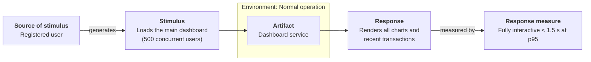
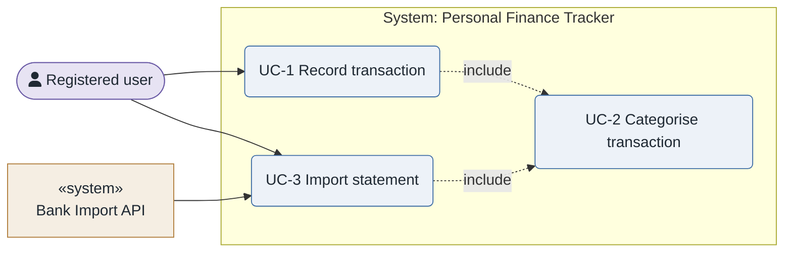
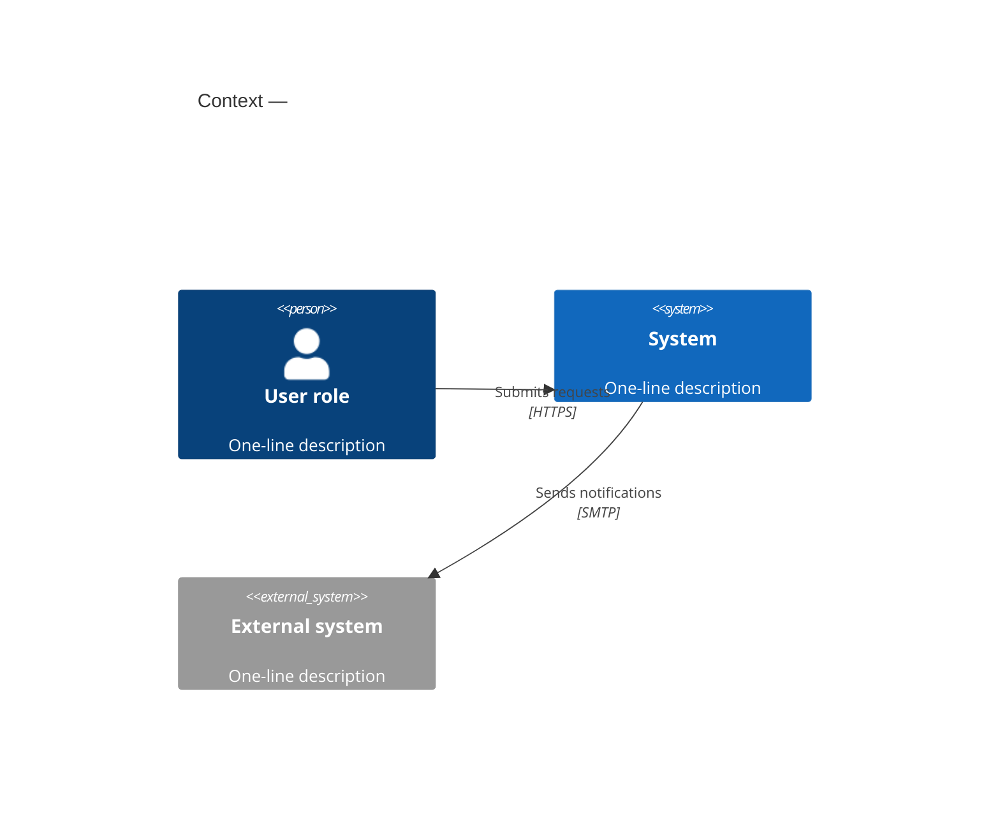
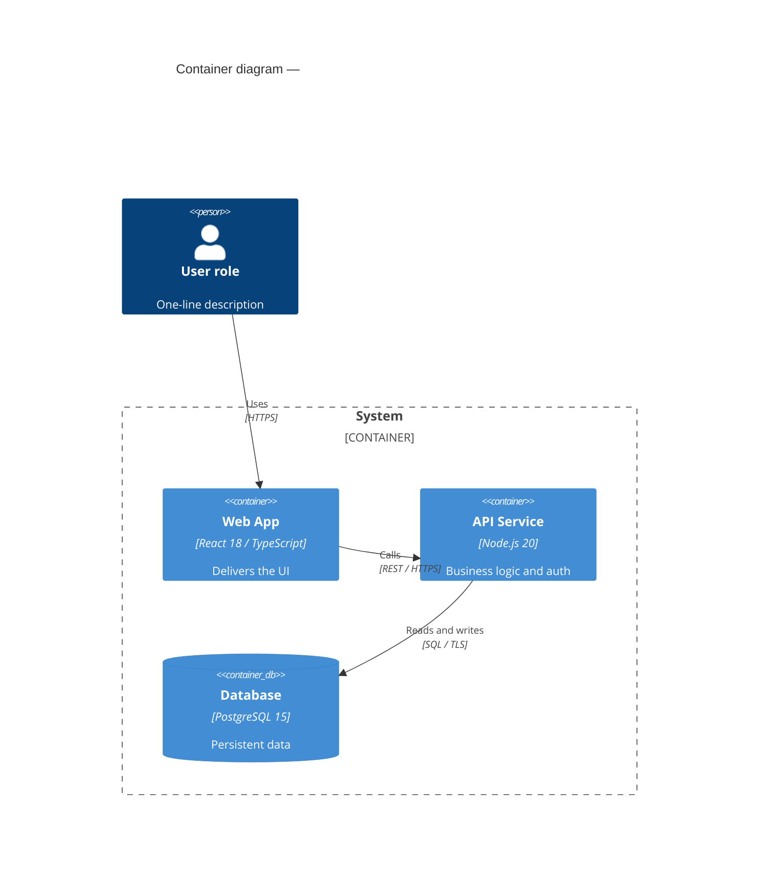

# SEI diagrams — clean UML / C4, rendered to PNG

Produce diagrams that are **readable at a glance**: few crossings, aligned flow, concrete labels,
one curated palette. Then render them to PNG.

- Diagram sources: `architecture/diagrams/*.mmd` (Mermaid) or `*.puml` (PlantUML).
- Rendered output: `architecture/diagrams/*.png`.
- Theme + palette: `${CLAUDE_PLUGIN_ROOT}/skills/sei-diagrams/assets/mermaid-theme.json`, `${CLAUDE_PLUGIN_ROOT}/skills/sei-diagrams/assets/palette.md`, `${CLAUDE_PLUGIN_ROOT}/skills/sei-diagrams/assets/plantuml-theme.puml`.
- Renderers: `${CLAUDE_PLUGIN_ROOT}/skills/sei-diagrams/scripts/render.sh` (Mermaid), `${CLAUDE_PLUGIN_ROOT}/skills/sei-diagrams/scripts/render-plantuml.sh` (PlantUML), `${CLAUDE_PLUGIN_ROOT}/skills/sei-diagrams/scripts/setup.sh`.

## Notation

Two engines, both supported for every diagram type. **Ask the user** which they prefer, unless
the calling skill already fixed it. Sensible defaults when they have no preference:

| Diagram | Default notation | Why |
|---------|------------------|-----|
| **Use case** | **PlantUML `usecase`** | only PlantUML has real UML glyphs — stick-figure actors, ellipse use cases, boundary rectangle, `<<include>>`/`<<extend>>` dependencies |
| Context / container / component / deployment | **Mermaid flowchart-C4** | honours the SEI palette and lays out cleanly; still full C4 semantics |
| Sequence / class / state | Mermaid | native support, renders without Java |
| Quality attribute scenario | Mermaid `flowchart LR` (PlantUML pattern also provided) | the canonical six-part box-and-arrow |

> The quality-attribute **utility tree is a table, not a diagram** — see
> `${CLAUDE_PLUGIN_ROOT}/templates/utility-tree.md`. `sei-diagrams` does not render it.

- **Mermaid** — `.mmd` source, `${CLAUDE_PLUGIN_ROOT}/skills/sei-diagrams/scripts/render.sh` (first run `${CLAUDE_PLUGIN_ROOT}/skills/sei-diagrams/scripts/setup.sh`). No Java.
- **PlantUML** — `.puml` source, `${CLAUDE_PLUGIN_ROOT}/skills/sei-diagrams/scripts/render-plantuml.sh`. Needs Java; the script
  auto-detects a keg-only Homebrew JDK and, if there is truly none, prints the one-line install.

**The ten rules and the visual-verification loop are identical for both** — only the source
syntax and the render script differ.

## Workflow

1. Pick the diagram type (table below) and confirm the **notation** (Mermaid or PlantUML — ask).
2. Write the source file to `architecture/diagrams/<name>.mmd` (Mermaid) or `<name>.puml` (PlantUML).
3. **Show the diagram source in the conversation** (a fenced ```mermaid or ```plantuml block) and
   get review.
4. **Render to PNG**:
   - Mermaid: `bash ${CLAUDE_PLUGIN_ROOT}/skills/sei-diagrams/scripts/render.sh architecture/diagrams/<name>.mmd`
     (first run: `bash ${CLAUDE_PLUGIN_ROOT}/skills/sei-diagrams/scripts/setup.sh`).
   - PlantUML: `bash ${CLAUDE_PLUGIN_ROOT}/skills/sei-diagrams/scripts/render-plantuml.sh architecture/diagrams/<name>.puml`.
5. **Visually cross-verify** — mandatory, same for both notations. `Read` the generated PNG and
   check it against the verification checklist below. If it fails, fix the source and go back to
   step 4. Only a PNG that passes may be embedded in a document or handed to the user.
6. Report the PNG path. Re-render **and re-verify** whenever the source changes.

## Visual verification (mandatory after every render)

After `render.sh` produces the PNG, open it with the `Read` tool and look at the actual image.
Walk this checklist explicitly and state the result:

**Correctness**
- Every element and relationship from the source is present in the image, none invented.
- Labels are the intended text, not truncated or overlapping their box.
- Arrow directions match the intended flow; response/return arrows are dashed where they should be.
- The `title` is visible; the legend (if any) is readable.
- C4: boundaries drawn around the right elements; datastores render as the datastore shape.
- Sequence: participant order matches call order; activation bars and `autonumber` present as intended.
- Use case: actors outside the system boundary, use cases inside, `<<include>>` / `<<extend>>` dashed.

**Legibility / crossings**
- Count edge crossings. If any crossing is avoidable by reordering nodes, changing direction,
  grouping into a subgraph, routing a hub, or switching to ELK layout — do it and re-render.
- No element overlaps another element or an edge label.
- No edge passes *through* an unrelated node.
- Text is large enough to read at 100 %; nothing clipped at the image edge.
- Aspect ratio is reasonable (not an extreme ribbon); if it is, split the diagram.

**If it fails**: adjust the `.mmd` source (see the Layout playbook), re-render, and `Read` the new
PNG again. Iterate until both sections pass. Note in the conversation what you changed and why.
Never present or embed a diagram you have not looked at as a rendered image.

## Diagram types

| Purpose | Notation | How to draw it |
|---------|----------|----------------|
| System context | C4 L1 | **Mermaid `flowchart` in C4 style** (pattern below) or PlantUML C4-PlantUML |
| Containers (apps, services, stores) | C4 L2 | **Mermaid `flowchart` in C4 style** or PlantUML C4-PlantUML |
| Components inside one container | C4 L3 | **Mermaid `flowchart` in C4 style** or PlantUML C4-PlantUML |
| Production topology | C4 deployment | **Mermaid `flowchart` in C4 style** (nested `subgraph` = nodes) or PlantUML |
| Runtime flow for a scenario | UML sequence | Mermaid `sequenceDiagram` |
| Domain / class model | UML class | Mermaid `classDiagram` |
| Lifecycle / mode logic | UML state | Mermaid `stateDiagram-v2` |
| **Use case model** | UML use case | **PlantUML `usecase`** (true UML glyphs — default); Mermaid `flowchart LR` fallback |
| Quality attribute scenario (6-part) | box-and-arrow | Mermaid `flowchart LR` or the PlantUML pattern (both below) |

> **Utility tree** — not a diagram. It is a Markdown table (`${CLAUDE_PLUGIN_ROOT}/templates/utility-tree.md`).

### Context & container diagrams follow the C4 model

The **Context** (C4 level 1) and **Container** (C4 level 2) diagrams — and Component (L3) and
Deployment — **must follow C4 principles** regardless of which drawing tool produces them:

1. **Level of abstraction is fixed per diagram.** A context diagram shows *people* + *software
   systems* only (no containers). A container diagram shows the containers **inside one system**
   + the people and external systems it talks to (no components). Never mix levels.
2. **Every element has all four**: a **name**, a **type** (Person / Software System / Container /
   Component / Data store), a **technology** (for containers/components/stores — a concrete
   stack), and a **one-line description/responsibility**.
3. **The system boundary is explicit.** System-owned elements sit inside a labelled boundary;
   people and external systems sit outside it.
4. **Every relationship is a directed, labelled arrow** — an action phrase and, where useful, the
   protocol (`"Reads product data from · JSON/HTTPS"`). No unlabelled lines.
5. **Internal vs external is visually distinct** (the palette does this: `internal` vs `external`
   vs `datastore` vs `source`).
6. **One diagram = one question.** Keep it to ≤ ~10 elements; if a system has more containers,
   split by concern and add a parent context diagram.
7. Diagrams are **self-explanatory**: a title, and a legend when notation isn't obvious.

### Notation: flowchart-C4 (house style) or C4-PlantUML

Both satisfy the principles above — pick per the user's notation choice:

- **Flowchart-C4 (default)** — C4 semantics drawn with Mermaid `flowchart` primitives and the
  semantic `classDef`s. Mermaid's *native* `C4Context`/`C4Container` renderer ignores the theme
  file (default blue, not the SEI palette) and routes edges poorly (labels collide), so it is
  **not** used for rendered deliverables — only for a throwaway inline sketch. The flowchart-C4
  form below is still C4; only the drawing primitive differs.
- **C4-PlantUML** — canonical C4 shapes and stereotypes via the C4-PlantUML macros
  (`Person()`, `System()`, `Container()`, `Component()`, `Rel()`, `System_Boundary()`,
  `Deployment_Node()`). **The C4-PlantUML macro set is vendored** under
  `${CLAUDE_PLUGIN_ROOT}/skills/sei-diagrams/assets/c4/` (`C4.puml`, `C4_Context.puml`, `C4_Container.puml`, `C4_Component.puml`,
  `C4_Deployment.puml`), so it renders **offline** — `!include` it by **relative path**, never
  `<C4/…>` (which fetches from the network). Follow the C4 include with
  `!include …/c4/sei-c4-palette.puml` so the C4 elements use the SEI palette (the
  non-C4 `plantuml-theme.puml` does not restyle C4 macros). Needs Java
  (`${CLAUDE_PLUGIN_ROOT}/skills/sei-diagrams/scripts/render-plantuml.sh` explains how to install it). Use when the user wants canonical
  C4 notation.

The worked example ships in **both notations** — `examples/personal-finance-tracker-mermaid/`
(every diagram Mermaid) and `examples/personal-finance-tracker-plantuml/` (every diagram
PlantUML / C4-PlantUML) — as a side-by-side reference.

### Structural diagram — house style (context / container / component / deployment)


Conventions: `([ ])` = person/actor (`source` class), `[ ]` = software element, `[( )]` =
datastore, `[[ ]]` = queue/bus (both `datastore` class), external elements get the `external`
class and sit **outside** the `subgraph` boundary. Put the tech stack on an `<i>` line. Name each
relationship with an action phrase. For a **deployment** diagram, nest `subgraph`s for
region → cluster → node and place containers in the leaf `subgraph`.

Same diagram in **C4-PlantUML** (canonical notation; render with `${CLAUDE_PLUGIN_ROOT}/skills/sei-diagrams/scripts/render-plantuml.sh`).
Adjust the `../…` depth so the two includes resolve from the `.puml` file's location:

```plantuml
@startuml container
!include ../../skills/sei-diagrams/assets/c4/C4_Container.puml
!include ../../skills/sei-diagrams/assets/c4/sei-c4-palette.puml
LAYOUT_TOP_DOWN()
title Container diagram — <SystemName>
Person(user, "User role", "how they access")
System_Ext(ext, "External system", "protocol")
System_Boundary(sys, "<System name>") {
  Container(web, "Web App", "React 18 / TS", "Delivers the UI")
  Container(api, "API Service", "Node.js 20 / Fastify", "Business logic and auth")
  ContainerDb(db, "Database", "PostgreSQL 15", "Persistent data")
  ContainerQueue(bus, "Event Bus", "Kafka", "Domain events")
}
Rel(user, web, "Uses over HTTPS")
Rel(web, api, "Calls REST API", "JSON/HTTPS")
Rel(api, db, "Reads / writes", "SQL/TLS")
Rel(api, bus, "Publishes events")
Rel(api, ext, "Sends notifications", "SMTP")
@enduml
```

**Deployment** in C4-PlantUML: `!include …/c4/C4_Deployment.puml`, then nest
`Deployment_Node(id, "name", "type") { … }` for region → platform → node, with `Container` /
`ContainerDb` in the leaf nodes.

**Sequence** in PlantUML: `!include …/assets/plantuml-theme.puml`, then `autonumber`, declare
all `participant`s at the top, `->` for calls and `-->` for returns, `alt` / `group` for
branches — one message per line, no `;` in message text.

## Quality attribute scenario diagram

The canonical SEI six-part scenario, drawn so every part is visible. **Use this for every `<ATTR>QA-n`**
in the `quality-attributes` and `quality-attribute-workshop` skills.



Rules for this pattern: exactly the six parts, left-to-right; the `Artifact` node lives **inside**
the `Environment` subgraph; the ISO/IEC 25010 characteristic goes in the `%%` comment title line;
use `classDef` names `source`, `artifact`, `response` (defined in the theme) for consistent colour.

Same scenario in **PlantUML** (house pattern): five `rectangle`s left-to-right, plus an
`Environment` rectangle joined to the `Artifact` by a dashed dependency. Keep it `left to right
direction`; do **not** add `skinparam linetype ortho` here (it forces the row vertical).

```plantuml
@startuml scenario-PQA-1
!include ../../skills/sei-diagrams/assets/plantuml-theme.puml
left to right direction
hide stereotype
title Quality attribute scenario — PQA-1 — Performance efficiency / time behaviour
rectangle "<b>Source of stimulus</b>\nRegistered user" as SRC #E7E3F3
rectangle "<b>Stimulus</b>\nLoads the dashboard (500 concurrent users)" as STIM #E7E3F3
rectangle "<b>Artifact</b>\nDashboard read path" as ART #EDF2F8
rectangle "<b>Response</b>\nRenders all charts and recent activity" as RESP #E4F0E9
rectangle "<b>Response measure</b>\nFully interactive < 1.5 s at p95" as MEAS #E4F0E9
rectangle "<b>Environment</b>\nNormal operation" as ENV #F5EEE3
SRC  --> STIM : generates
STIM --> ART  : arrives at
ART  --> RESP : produces
RESP --> MEAS : measured by
ENV  ..> ART
@enduml
```

## Use case diagram

A use case diagram is a **UML diagram** — draw it with the **UML-specific drawing components**:
**stick-figure actors** for human/role actors, **ellipse (oval) use cases**, a **system boundary
rectangle**, solid association lines (actor ↔ use case), and dashed `..>` dependency arrows
stereotyped `<<include>>` / `<<extend>>` (extend points from the extension to the base). Mermaid's
`flowchart` primitives (stadiums, rounded rectangles) are **not** UML symbols, so:

- **Recommended: PlantUML** — it has the real UML glyphs. This is the default for use case diagrams.
- **Fallback: Mermaid flowchart convention** — only when Java is unavailable and the user accepts
  approximate shapes. Keep the convention: **human actors** as a stadium node with a
  **`fa:fa-user` person icon** in the label (`([fa:fa-user Registered user])`), **system actors**
  as a `«system»` rectangle, both **outside** the boundary `subgraph`; use cases `( )` inside;
  `-. include .->` / `-. extend .->` dashed.

**Systems are not actors — don't draw them as stick figures.** An actor in UML is a *role*, and a
role played by an external system (a third-party API, a batch job, another service) is still
drawn distinctly from a human role: give it a `«system»`-stereotyped **rectangle**, not the
person glyph. In PlantUML that's `rectangle "<Name>" << system >> as alias` used in place of
`actor "<Name>" as alias`; the rectangle still participates in ordinary associations
(`alias --> usecaseAlias`) and sits outside the system boundary exactly like an actor would. In
the Mermaid fallback it's the `["«system»<br/>Name"]` box already shown above. Reserve the
stick figure for a human role (or an organizational role played by a person).

One diagram per **use case** (in its `UC-<n>.md`) plus one **overview** diagram per actor group /
subsystem (≤ ~10 use cases).

**PlantUML (UML notation — default):**

```plantuml
@startuml
!include ../../../skills/sei-diagrams/assets/plantuml-theme.puml
skinparam actorStyle awesome
left to right direction
actor "Registered user" as user
rectangle "Bank Import API" << system >> as bank
rectangle "Personal Finance Tracker" {
  usecase "UC-1\nRecord transaction" as uc1
  usecase "UC-2\nCategorise transaction" as uc2
  usecase "UC-3\nImport statement" as uc3
}
user --> uc1
user --> uc3
bank --> uc3
uc1 ..> uc2 : <<include>>
uc3 ..> uc2 : <<include>>
@enduml
```

Render with `${CLAUDE_PLUGIN_ROOT}/skills/sei-diagrams/scripts/render-plantuml.sh` (auto-detects a keg-only Homebrew JDK; if truly no Java,
it prints the one-line install command).

**Mermaid fallback (approximate shapes — human actor gets a `fa:fa-user` person icon, system
actor gets a `«system»` box):**



**Whichever notation is used, the verification is the same**: `Read` the rendered PNG and check
actors are outside the boundary, use cases are inside it, associations are solid, include/extend
are dashed `<<…>>` dependencies, and there are no avoidable crossings — iterate until it passes.

## The ten diagram rules

1. **Title.** Every diagram starts with a title: native `C4*` diagrams use a `title` line right
   after the keyword; `sequenceDiagram` uses `title …` on line 2; `flowchart` / `classDiagram` /
   `stateDiagram` put the title in a top `%%` comment; PlantUML uses a `title` line.
2. **Aliases** are `camelCase` or `snake_case` — never contain spaces (`apiService`, not `api service`).
3. **Descriptions.** Every element carries a specific role/description — a last string argument in
   native C4, an `<i>…</i>` line in flowchart-C4.
4. **Concrete technology.** Every software element and datastore names a real stack
   (`PostgreSQL 15`, `React 18 / TypeScript`, `Spring Boot 3`).
5. **Specific relationship labels** — an action phrase (`"Publishes OrderPlaced via Kafka"`),
   never a bare verb (`"uses"`, `"calls"`).
6. **Size ≤ 10 nodes** per diagram. More than that → split into sub-diagrams.
7. **Boundaries.** Container and component diagrams wrap system-owned elements in a boundary —
   a `subgraph "<SystemName>"` in flowchart-C4, `Boundary(id, "Label") { … }` in native C4. External
   elements sit outside it.
8. **Sequence syntax.** Declare all participants at the top; `autonumber` when > 4 steps; `->>`
   for sync calls, `-->>` for responses, `-)` for async fire-and-forget. No `;` in message text
   (Mermaid treats it as a statement separator) — use a comma or em dash.
9. **Minimise crossings** — see the layout playbook below. A diagram with avoidable crossings is
   not finished.
10. **One palette.** Never set ad-hoc `style`/`fill` colours inline. Use the theme file and the
    named `classDef`s. Colour must carry meaning (external vs internal, datastore, emphasis),
    not decoration.

## Layout playbook — fewer crossings

- **One primary flow direction.** `flowchart LR` for pipelines and scenario diagrams, `TB` for
  hierarchies/layers. Don't mix.
- **Order nodes to match call order.** In sequence diagrams, place participants left→right in the
  order they are first invoked. In C4, place the user on the left, datastores on the right, and
  services in call order between.
- **Group with subgraphs / `Boundary`.** Related nodes in the same box localise their edges.
- **Route shared dependencies to an edge.** Put a cache / bus / auth service that everything talks
  to on one side so its fan-in doesn't cross the middle.
- **Prefer a hub over a mesh.** If N components all talk to each other, introduce a connector
  (event bus, gateway) — it's both truer to the architecture and far cleaner.
- **≤ 10 nodes, ≤ ~15 edges.** Past that, split by concern into multiple diagrams and add a
  parent context diagram.
- **No long back-edges.** If an arrow runs against the main direction across the whole diagram,
  reorder nodes or split the diagram.
- **Optional ELK layout.** After `setup.sh` installs `@mermaid-js/layout-elk`, add
  `---\nconfig:\n  layout: elk\n---` at the top of a `flowchart` to let ELK route edges with
  far fewer crossings. Dagre (default) still renders if ELK isn't present.

## Interactive diagram review protocol

When one or more diagrams are added or changed in a session:

1. Open with one line: **"Diagrams modified this step: §N Title [, §M Title]"**.
2. Render each as a fenced ```mermaid block in the conversation.
3. After each, one sentence: what changed and why.
4. Every sequence diagram gets a plain-English description paragraph immediately below it.
5. Wait for the user's OK on the source.
6. Render to PNG and **`Read` the PNG** — run the Visual verification checklist and report each
   result briefly (`correctness: ok`, `crossings: 1 avoidable → reordered nodes, re-rendered`).
   Iterate source → render → `Read` until it passes.
7. Only then embed it in the target document — see **Embedding in Markdown** below.

## Embedding in Markdown (GitHub / GitLab friendly)

Always keep the diagram **source** (`.mmd` / `.puml`) and its verified `.png` in a `diagrams/`
sub-folder **next to the Markdown file** that uses them. How the document references the diagram
depends on the notation:

### Mermaid — inline the fenced block + the image line

GitHub and GitLab render a fenced ```mermaid block natively, so embed **both**: the fenced
source block (the editable source of truth) **and** a relative image line to the verified PNG.

~~~markdown
### Diagram

```mermaid
flowchart TB
  %% Container diagram — Acme (C4 level 2)
  user(["Customer<br/><i>browser</i>"])
  subgraph sys["Acme"]
    web["Web App<br/><i>React</i>"]
    db[("DB<br/><i>PostgreSQL 15</i>")]
  end
  user -->|"Uses (HTTPS)"| web
  web -->|"Reads / writes (SQL)"| db
  classDef source fill:#E7E3F3,stroke:#6B5BA6; classDef internal fill:#EDF2F8,stroke:#3E6DA5;
  classDef datastore fill:#E4F0E9,stroke:#3F7D5C;
  class user source
  class web internal
  class db datastore
```


~~~

### PlantUML — the image line + a link to the source (do **not** paste the source)

GitHub / GitLab do **not** render a fenced ```plantuml block, so pasting the `@startuml … @enduml`
into the Markdown adds noise without any benefit. Instead reference it:

~~~markdown
### Diagram


Source: [`diagrams/container.puml`](diagrams/container.puml) · rendered + visually verified.
~~~

The `.puml` file in `diagrams/` is the editable, diffable, re-renderable source; the document
carries the PNG and a link to it.

### Rules for the image line (both notations)

- Path is **relative to the `.md` file**, forward slashes, no leading `/`, no `file://`, no
  absolute paths — this is what makes it render on GitHub and GitLab.
- Alt text = the diagram title.
- The PNG must be the one you visually verified; re-render and the file (same path) updates in place.
- Never replace a diagram with a bare "see `diagrams/x.png`" text reference — always the ``
  image line (plus, for PlantUML, the source link).
- `${CLAUDE_PLUGIN_ROOT}/scripts/build-report.sh --embed-diagrams` base64-inlines both the fenced Mermaid blocks
  **and** the referenced PNGs, so a report stays self-contained regardless of notation.

## Rendering

```bash
# one-time
bash ${CLAUDE_PLUGIN_ROOT}/skills/sei-diagrams/scripts/setup.sh

# render one file, a glob, or a whole folder
bash ${CLAUDE_PLUGIN_ROOT}/skills/sei-diagrams/scripts/render.sh architecture/diagrams/context.mmd
bash ${CLAUDE_PLUGIN_ROOT}/skills/sei-diagrams/scripts/render.sh architecture/diagrams/
bash ${CLAUDE_PLUGIN_ROOT}/skills/sei-diagrams/scripts/render.sh --out architecture/quality-attributes/diagrams "architecture/quality-attributes/*.mmd"

# extract mermaid blocks from a Markdown file and render each
bash ${CLAUDE_PLUGIN_ROOT}/skills/sei-diagrams/scripts/render.sh architecture/add/foo-Architecture.md
```

`render.sh` applies `${CLAUDE_PLUGIN_ROOT}/skills/sei-diagrams/assets/mermaid-theme.json` (palette + `themeCSS`), renders at scale 3 (crisp
PNG), white background, width 1600. Output PNG sits next to the source unless `--out` is given.
It also extracts and renders every ```mermaid block from a `.md` file (`<mdname>-01.png`, …).

**PlantUML** (only if the user needs full UML): `bash ${CLAUDE_PLUGIN_ROOT}/skills/sei-diagrams/scripts/render-plantuml.sh
architecture/diagrams/model.puml`. Requires a Java runtime — if missing, the script prints the
`brew install openjdk` hint. `${CLAUDE_PLUGIN_ROOT}/skills/sei-diagrams/assets/plantuml-theme.puml` carries the matching palette; `!include`
it at the top of each `.puml`.

## Rules

- Always show a diagram source in the conversation before rendering it.
- **Always render to PNG and `Read` the PNG** to visually cross-verify it — correctness and
  minimal crossings — before embedding it in a document or presenting it as done. A diagram that
  has not been looked at as a rendered image is not finished.
- Iterate: if verification fails, change the source per the Layout playbook, re-render, re-`Read`.
- Apply all ten rules and the layout playbook to every diagram — including quick ones.
- Colour is semantic and comes only from the theme + the `classDef` lines in `${CLAUDE_PLUGIN_ROOT}/skills/sei-diagrams/assets/classdefs.md`;
  no ad-hoc inline colour.
- Keep the `.mmd` / `.puml` source **and** the rendered `.png` in a `diagrams/` sub-folder next to
  the Markdown that uses them, so diagrams are re-renderable, diff-able, and the relative image
  path resolves on GitHub / GitLab.
- Embed every diagram in Markdown per the **Embedding in Markdown** section: Mermaid = the
  ```mermaid fenced block **plus** a `` image line; PlantUML = the
  image line **plus** a link to the `.puml` source (no pasted `@startuml` block).
- Re-render **and re-verify** the PNG whenever the source changes; never hand-edit a PNG.
- `python tests/validate.py` checks every `.mmd` file and every fenced mermaid block against the
  rules — run it and fix reported issues.

## Appendix — native Mermaid C4 syntax (inline sketches only)

Use only for a throwaway sketch shown in chat. Does **not** honour the SEI palette and routes
edges poorly — do not render these to PNG for a deliverable; use the flowchart-C4 house style
instead.





Keywords: `Person`/`Person_Ext`, `System`/`System_Ext`/`SystemDb`/`SystemQueue`,
`Container`/`Container_Ext`/`ContainerDb`/`ContainerQueue`, `Component`/`Component_Ext`/…,
`Boundary`/`System_Boundary`/`Container_Boundary`/`Enterprise_Boundary`,
`Rel`/`Rel_U|D|L|R`/`BiRel`, `Deployment_Node` (for `C4Deployment`). Same ten rules apply.
