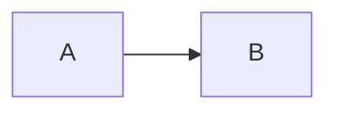
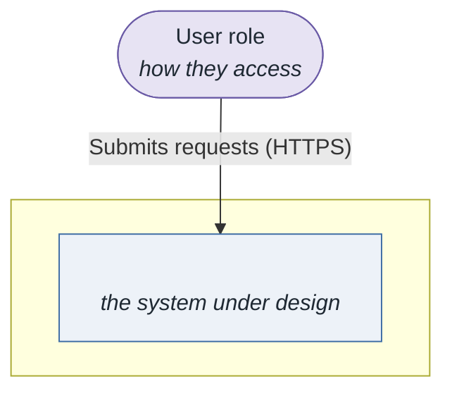
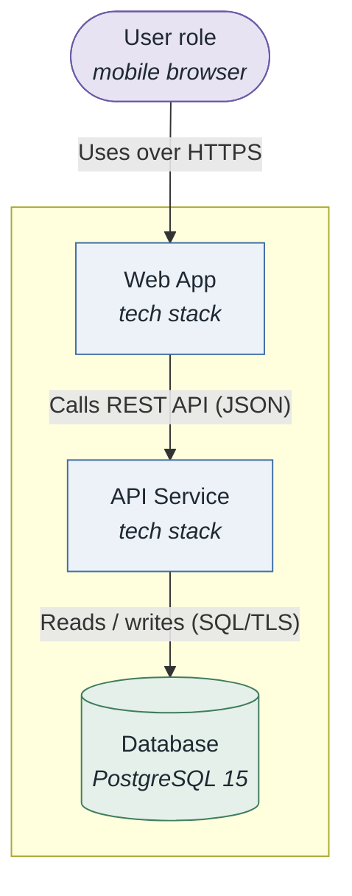
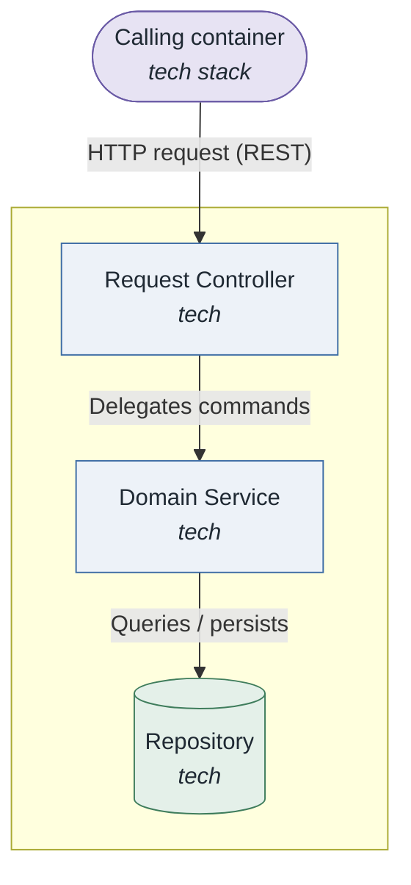
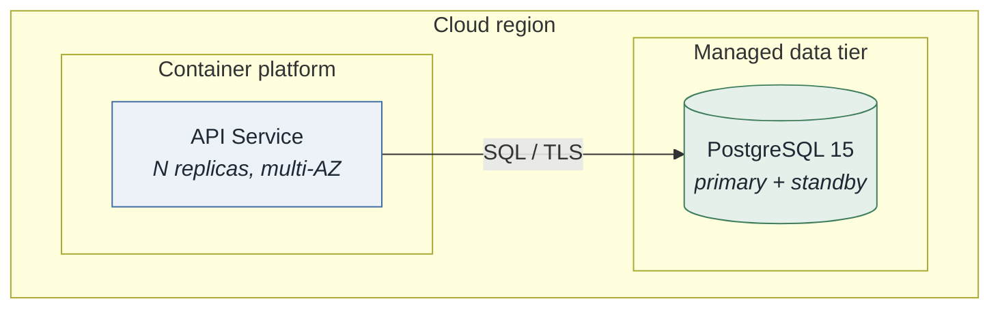

# Architecture: <name>

- **System**: <one line>
- **Date**: <YYYY-MM-DD>
- **Session**: `<slug>-session.md`
- **Drivers**: [`../drivers/README.md`](../drivers/README.md)

> Companion document produced by `/attribute-driven-design`. For a full Views-and-Beyond
> description, run `/architecture-docs`; this document is the ADD working architecture.

<!-- Mermaid: every diagram appears as BOTH a ```mermaid block AND, immediately after it,
     a  line pointing at the verified render in ./diagrams/ .
     PlantUML: the  line + a Source: link to diagrams/<name>.puml
     (no inlined ```plantuml block — GitHub does not render it).
     The relative, forward-slash, no-leading-slash path renders on GitHub and GitLab. -->

_Example of the diagram + image pattern used throughout this document:_




## 1. Introduction
<Purpose, scope, high-level description.>

## 2. Context diagram
### Diagram

### Description
<Plain-English explanation.>

## 3. Architectural drivers
### Quality Attribute Scenarios (key)
| ID | QA (ISO 25010) | Stimulus | Response | Measure | Priority |
|----|----------------|----------|----------|---------|----------|
### Primary functional requirements — use cases (key)
| ID | Name | Priority |
|----|------|----------|
### Constraints (key)
| ID | Type | Description |
|----|------|-------------|

## 4. Container diagram
### Diagram

### Description
<Plain-English explanation.>

## 5. Component diagrams
### <Container name>
#### Diagram

#### Description
<Plain-English explanation.>

## 6. Sequence diagrams
<One per key scenario. Each followed immediately by a plain-English description paragraph.>

## 7. Deployment diagram
### Diagram

### Description
<Plain-English explanation.>

## 8. Interfaces and events
### Interfaces
| Component | Interface | Protocol | Description |
|-----------|-----------|----------|-------------|
### Events
| Event | Publisher | Consumers | Description |
|-------|-----------|-----------|-------------|

## 9. Design decisions
| Decision | Rationale (cite driver IDs) | Alternatives discarded |
|----------|-----------------------------|------------------------|
