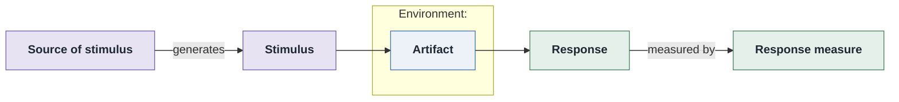

# Quality Attribute Scenario: <ATTR>QA-<n>

| Part | Value |
|------|-------|
| **ID** | <ATTR>QA-<n> |
| **ISO/IEC 25010 characteristic** | <e.g. Reliability> |
| **Sub-characteristic** | <e.g. availability> |
| **Source of stimulus** | <who/what> |
| **Stimulus** | <the event/condition> |
| **Artifact** | <the part stimulated> |
| **Environment** | <system state: normal / peak / degraded / deployment> |
| **Response** | <what the system must do> |
| **Response measure** | <numeric, with a percentile/threshold/time bound> |
| **Business goals supported** | BG-<…> |
| **Priority** | Importance = H/M/L · Difficulty = H/M/L |
| **Type** | general | concrete |

## Six-part scenario diagram

Rendered from the block above · visually verified: yes/no · relative path renders on GitHub / GitLab

## Notes / assumptions

<open questions, tactics likely needed, links to related scenarios>
