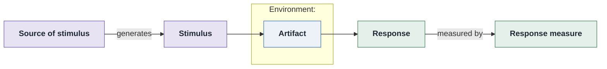

# <ATTR>QA-<n>: <short title>

- **Status**: open | in design | partially | addressed | at risk | retired
- **Source**: authored here by `/drivers` | written here by `/quality-attributes` (register mode) | imported from a standalone `../../quality-attributes/scenarios.md`

The quality attribute is **documented as a six-part quality attribute scenario** and **supported
by its own six-part scenario diagram** (below).

| Part | Value |
|------|-------|
| **ID** | <ATTR>QA-<n> |
| **ISO/IEC 25010 characteristic** | <e.g. Reliability> |
| **Sub-characteristic** | <e.g. availability> |
| **Source of stimulus** | <who/what> |
| **Stimulus** | <the event/condition> |
| **Artifact** | <the part stimulated> |
| **Environment** | <system state: normal / peak / degraded / deployment> |
| **Response** | <what the system must do> |
| **Response measure** | <numeric, with a percentile/threshold/time bound> |
| **Business goals supported** | BG-<…> |
| **Priority** | Importance = H/M/L · Difficulty = H/M/L |
| **Candidate tactics** | <the tactic categories this attribute is normally met with — see below> |
| **Type** | general | concrete |

**Candidate tactics** are a *hint, not a decision*: the tactic families from
`${CLAUDE_PLUGIN_ROOT}/references/tactics-catalog.md` that this attribute is normally achieved with, named so
ADD Step 4 starts from a shortlist and ATAM Step 6 knows which questionnaire to walk. Name the
*category* and the specific tactics (e.g. *Performance — manage resources*: caching, introduce
concurrency). The architecture may end up using none of them; record what it does use in the ADR.

## Six-part scenario diagram




Rendered from the block above · visually verified: yes/no · relative path renders on GitHub / GitLab

> **If drawn in PlantUML**: drop the ```mermaid block above; keep the `` image line and add
> `Source: [diagrams/scenario-<ATTR>QA-<n>.puml](diagrams/scenario-<ATTR>QA-<n>.puml)`.
> GitHub does not render a ```plantuml block, so it is not inlined (see the `sei-diagrams`
> skill's *Embedding in Markdown* section).

## Notes / assumptions

<open questions, tactics likely needed, links to related scenarios>
