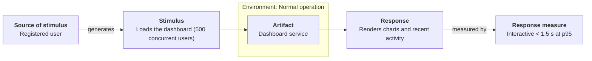

# Quality Attribute Scenarios: <SystemName>

- **Date**: <YYYY-MM-DD>
- **Source material**: <brief / PRD / interview>
- **Status**: draft | reviewed | baselined
- **Mode**: standalone | register (per-scenario files in `../drivers/quality-attributes/`)

<One to three plain sentences: what this summary covers and where to start.>

## Business goals

| ID | Goal | Stakeholder |
|----|------|-------------|
| BG-1 | <stakeholder needs outcome so that value> | <role> |

## Quality attribute scenarios

QA column = `ISO/IEC 25010 characteristic / sub-characteristic`.

| ID | QA (ISO 25010) | Source | Stimulus | Artifact | Environment | Response | Response measure | BG | Imp | Diff |
|----|----------------|--------|----------|----------|-------------|----------|------------------|----|-----|------|
| PQA-1 | Performance efficiency / time behaviour | Registered user | Loads dashboard (500 concurrent) | Dashboard service | Normal operation | Renders charts + recent activity | Interactive < 1.5 s @ p95 | BG-1 | H | M |

### <ATTR>QA-<n> — scenario diagram (standalone mode; optional in register mode)

<!-- One section per scenario, in table order. Register mode leaves these sections out: the
     diagrams live beside the per-scenario files, linked from the section below. -->

### Scenario files and diagrams (register mode; optional in standalone mode)

| ID | Scenario file | Diagram |
|----|---------------|---------|
| <ATTR>QA-<n> | [<ATTR>QA-<n>](../drivers/quality-attributes/<ATTR>QA-<n>.md) | [scenario](../drivers/quality-attributes/diagrams/scenario-<ATTR>QA-<n>.png) |

## Primary functional requirements — use cases with architectural impact

| ID | Use case name | Why it shapes the architecture |
|----|---------------|--------------------------------|
| UC-1 | | |

## Constraints

| ID | Type (business / technical / regulatory) | Description |
|----|-----------------------------------------|-------------|

## Utility tree

| Quality attribute | Refinement (concern) | Leaf scenario (ID — one line + measure) | Priority (V, R) | Status |
|-------------------|----------------------|----------------------------------------|:---------------:|:------:|
| Security | Confidentiality | SQA-1 — 0 cross-tenant reads; 100 % logged | (H, H) `★` | open |
| Performance efficiency | Time behaviour | PQA-1 — dashboard < 1.5 s @ p95, 500 concurrent | (H, M) | open |

_Reading the tree_: a refinement with no leaf → look for an unrecorded ASR; the `★` `(H,H)`
leaves get the most attention.

## Architectural drivers (prioritised)

1. <ATTR>QA-<n> (V, R) — <one line>

---

**Navigation**: [architecture package](../README.md) · [drivers](../drivers/README.md)
