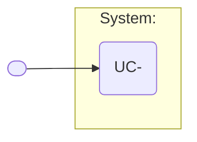

# Use case: UC-<n> — <goal-phrased name>

- **Scope**: <system / subsystem>
- **Level**: user goal | subfunction
- **Primary actor**: <role>
- **Supporting actors**: <systems / roles>
- **Stakeholders and interests**:
  - <stakeholder> — <what they need from this use case>
- **Trigger**: <event that starts it>
- **Preconditions**: <what must be true before>
- **Postconditions (minimal guarantee / success guarantee)**: <what is true after>

## Main success scenario

1. <actor action>
2. <system response>
3. …

## Extensions / alternate flows

- **2a.** <condition>: 1. … 2. …
- **3a.** <condition>: 1. …

## Architectural significance

- **Drivers exercised**: <<ATTR>QA-… , integration, trust/process boundary, load profile>
- **Notes**: <why this use case shapes structure>

## Related drivers

`BG-…`, `<ATTR>QA-…`, `CON-…`

---

### Use case diagram fragment (Mermaid convention)



### Or strict UML (PlantUML)

```plantuml
@startuml
!include ../skills/sei-diagrams/assets/plantuml-theme.puml
left to right direction
actor "<Actor>" as actor1
rectangle "<name>" {
  usecase "UC-<n> <name>" as uc
}
actor1 --> uc
@enduml
```
