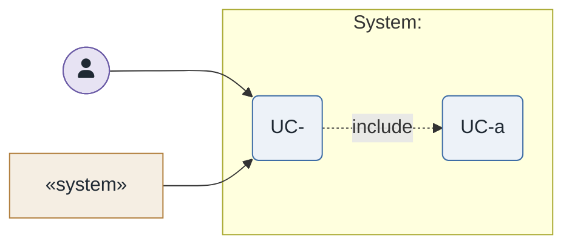

# UC-<n>: <goal-phrased name>

- **Scope**: <system / subsystem>
- **Level**: user goal | subfunction
- **Primary actor**: <role>
- **Supporting actors**: <systems / roles>
- **Stakeholders and interests**:
  - <stakeholder> — <what they need from this use case>
- **Trigger**: <event that starts it>
- **Preconditions**: <what must be true before>
- **Postconditions (minimal guarantee / success guarantee)**: <what is true after>
- **Priority**: high | medium | low
- **Status**: open | in design | partially | addressed | retired

## Main success scenario

1. <actor action>
2. <system response>
3. …

## Extensions / alternate flows

- **2a.** <condition>: 1. … 2. …
- **3a.** <condition>: 1. …

## Architectural significance

- **Drivers exercised**: <<ATTR>QA-… , integration, trust/process boundary, load profile>
- **Notes**: <why this use case shapes structure>

## Related drivers

`BG-…`, `<ATTR>QA-…`, `CON-…`

## Use case diagram

A **proper UML use case diagram for this use case**, drawn with **UML-specific components** —
human actors as stick figures and system actors as a `«system»`-stereotyped rectangle, both
**outside** the system boundary rectangle, ellipse use cases **inside** it, solid association
lines, dashed `..>` dependencies stereotyped `<<include>>` (always) / `<<extend>>` (conditional).
A supporting actor that is a system (an external API, service, or batch job — anything without a
goal of its own) is **not** an `actor`: model it as a `rectangle "<name>" <<system>>` so it reads
as a system, not a person. Rendered to `diagrams/UC-<n>.png` and visually cross-verified.

**PlantUML (UML notation — default):**

```plantuml
@startuml
!include ../../../skills/sei-diagrams/assets/plantuml-theme.puml
skinparam actorStyle awesome
left to right direction
actor "<Primary actor>" as actor1
rectangle "<Supporting system>" <<system>> as supp
rectangle "<system name>" {
  usecase "UC-<n>\n<name>" as uc
  usecase "UC-<n>a\n<included sub-use-case>" as sub
}
actor1 --> uc
supp --> uc
uc ..> sub : <<include>>
@enduml
```


**Mermaid fallback (approximate shapes — only if no Java):**



For a human actor use `fa:fa-user` (a person glyph) in Mermaid / a stick figure (`actor`) in
PlantUML; for a system/API supporting actor use the `«system»` rectangle in both — never a stick
figure, since a system is not a person.

The `UC-<n>a` suffix on the included sub-use-case above is only correct when that sub-behaviour is
private to **this** use case. If it is `<<include>>`d by more than one parent use case, it is not a
private sub-flow — give it its own top-level `UC-<m>.md` and its own code, and reference that same
code (never a different per-parent suffix) in every diagram that includes it, including any
overview diagram.

<!-- changed <YYYY-MM-DD>: <what and why> -->
