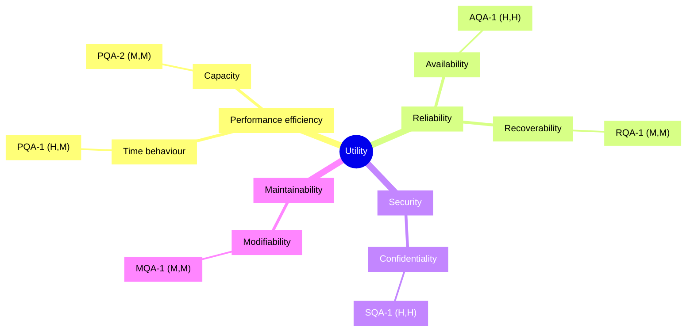

# Quality Attribute Utility Tree: <system>

- **Date**: <YYYY-MM-DD>
- **Purpose**: prioritise quality-attribute requirements as scenarios (input to ATAM step 6 / ADD)

Each leaf is a scenario tagged `(Importance, Difficulty)`, each H/M/L.
Importance = to the business. Difficulty = expected architectural challenge.

## Indented list

- **Utility**
  - **Performance efficiency**
    - Time behaviour
      - `(H, M)` PQA-1 — dashboard interactive < 1.5 s @ p95 under 500 concurrent users
    - Capacity
      - `(M, M)` PQA-2 — sustain 50 req/s write throughput with < 1 % error
  - **Reliability**
    - Availability
      - `(H, H)` AQA-1 — 99.5 % monthly uptime; single-AZ failure recovers < 60 s
    - Recoverability
      - `(M, M)` RQA-1 — restore from backup within RTO 4 h, RPO 15 min
  - **Security**
    - Confidentiality
      - `(H, H)` SQA-1 — 0 successful cross-tenant reads; 100 % of attempts logged
  - **Maintainability**
    - Modifiability
      - `(M, M)` MQA-1 — add a report type in ≤ 1 person-day, 0 regressions

## Mermaid mindmap

Node shape note: `mindmap` treats `id(text)` and bare `(…)` as shape syntax — always give leaves
an id and bracket form `id["<ATTR>QA-n (Imp,Diff)"]`.

_visually verified: yes/no_

## Analysis targets

The `(H,H)` and `(H,M)` leaves are analysed first: AQA-1, SQA-1, PQA-1.
